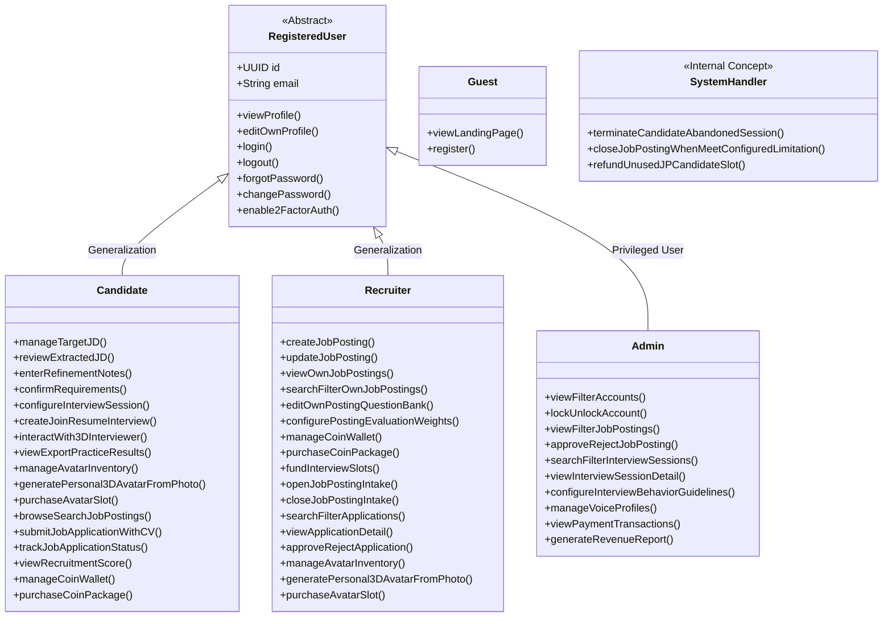

# Actors and Capabilities

This document defines the actors of the RoleCue platform and establishes their canonical capability boundaries according to the finalized product scope.

The formal use-case model contains **62** use cases. Two umbrella/grouping use cases (`View Interview Session Result` and `Manage Voice Profiles`) are not counted, while their child use cases are counted. This Brain records their durable capability boundaries without assigning use-case numbers.

> [!IMPORTANT]
> **Use Case reconciliation gap (2026-10-20):** `Configure Interview Behavior Guidelines` is mandatory registered Admin scope, ratified by the product owner, but is absent from the canonical diagram's active **Version 2** page (`5k5qk9e5ypGhG33TpJGQ`, linked in [[02_System/Context|System Context]]). Read-only inspection found 65 UC ellipse nodes, including the two stated uncounted grouping nodes and repeated labels (`Search and Filter Interview Sessions`, `View Application Detail`); node counts alone do not establish the declared 62-counting convention. Preserve the frozen **62** count and existing UC IDs. The documentation team must reconcile guideline coverage and formal diagram/SRS counting separately; the capability additions below do not renumber or recount the formal model.

---

## 1. Actor Catalog & Hierarchy

### Detailed Actor Definitions

#### 1.1. Guest (Public Visitor)
* **Definition:** An unauthenticated visitor accessing the public web application.
* **Canonical Capabilities:**
  * **View Landing Page:** View platform value proposition, product overview, and public information.
  * **Register:** Initiate registration to create an account as a Candidate or Recruiter.
* **Boundary Invariant:** Guests do **NOT** have access to pricing exploration, pricing plan viewing, public 3D avatar teasers, avatar previews, 2-question voice demos, anonymous voice demos, or public interactive demos.

#### 1.2. Registered User (Abstract Authenticated User)
* **Definition:** The shared authenticated-user abstraction representing any verified account holder. Serves as the common base for Candidate, Recruiter, and Admin.
* **Canonical Capabilities:**
  * View Profile
  * Edit Own Profile
  * Log in
  * Log out
  * Forgot Password (including password-reset behavior)
  * Change Password
  * Enable 2-Factor Authentication
* **Inheritance Boundary:** Registered User inheritance does **NOT** grant Admin a personal coin wallet or personal avatar inventory. Only Candidates and Recruiters possess wallets and avatar inventories.

#### 1.3. Candidate (Interview Practice & Career Seeker)
* **Definition:** An authenticated job seeker using RoleCue to prepare for technical interviews and discover career opportunities.
* **Canonical Capabilities:**
  * **Target JD for Practice Management:** Upload or paste target job descriptions (text or PDF) for personal practice.
  * **AI-Extracted JD Review & Confirmation:** Inspect and modify structured technical competencies extracted by AI; enter natural-language refinement notes (e.g., *"Exclude C# from the interview"*); confirm requirements before Blueprint generation.
  * **Interview Configuration:** For a Target JD interview, choose an available system 3D interviewer or eligible personal 3D model from avatar inventory, an available Voice Profile, 3D environment, difficulty, and duration. For a Job Posting interview, the Job Posting's company-defined 3D interviewer model and Voice Profile apply and cannot be overridden.
  * **Interview Session Lifecycle & Coin Charging:** Create, test audio and interview readiness, join, pause, and resume interview sessions. Practice interviews are debited 5 coins from the Candidate's personal wallet upon session start; reconnect/resume of the same session incurs no second charge, and starting again while an unfinished practice session exists for the same Role Profile returns that session free.
  * **Spoken Interaction with 3D AI Interviewer:** Conduct real-time voice conversation with speech-synchronized 3D interviewer animation. Receives a random selection of core questions from the bank with bounded follow-ups.
  * **Practice History & Diagnostic Results:** Review practice performance reports, scores across core technical competencies, radar charts, turn critiques, actionable recommendations, and export results.
  * **Personal 3D Avatar Inventory:** Start with **3 personal avatar storage slots**; read actual capacity from the authoritative API. Access the embedded Avaturn generator (RoleCue stores the final VRM asset); creating an avatar is free while a slot is available, with no separate generation fee. When full (`INVENTORY_FULL`), delete models or purchase additional capacity with wallet coins (1 coin per slot).
  * **Job Posting Discovery & Application:** Browse, search, filter, and view moderated, funded recruiter Job Postings with Recruiter-opened intake, subject to account-lock visibility restrictions (Decision 13b). Submit application with CV/resume.
  * **Recruitment Interview Participation:** Upon passing Recruiter CV screening, participate in the required technical interview funded by the Recruiter's prepaid slots (no coin charge to Candidate).
  * **Recruitment Result Visibility:** View overall recruitment evaluation score. Candidates **cannot** view recruitment transcripts or audio/video recordings during recruitment.
  * **Coin Wallet Management:** Purchase coin packages via payment gateway; view wallet coin balance and transaction history.
* **Boundary Invariant:** Candidates **never** view, edit, or confirm Interview Blueprints. Candidates do not purchase memberships or subscriptions.

#### 1.4. Recruiter (Employer Hiring Representative)
* **Definition:** A verified recruiter or hiring representative publishing job opportunities and reviewing incoming applications.
* **Canonical Capabilities:**
  * **Create Job Posting:** Begin a Job Posting (the company's Job Description) from JD-like content; review and confirm AI-extracted structured requirements.
  * **Configure Job Posting Interview:** Select the company 3D interviewer model and Voice Profile that Candidates must use for that Job Posting's interview.
  * **Manage Question Bank (Blueprint):** Generate the question bank once, then view and edit core questions for own Job Postings while `pending` or `rejected`; explicitly submit (or resubmit) the Posting for review, which requires a non-empty bank.
  * **Configure Evaluation Weights:** Optionally select a metric subset totaling 100%, separately from the question bank; otherwise valid equal-split defaults apply (currently five metrics at 20% each). Defaults do not block approval. Editable in `pending`/`rejected`, locked in `open`/`intake_closed`/`closed`, subject to the finalized technical state mapping (Decision 13a).
  * **Update Job Posting:** Modify requirements or description for submitted or active Job Postings.
  * **Close Job Posting Intake:** Close application intake. Halts receiving new Applications; automatically rejects remaining unscreened / not-approved Applications; Candidates already approved for interview remain interview-eligible. There is NO Reopen Intake flow and NO manual End Recruitment command.
  * **View & Search Own Postings:** Inspect, filter, and search own Job Postings.
  * **View Application Detail (Consolidated Review):** Search and filter incoming applications; view Candidate application details and uploaded CV/resume immediately upon submission; render CV screening approval or rejection. Recruiter may approve at most `interview_slot` Candidates to proceed to recruitment interview. Approved Candidates receive an interview deadline of `interview_deadline = approval_time + 24 hours` (calculated from the instant of CV approval; `approval_time` is conceptual and only `interview_deadline` is persisted). The Candidate must complete the interview before this deadline.
  * **Approve / Reject Application (Hard-Gated Final Decision):** Render definitive final decision (`Approve` or `Reject` Application). This decision is HARD-GATED until `MAX(interview_deadline)` across all interview-eligible Applications for the Job Posting. After the gate, the Recruiter opens View Application Detail, reviews Candidate profile, CV, and authorized interview score, result, recordings, and transcripts, and renders the final decision. CV review and interview evidence review are consolidated inside View Application Detail; there are no separate top-level capabilities for reviewing CVs or results.
  * **Fund Interview Slots & Open Intake:** After Admin moderation approval, fund `interview_slot` with personal wallet coins; successful funding opens Application Intake in the same step (no separate Open Intake action). Funding happens exactly once per Posting at 1 coin per slot (no top-ups). Approval alone does not open intake: approval sets `open`, and an `open` Posting with `interview_slot` unset is approved but not yet open (mapping settled 2026-10-29; implementation alignment in progress, the interim implementation still accepts applications before funding; Decisions 13/16).
  * **Personal Avatar Inventory:** Start with **3 personal avatar storage slots**, read actual capacity from the authoritative API, generate avatars via embedded Avaturn free while a slot is available, and purchase additional capacity with wallet coins (1 coin per slot) when full. There is no separate generation fee.
* **Boundary Invariant:**
  * **Job Posting IS the Company JD:** No separate "Corporate JD" or company tenant entity exists.
  * **Scope Termination:** Recruitment scope strictly terminates at **Approve / Reject Application**. No multi-stage hiring funnels, panel scheduling, offers, or onboarding.
  * **No Memberships or Tax Systems:** Recruiters use coin wallets to fund interview slots and avatar operations. No corporate subscriptions or VAT invoices.

#### 1.5. Administrator (Platform Governance & Operations)
* **Definition:** A privileged operator responsible for platform security, content oversight, interviewer behavior guidelines, voice profile curation, and financial auditability.
* **Canonical Capabilities:**
  * **Account Governance:** View and filter user accounts; lock and unlock accounts.
  * **Job Posting Moderation:** View and filter submitted Job Postings; approve and reject Job Postings.
  * **Interview Session Oversight:** Search and filter interview sessions; inspect operational session details.
  * **Configure Interview Behavior Guidelines:** Mandatory registered capability ratified on **2026-10-20**. Admin configures guidelines influencing the intended behavior of the AI interviewer; Admin authorization is required and completed historical interview results remain unchanged. UI, schema, persistence, guideline fields, versioning, and prompt composition remain TBD; implementation in `main` is not asserted.
  * **Voice Profile Catalog Management:** Manage Voice Profiles (view voice profiles, fetch voice profiles from external TTS providers, delete obsolete profiles). `Manage Voice Profiles` serves as an uncounted grouping capability; its child use cases are counted.
  * **Financial Audit & Reporting:** View unified payment transactions (PayOS orders and internal ledger movements); generate revenue reports.
* **Boundary Invariant:**
  * **Admin DOES manage:** Interview Behavior Guidelines, provider-sourced Voice Profiles (viewing, fetching, deleting), account locks, posting moderation, operational session oversight, and financial audits.
  * **Separate Exclusions:** The guideline capability does not authorize unrestricted raw LLM system-prompt editing, global evaluation rubric/weight editing, runtime feature toggles, provider configuration management, or coin package pricing administration (Decision 16).
  * **Admin does NOT manage:** 3D avatar meshes or 3D background presets (built-in platform presets).
  * **No Wallets or Inventories:** Admin does not hold a personal coin wallet or personal avatar inventory.
  * **No Recording Access by Inference:** Session oversight does not grant Admin access to recruitment audio/video recordings.
  * **No Dispute Queues:** Admins do not adjudicate refund requests or manage billing disputes. Unused slot refunds upon terminal Job Posting close execute automatically as internal coin movements.

#### 1.6. System Handler (Internal Automated Handler)
* **Definition:** An internal automated system handler executing scheduled background operations and lifecycle enforcement.
* **Canonical Capabilities:**
  * **Terminate Candidate's Abandoned Session:** Detects and terminates abandoned or orphaned interview sessions after extended inactivity.
  * **Close Job Posting When Meet Configured Limitation:** Automatically triggers Close Intake when the configured interview capacity (`interview_slot` approved candidates) is reached. Halts new applications, automatically rejects remaining unscreened/not-approved applications, and preserves interview eligibility for already-approved candidates without issuing refunds yet.
  * **Interview Deadline Expiry Enforcement:** If an approved Candidate does not complete the recruitment interview by `interview_deadline` (calculated as `approval_time + 24 hours`; merely starting the interview before the deadline is insufficient), automatically transitions the Application to terminal `REJECTED`.
  * **Terminal Job Posting Close & Refund (Refund unused JP Candidate Slot):** Once intake is closed and EVERY Application in scope reaches a terminal result (`APPROVED` or `REJECTED`), or there are no Applications, automatically transitions the Job Posting to terminal closed state and refunds all still-unused recruitment interview capacity (`interview_slot` minus consumed sessions) to the owning Recruiter's personal wallet as internal coins, exactly once per Posting.
* **Boundary Invariant:** The System Handler is strictly an **internal concept**, not an external entity on context diagrams. It does **not** manage invented background jobs like draft JD expiration, subscription reconciliation, or generic scheduled maintenance.

---

## 2. Canonical Capability Mapping

RoleCue's finalized capabilities are organized semantically into ten cohesive domain areas:

### 2.1. Authentication & Account Management
* **Actors:** Registered User, Guest
* **Capabilities:**
  * View landing page
  * Register new account
  * Log in & log out
  * View & edit own profile
  * Forgot Password (including password-reset behavior)
  * Change password
  * Enable 2-factor authentication

### 2.2. Target Job Description & Refinement
* **Actors:** Candidate
* **Capabilities:**
  * Upload or paste target Job Description (text or PDF) for personal practice
  * Review AI-extracted technical competencies (languages, frameworks, databases, tools, seniority)
  * Enter natural-language refinement notes (e.g., *"Exclude C# from the interview"*)
  * Confirm requirements to authorize question-bank Blueprint generation
  * Manage personal Target JD library

### 2.3. Interview Planning & Question-Bank Generation
* **Actors:** Candidate, Recruiter, System
* **Capabilities:**
  * Candidate configures a Target JD interview with an available system or eligible personal 3D interviewer model, Voice Profile, 3D environment, difficulty level, and duration
  * System generates a single internal core-question bank Blueprint per JD following confirmed requirements (strictly hidden from Candidate)
  * Recruiter generates the question bank once and views/edits its core questions for own Job Posting while `pending` or `rejected`, then explicitly submits it for review
  * Recruiter may customize posting-level metric weights totaling 100% separately from the question bank; otherwise use valid equal-split defaults (Decision 13a)
  * Candidate uses the Job Posting's locked company 3D interviewer model and Voice Profile for recruitment interviews

### 2.4. Real-Time Interview Simulation
* **Actors:** Candidate, System Handler
* **Capabilities:**
  * Test Audio and Interview Readiness (microphone and audio check)
  * Join and start 3D mock interview simulation
  * Coin charging boundary: Practice interview debited 5 coins from Candidate wallet upon session start; reconnect/resume is free, and an unfinished practice session for the same Role Profile is returned instead of charging again. Recruitment interview consumes prepaid Recruiter interview slot; no charge to Candidate
  * Real-time conversational spoken interaction with 3D avatar (STT / TTS with blend-shape lip-sync visemes)
  * Adaptive questioning loop: Random selection of $x$ core questions from bank with bounded follow-ups
  * Pause, resume, or end interview session
  * Capture audio/video recordings and transcripts for recruitment interviews (owning Recruiter access only)
  * Terminate abandoned interview session (System Handler)

### 2.5. Post-Interview Evaluation & History
* **Actors:** Candidate, Recruiter
* **Capabilities:**
  * Candidate views personal practice interview history and session listings
  * Candidate views practice performance report with overall score (0–100), competency breakdown, radar visualization, turn critiques, and actionable study roadmap
  * Candidate exports practice results
  * Candidate views recruitment evaluation score (transcripts and recordings remain hidden from candidate during recruitment)
  * Recruiter reviews applicant evaluation result, competency breakdown, turn critiques, and recruitment audio/video recordings and transcripts

### 2.6. Personal 3D Avatar Inventory
* **Actors:** Candidate, Recruiter
* **Capabilities:**
  * Generate personal 3D avatar through embedded free Avaturn iframe; RoleCue converts received final GLB to VRM production asset
  * Avatar creation is free while a storage slot is available; no separate generation fee (Decision 7, settled 2026-10-27)
  * Start with 3 personal avatar storage slots; creation is refused when full (`INVENTORY_FULL`); frontend reads actual capacity from the authoritative API
  * View and manage personal avatar inventory capacity
  * Purchase additional avatar inventory capacity slots using coins (1 coin per slot, 1–10 per purchase; permanent capacity)
  * Remove avatars to free storage capacity

### 2.7. Recruiter Job Posting & Intake Management
* **Actors:** Recruiter, System Handler
* **Capabilities:**
  * Create Job Posting from JD-like content; review and confirm extracted technical requirements
  * Select company 3D interviewer model and Voice Profile before submitting for Admin approval
  * Update Job Postings (modify requirements or description)
  * View and search own Job Postings
  * Close Job Posting Intake: Recruiter manually closes intake (halts new applications, automatically rejects remaining unscreened/not-approved applications, preserves interview eligibility for already-approved candidates). There is NO Reopen Intake flow.
  * Close Job Posting When Meet Configured Limitation: System Handler automatically closes intake when `interview_slot` Candidates have been approved for interview.
  * After Admin moderation approval, fund interview slots using personal wallet coins; debit, unified ledger entry, and `job_postings.interview_slot` update are atomic and idempotent
  * Successful funding opens Application Intake; only then may Candidates discover and apply, subject to account-lock visibility rules (Decisions 13/13b; mapping settled 2026-10-29: intake open = `status = 'open' AND interview_slot IS NOT NULL`; implementation alignment in progress, interim implementation still accepts applications before funding)
  * Terminal Job Posting Close & Refund: System Handler automatically triggers terminal close and `Refund unused JP Candidate Slot` when all applications have reached terminal status (`APPROVED` or `REJECTED`). There is NO manual End Recruitment command.

### 2.8. Job Application & CV-First Workflow
* **Actors:** Candidate, Recruiter, System Handler
* **Capabilities:**
  * Candidate browses, searches, and views moderated, funded Job Postings with Recruiter-opened intake, subject to account-lock visibility restrictions (Decision 13b)
  * Candidate submits application with uploaded CV/resume (unlimited submissions while intake is open; submissions are NOT capped by `interview_slot`)
  * Application and CV are immediately visible to the owning Recruiter
  * Recruiter reviews submitted application and CV via **View Application Detail**; may approve at most `interview_slot` Candidates to proceed to interview
  * Approved Candidates receive an interview deadline of `interview_deadline = approval_time + 24 hours` (calculated from the instant of CV approval; `approval_time` is conceptual and only `interview_deadline` is persisted); failure to complete the interview by the deadline results in automatic terminal `REJECTED`
  * Approved applicant conducts required technical interview; the funded slot is consumed upon the Candidate's first successful interview start, when the Application's single recruitment session is created (reconnect/resume incurs no additional slot consumption; Candidate is never charged)
  * System attaches Interview Result and recruitment recordings to Application
  * Hard-Gated Final Review: Recruiter final Approve/Reject decisions are hard-gated until `MAX(interview_deadline)` across all interview-eligible Applications for that Job Posting
  * Recruiter opens **View Application Detail**, inspects candidate profile, CV, and authorized interview score, result, recordings, and transcripts, and executes **Approve / Reject Application** (all review capabilities consolidated inside View Application Detail)
  * Candidate tracks application status and views recruitment score (recordings and transcripts hidden)

### 2.9. Coin Wallets & Payment Governance
* **Actors:** Candidate, Recruiter, Admin, PayOS (Payment Gateway)
* **Capabilities:**
  * Candidate and Recruiter purchase coin packages via PayOS using real money
  * Personal coin wallets track balance and immutable transactions under the unified transaction model (`from`, `to`, `amount`, `currency`, `description`, `status`, `payos_order_code`)
  * Candidate spends coins on practice interview starts and avatar capacity slots
  * Recruiter spends coins on interview slots and avatar capacity slots
  * Internal coin refund credited to Recruiter wallet upon terminal Job Posting auto-close for eligible unused interview capacity (`Refund unused JP Candidate Slot`)
  * Admin views payment transactions; generates revenue reports

### 2.10. Administration & Platform Governance
* **Actors:** Admin
* **Capabilities:**
  * View and filter user accounts; lock and unlock accounts
  * View and filter job postings; approve and reject job postings
  * Search and filter interview sessions; inspect operational session details
  * Configure Interview Behavior Guidelines (Admin authorization required, intended AI interviewer behavior, historical completed results unchanged; implementation details TBD)
  * Manage Voice Profiles (view voice profiles, fetch from TTS providers, delete obsolete profiles)

---

## 3. Strict Scope Invariants

1. **No ATS Progression:**
   Recruitment scope strictly terminates at `Approve / Reject Application`. There are no capabilities for multi-stage hiring pipelines, panel scheduling, interview scorecards, offer management, or employee onboarding.
2. **Blueprint Access Invariant:**
   Candidates **never** view, edit, or confirm an Interview Blueprint. Blueprints are ONLY the persistent core-question banks generated after requirement confirmation (evaluation configuration is a separate concern). Recruiters **can** view and edit core questions in the question bank for their own Job Postings. There is no separate Blueprint table in the database; persistent storage uses `core_questions`.
3. **No Multi-Tenancy Architecture:**
   Recruiters manage their Job Postings directly. There are no company tenants, company workspaces, tenant-specific schemas, or tenant isolation middleware.
4. **No 3D Marketplace:**
   Avatars are limited to curated platform presets and user-generated personal avatars in Candidate or Recruiter inventories. There is no community publishing, avatar store, trading, or monetization.
5. **Coin Wallets & Unified Transactions:**
   Platform monetization is structured around coin packages and personal wallets for Candidates and Recruiters. Admin has no wallet. PayOS is the confirmed real-money payment provider. The platform uses a unified transaction model rather than separate payment orders and coin transactions. Unused funded interview slots are refunded as coins upon terminal Job Posting auto-close.
6. **Recruitment Recording & Visibility Boundary:**
   Audio/video recordings and transcripts captured during recruitment interviews are accessible exclusively to the owning Recruiter. Candidates view their evaluation score, but cannot view recruitment transcripts or recordings during recruitment. Admin does not possess recruitment recording access by inference. Practice interviews do not record video.
7. **No Company Hiring Headcount Persistence or Enforcement:**
   `interview_slot` represents exclusively maximum recruitment interview capacity (the maximum number of Candidates approved to interview). RoleCue does NOT persist or enforce company hiring headcount or target hire counts.
