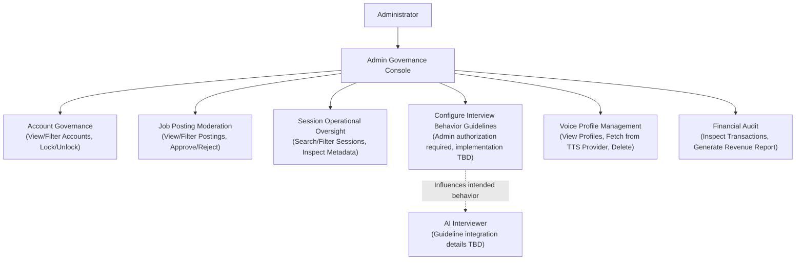

# Administration & Governance Domain

The **Administration & Governance Domain** provides the operational, supervisory, and configuration controls required to manage user accounts, review submitted job postings, inspect operational interview sessions, configure interviewer behavior guidelines, curate TTS voice profiles, and audit platform financial transactions.

---

## 1. Purpose

Empower platform administrators with centralized governance tools to enforce account security, maintain job posting quality, oversee operational interview sessions, configure the intended behavior of the AI interviewer through guidelines, curate voice synthesis options, and audit financial revenue records.

---

## 2. Core Concepts

* **Account Governance:**
  Administrative oversight of Candidate and Recruiter accounts. Supports account search and filtering, along with security locking and unlocking.
* **Job Posting Moderation:**
  Supervisory review of Job Postings submitted by Recruiters. Supports viewing, filtering, and approving or rejecting Job Postings. Only Postings the Recruiter has explicitly submitted for review (with a non-empty question bank) enter the moderation queue; a `pending` Posting still in preparation does not. Approval is a moderation decision that sets `open`; public availability and applications additionally require successful wallet-coin funding, which opens intake. Admin still sees an approved, unfunded Posting as approved, awaiting funding.
* **Interview Session Operational Oversight:**
  Supervisory access to interview session records. Enables searching, filtering, and inspecting operational session metadata and diagnostics.
  * **Privacy Invariant:** Operational oversight does **not** grant Administrators access to recruitment audio/video recordings or conversational transcripts.
* **Configure Interview Behavior Guidelines:**
  Mandatory registered capability, ratified on **2026-10-20**: an authorized Admin configures guidelines that influence the intended behavior of the AI interviewer. This is a product requirement, not a claim of implementation in `main`. Configuration UI, schema, persistence, guideline fields, versioning, and prompt composition remain **TBD** (Decision 16).
* **Voice Profile Catalog Management:**
  Administrative management of Text-to-Speech (TTS) voice profiles made available during session configuration. Supports viewing voice profiles, fetching new voice profiles from TTS providers, and deleting obsolete voice profiles.
* **Financial Audit & Reporting:**
  Administrative oversight of platform revenue. Supports viewing and filtering unified financial transactions (`transactions` table, recording real-money PayOS orders and internal coin movements) and generating revenue reports. Revenue is the sum of the `VND` amounts of successful PayOS top-ups; internal `COIN` movements (practice fees, slot funding, avatar storage, refunds) are not revenue. The transaction list, revenue summary and CSV export accept an optional `date_from`/`date_to` window on `transactions.created_at` (`[date_from, date_to)`, RFC 3339 with an offset; invalid, duplicate or reversed values return 400 `VALIDATION_ERROR`); the list sorts newest first. `/admin/billing` and `/admin/revenue` share a time-window selector (All time by default, Today, Last 7 days, Last 30 days, This month, Custom range) in Vietnam time (UTC+07:00); a custom range covers inclusive calendar days. Responses carry `created_at` in UTC; the CSV adds a `Created At (UTC+07:00)` column. Added in migration 000014 (KAN-191/192/206) (Decision 15).
* **Capabilities Excluded from Frozen Scope:**
  * *Unrestricted Raw LLM System-Prompt Editing:* A general-purpose raw-prompt editor is not authorized by the ratified Interview Behavior Guidelines capability.
  * *LLM Provider Configuration Management:* Provider configuration controls are not included by the guideline decision.
  * *Global Evaluation Criteria Calibration:* Admin editing of global evaluation rubrics, criteria, and weights is excluded from current scope.
  * *Interview Feature Configuration / Runtime Toggles:* System-wide configuration of interview features and runtime toggles is excluded from current scope.
  * *Coin Package Pricing Administration:* Administrative editing of coin package pricing tiers is excluded from current scope.

---

## 3. Actors Involved

* **Administrator:** Privileged platform operator exercising governance authority across platform domains.
  * Configures Interview Behavior Guidelines under Admin authorization; completed historical interview results remain unchanged.
  * **Boundary Restriction:** Administrators do **NOT** have a personal coin wallet or personal avatar inventory. Registered User inheritance does not confer wallet or inventory ownership to an Admin.

---

## 4. Main Domain Flow

---

## 5. Business Rules & Invariants

1. **Admin Scope Boundaries (What Admin Manages vs. Does NOT Manage):**
   * **Admin DOES manage:** Interview Behavior Guidelines, provider-sourced Voice Profiles (viewing, fetching from provider APIs, deleting), account lock/unlock, job posting moderation, operational session metadata, and payment transaction audits.
   * **Admin does NOT manage:** 3D avatar meshes or 3D background presets (which are built-in platform presets).
   * **No Wallets or Avatar Inventories:** Administrators do not hold personal coin wallets or personal avatar inventories.
   * **No Recruitment Recording Access by Inference:** Session operational oversight does not grant Admin access to applicant recruitment audio/video recordings or transcripts, which are private to the owning Recruiter.
   * **No Dispute Queues:** The platform does not model refund dispute adjudication queues or cash refund forms. Unused slot refunds execute automatically as internal coin movements (`Refund unused JP Candidate Slot`) upon terminal Job Posting auto-close.
2. **Immediate Account Revocation & Notification:**
   * Locking a user account immediately invalidates active sessions and causes Go API middleware to deny subsequent authenticated actions.
   * **Lock/Unlock Notification:** Account lock/unlock operations should trigger transactional email notifications through the configured Email Provider.
   * **Decoupling Invariant:** Successful account state transitions in the database must **never** depend on successful email delivery; network timeouts or email dispatch errors do not roll back the lock/unlock state. (Implementation status: email dispatch on lock/unlock is pending verification in application code).
3. **Candidate Session Privacy:**
   Administrative session oversight is focused on operational diagnostics and session status. Unrestricted administrative browsing of candidate practice content is bounded by privacy invariants.
4. **Historical Evaluation Integrity:**
   Configuring Interview Behavior Guidelines must **never** retroactively alter or recalculate completed interview results or historical Performance Reports. This requirement does not authorize global evaluation editing or settle guideline versioning/application timing.
5. **Two-Party Auditability:**
   All administrative actions (locking accounts, approving/rejecting job postings, modifying voice profiles) are recorded in an immutable audit log.
6. **Job Posting Publication Gate:**
   Recruiter Job Postings remain unavailable to Candidates until Admin moderation approval and successful Recruiter wallet-coin funding (the Recruiter's Open Intake action) are both satisfied, subject also to Decision 13b's account-lock visibility restrictions. Admin approval sets `open` but does not by itself open intake, and it must not require custom evaluation weights because Decision 13a's equal-split fallback is valid. Admin acts only on submitted Postings. Admin rejection prevents public availability; Admin does not configure the company's 3D interviewer model or Voice Profile. No `approved` Job Posting state or independent `intake_status` column is added: per the mapping settled 2026-10-29, `status = 'open' AND interview_slot IS NULL` is approved but not yet open (off the job board, applications refused with `INTAKE_NOT_OPEN`), and intake is open once `interview_slot` is set. Implementation alignment in progress (2026-10-29): until it lands, the interim implementation lets Candidates apply before funding, while CV approval and interview start already need funded capacity (Decisions 13/16; [[02_System/Domain-Model|Domain Model]]).
7. **Guideline Authorization & Implementation Boundary:**
   Only Admin may Configure Interview Behavior Guidelines. This does not grant raw LLM system-prompt editing, global evaluation rubric/weight editing, runtime feature toggles, provider configuration, or pricing administration. Implementation details remain TBD until specified and reviewed. The registered capability is missing from the active Version 2 Use Case diagram; the formal 62-counted-UC model and IDs remain unchanged pending documentation-team reconciliation ([[00_Project/Actors-and-Capabilities|Actors and Capabilities]]).

---

## 6. Relationships to Other Domains

* **[[01_Domains/Auth/README|Auth Domain]]:**
  Executes account locking and unlocking operations.
* **[[01_Domains/Job-Posting-Application/README|Job-Posting-Application Domain]]:**
  Enables administrative review, filtering, and approval/rejection of submitted Job Postings.
* **[[01_Domains/Interview/README|Interview Domain]]:**
  Allows Administrators to search, filter, and inspect operational interview session metadata and diagnostics, and Configure Interview Behavior Guidelines influencing intended AI interviewer behavior. Guideline integration details remain TBD; completed results remain unchanged.
* **[[01_Domains/Avatar-Voice/README|Avatar-Voice Domain]]:**
  Maintains the active catalog of Voice Profiles sourced from TTS providers.
* **[[01_Domains/Payment/README|Payment Domain]]:**
  Provides unified transaction (`transactions`) inspection and revenue report generation.

---

## 7. External Integrations

* **TTS Providers:** Fetches available voice profiles from provider APIs and manages active voice options.
* **Email Provider:** Dispatches administrative notices (e.g., account lock/unlock notifications).
