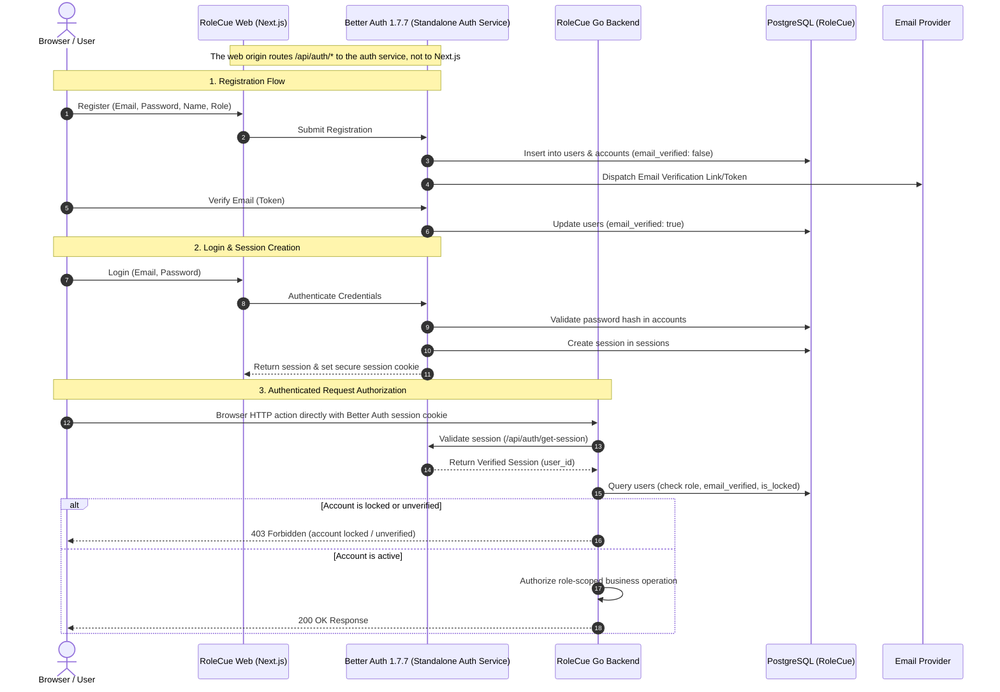
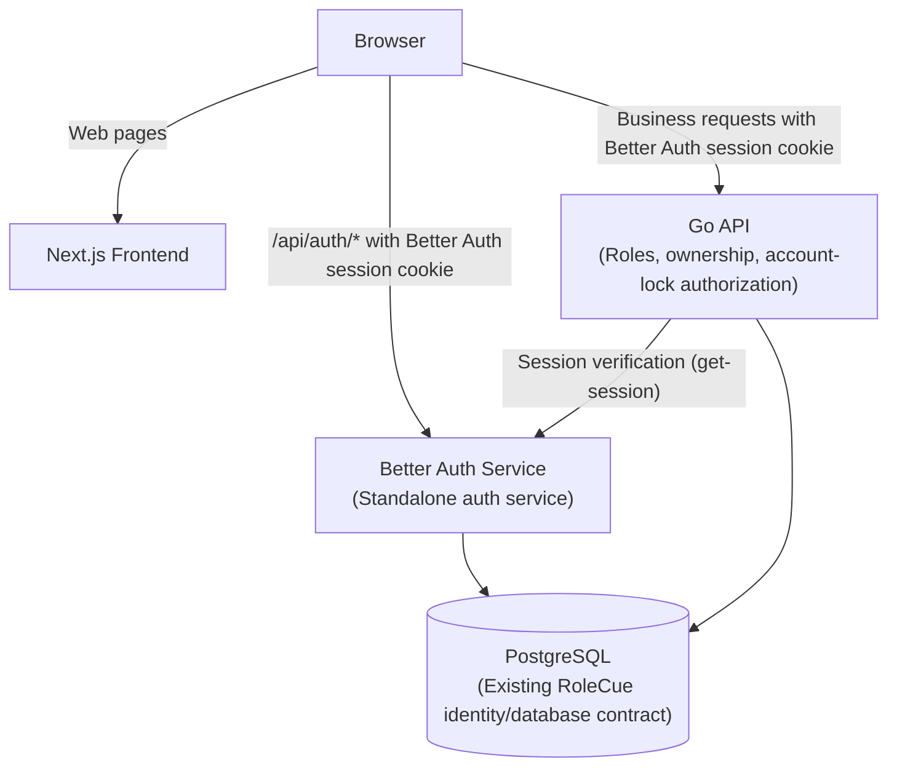

# Authentication & Identity Domain

The **Authentication & Identity Domain** manages user onboarding, credential verification, authenticated session management, role-based authorization, and account security.

---

## 1. Purpose

Provide secure, reliable identity verification and authorization for all users. Ensures that Candidates, Recruiters, and Administrators are authenticated securely and that domain resources are strictly isolated according to ownership and role boundaries.

---

## 2. Core Concepts

* **User (`users`):** The foundational identity record containing `id`, `name`, `email`, `email_verified`, `role` (`candidate`, `recruiter`, `admin`), `is_locked`, `lock_reason`, `lock_expires_at`, `two_factor_enabled`, `company_name`, `company_website`, and `onboarding_status`.
* **Better Auth Accounts (`accounts`):** Stores provider credentials, OAuth tokens, and salted password hashes linked to `users.id`.
* **Better Auth Single Session Authority (`sessions`):**
  * Manages active authenticated sessions via secure HTTP cookies (`.session_token`).
  * Stores `token`, `expires_at`, `ip_address`, `user_agent`, and `user_id`.
  * **Canonical Architecture:** "Single session" means **one session authority**: Better Auth sessions are the only session model in RoleCue. There is **no legacy JWT access/refresh token pair**, JWT exchange, or custom Go session/refresh-token layer. It does **not** mean one session per user: a user may hold several concurrent sessions (for example on different devices or browsers), each a separate `sessions` row.
  * **Session Lifetime:** Sessions last 14 days and are renewed by activity (one-day update age); the session cookie cache is disabled, so every verification reads current session state.
  * **Authority Boundary:** Better Auth owns identity, credentials, and sessions. Go verifies the Better Auth session and independently enforces RoleCue business authorization, current roles, ownership, and account-lock rules; Go does not own a second session model.
* **Verifications & 2FA (`verifications`, `two_factors`):**
  * `verifications`: Stores verification identifiers, values, and expiration for email verification.
  * `two_factors`: Stores TOTP secrets, backup codes, verification status, and lockouts for two-factor authentication.
* **System Roles:**
  * `candidate`: Job seekers who practice mock interviews and submit applications to job postings.
  * `recruiter`: Hiring representatives who publish job postings and review applications.
  * `admin`: Privileged platform operators who moderate job postings, oversee sessions, Configure Interview Behavior Guidelines, manage voice profiles, and audit accounts/finances.
* **Account Status & Locking:**
  * Normal accounts operate with `is_locked = false` and `email_verified = true`.
  * When `is_locked = true`, all protected actions and session authentications are immediately rejected.

### 2.1. Standalone Authentication Service

Better Auth **1.7.7** runs as RoleCue's own **standalone authentication service** (`auth/`, a Bun service), deployed independently of the Next.js frontend and the Go API. It is an internal RoleCue component, not an external identity provider, and it does not introduce a second session authority. Source evidence at RoleCue commit `972dd7075d1f8b5314a67b166e4d69a3075ef774`: [auth service](https://github.com/cog-forge/rolecue/tree/972dd7075d1f8b5314a67b166e4d69a3075ef774/auth), [Better Auth options](https://github.com/cog-forge/rolecue/blob/972dd7075d1f8b5314a67b166e4d69a3075ef774/auth/src/options.ts), and [Go session verifier](https://github.com/cog-forge/rolecue/blob/972dd7075d1f8b5314a67b166e4d69a3075ef774/api/internal/features/auth/service/session_verifier.go).

| Contract | Implementation |
| :--- | :--- |
| Better Auth host | Standalone auth service; Next.js no longer serves `/api/auth/*` |
| Browser authentication | The web origin routes `/api/auth/*` directly to the auth service; Better Auth sets the `rolecue` session cookies |
| Go session verification | Go calls the auth service (`/api/auth/get-session`, cookie cache disabled) and relays renewed or cleared cookies to the browser |
| Identity & session storage | Better Auth-owned identity/credential/session tables in the existing RoleCue PostgreSQL database; schema owned by the shared migrations; no Go-owned session store |
| Business authorization | Go enforces roles, verified email, ownership, and account-lock rules against current `users` state |
| Authentication behavior | Email verification, password recovery, OAuth (Google, GitHub, Facebook), TOTP two-factor with backup codes, and Admin lock/unlock through the Better Auth Admin plugin |

There remains **one Better Auth-owned session model**. JWT exchange, custom Go refresh tokens, a second session authority, and a replacement framework are excluded. Missing, expired, or revoked sessions return `401`; a valid session rejected by current application policy (for example a locked account) returns `403`; an unavailable auth service or database returns `503` (fail closed).

---

## 3. Actors Involved

* **Guest:** Explores public landing page and initiates registration as a Candidate or Recruiter.
* **Registered User (Candidate / Recruiter / Admin):** Manages shared account capabilities:
  * View Profile
  * Edit Own Profile
  * Log in
  * Log out
  * Forgot Password (including password-reset behavior)
  * Change Password
  * Enable 2-Factor Authentication
* **Administrator:** Views and filters user accounts; locks/unlocks accounts for security governance.

---

## 4. Main Domain Flow

### Authentication Flow — Standalone Auth Service

### Deployment Boundary

---

## 5. Business Rules & Invariants

1. **Password Security:** Passwords must be cryptographically hashed using standard salted hashing algorithms within Better Auth. Plaintext passwords are never logged or stored.
2. **Session Verification via Go Middleware:**
   * Go API route handlers validate session authenticity against Better Auth and verify current `users` record state (`is_locked`, `email_verified`, `role`) on every authenticated request.
   * There are no stateless JWT claims or custom refresh-token exchange endpoints.
   * The standalone auth service changed Better Auth's deployment boundary, not its session authority or Go's independent business-authorization responsibility. Cookie security, the identity/database contract, email verification, password recovery, and OAuth behavior are preserved.
3. **Immediate Lock Enforcement:**
   * When an Administrator marks an account as locked (`is_locked = true`), Go API middleware immediately denies all subsequent requests, returning `403 Forbidden`.
   * **Lock/Unlock Email Notification:** Locking or unlocking an account produces a transactional email notification through the configured Email Provider.
   * **Delivery Decoupling:** Successful database status transitions must **never** depend on successful email delivery; email failures do not roll back the lock/unlock state transition.
   * **Session Revocation:** Locking an account revokes all of its sessions; unlocking never revives them. A successful password reset also revokes all of the user's sessions.
4. **Email Uniqueness:** Email addresses are normalized to lowercase and must be strictly unique across all accounts in `users`.
5. **No Anonymous Privilege Escalation:** Guests have zero access to authenticated candidate, recruiter, or admin operations.
6. **Role Isolation & Ownership Boundaries:** A Candidate cannot access Recruiter management endpoints; a Recruiter cannot access Candidate practice resources without an authorized Candidate account. Candidates and Recruiters hold personal coin wallets and avatar inventories; Administrators have neither. Recruitment recordings and transcripts are private to the owning Recruiter; Candidates cannot access recruitment transcripts during recruitment, and Administrators do not have access by inference.
7. **Password Recovery:** `Forgot Password` is the single password-recovery capability. It includes issuing and validating a recovery link or token and setting a replacement password; `Reset Password` is not a separate formal capability. `Change Password` remains the authenticated-user capability for replacing a known password.

---

## 6. Relationships to Other Domains

* **All Domains:** Provides the authoritative `user_id` foreign key (`users.id`) referenced across:
  * [[01_Domains/Job-Description/README|Job-Description]] (`role_profiles.candidate_id`)
  * [[01_Domains/Job-Posting-Application/README|Job-Posting-Application]] (`job_postings.recruiter_id`, `applications.candidate_id`)
  * [[01_Domains/Avatar-Voice/README|Avatar-Voice]] (`inventories.user_id`)
  * [[01_Domains/Payment/README|Payment]] (`wallets.user_id`)
* **[[01_Domains/Administration/README|Administration]]:** Admin user governance operates directly on `users` accounts (viewing, filtering, locking/unlocking).

---

## 7. External Integrations

* **Better Auth:** Authentication framework managing identity, credentials, accounts, password hashing, and cookie-based sessions. It runs in RoleCue's standalone internal auth service, not as an additional external identity provider or session model.
* **Email Provider:** Dispatches account verification emails, password recovery links, and security/account notices.

