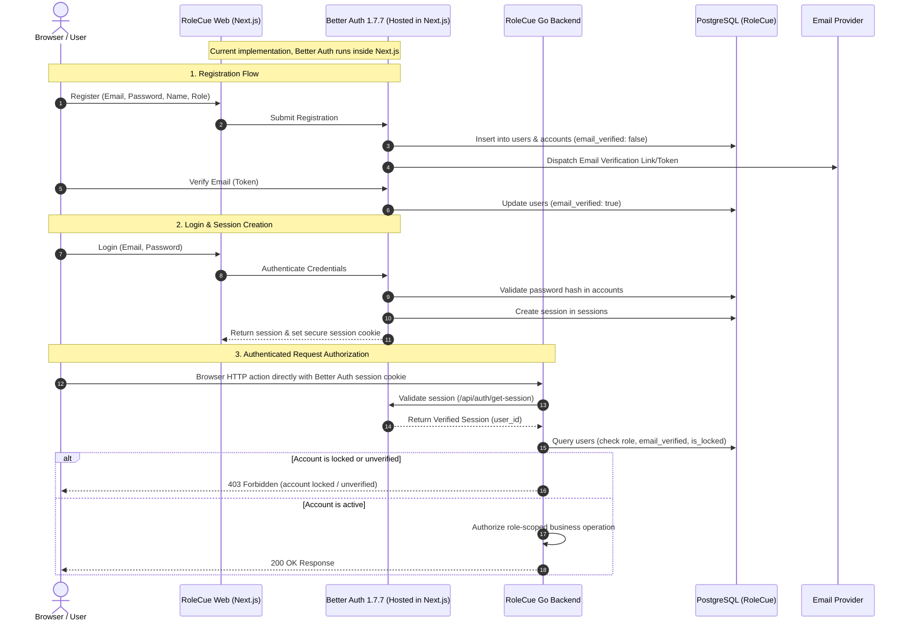
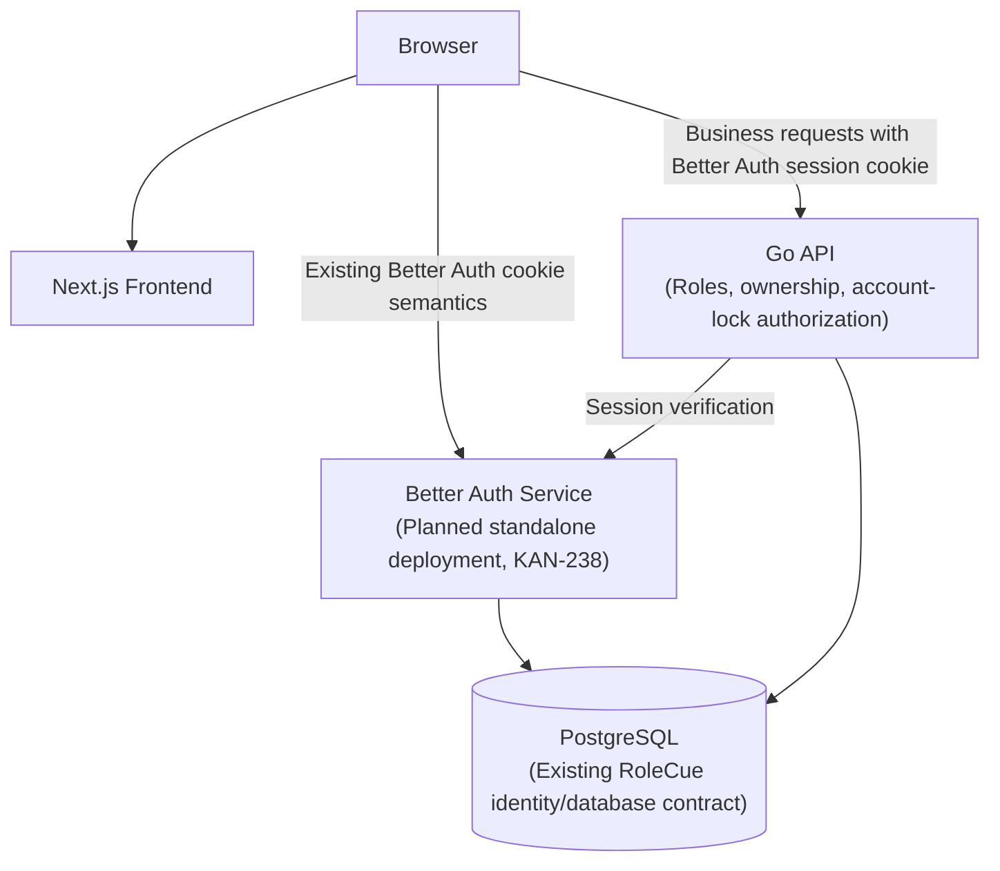

# Authentication & Identity Domain

The **Authentication & Identity Domain** manages user onboarding, credential verification, authenticated session management, role-based authorization, and account security.

---

## 1. Purpose

Provide secure, reliable identity verification and authorization for all users. Ensures that Candidates, Recruiters, and Administrators are authenticated securely and that domain resources are strictly isolated according to ownership and role boundaries.

---

## 2. Core Concepts

* **User (`users`):** The foundational identity record containing `id`, `name`, `email`, `email_verified`, `role` (`candidate`, `recruiter`, `admin`), `is_locked`, `lock_reason`, `lock_expires_at`, `two_factor_enabled`, `company_name`, `company_website`, and `onboarding_status`.
* **Better Auth Accounts (`accounts`):** Stores provider credentials, OAuth tokens, and salted password hashes linked to `users.id`.
* **Better Auth Single-Session Model (`sessions`):**
  * Manages active authenticated sessions via secure HTTP cookies (`.session_token`).
  * Stores `token`, `expires_at`, `ip_address`, `user_agent`, and `user_id`.
  * **Canonical Architecture:** RoleCue uses a Better Auth single-session cookie architecture. There is **no legacy JWT access/refresh token pair** or custom Go refresh-token rotation layer.
  * **Authority Boundary:** Better Auth owns identity, credentials, and sessions. Go verifies the Better Auth session and independently enforces RoleCue business authorization, current roles, ownership, and account-lock rules; Go does not own a second session model.
* **Verifications & 2FA (`verifications`, `two_factors`):**
  * `verifications`: Stores verification identifiers, values, and expiration for email verification.
  * `two_factors`: Stores TOTP secrets, backup codes, verification status, and lockouts for two-factor authentication.
* **System Roles:**
  * `candidate`: Job seekers who practice mock interviews and submit applications to job postings.
  * `recruiter`: Hiring representatives who publish job postings and review applications.
  * `admin`: Privileged platform operators who moderate job postings, oversee sessions, Configure Interview Behavior Guidelines, manage voice profiles, and audit accounts/finances.
* **Account Status & Locking:**
  * Normal accounts operate with `is_locked = false` and `email_verified = true`.
  * When `is_locked = true`, all protected actions and session authentications are immediately rejected.

### 2.1. Current Hosting vs. Planned Standalone Service (KAN-238)

**Current state (reviewed 2026-10-20):** Better Auth **1.7.7 runs inside Next.js**. The Browser authenticates with Better Auth cookies, and Go verifies those sessions through the Next.js-hosted Better Auth runtime. Source evidence at RoleCue commit `fd80b0eaa2771f1c2df1ae8b030e730c6382c328`: [pinned dependency](https://github.com/cog-forge/rolecue/blob/fd80b0eaa2771f1c2df1ae8b030e730c6382c328/frontend/package.json), [Next.js auth route](https://github.com/cog-forge/rolecue/blob/fd80b0eaa2771f1c2df1ae8b030e730c6382c328/frontend/src/app/api/auth/%5B...all%5D/route.ts), and [Go session verifier](https://github.com/cog-forge/rolecue/blob/fd80b0eaa2771f1c2df1ae8b030e730c6382c328/api/internal/features/auth/service/session_verifier.go).

**Planned target (authorized 2026-10-20, KAN-238 under development):** Extract Better Auth into an **independently deployable authentication service** within RoleCue. This is a planned deployment-boundary change, not a shipped service or a new authentication authority.

| Contract | Current implementation | Planned KAN-238 target |
| :--- | :--- | :--- |
| Better Auth host | Inside Next.js | Standalone Better Auth service |
| Browser authentication | Better Auth cookie authentication via Next.js-hosted auth | Better Auth cookie authentication via standalone service; preserve existing cookie semantics and security boundaries |
| Go session verification | Calls Next.js-hosted Better Auth (`/api/auth/get-session`) | Calls Better Auth service for session verification |
| Identity & session storage | Better Auth-owned identity/credential/session contract in RoleCue PostgreSQL | Same identity/database contract; no new identity database or Go-owned session store |
| Business authorization | Go enforces roles, ownership, and account-lock rules | Remains Go-owned |
| Authentication behavior & compatibility | Existing email verification, password recovery, OAuth, and public authentication APIs | Preserve those behaviors and public API compatibility where possible |

The target retains **one Better Auth-owned session model**. JWT exchange, custom Go refresh tokens, a second session authority, unnecessary authentication abstractions, and a replacement framework are outside the authorized change. Deployment/routing and compatibility details remain subject to KAN-238 implementation review. Update actual technical architecture documentation once KAN-238 merges; the current-state flow below remains the implementation reference until then.

---

## 3. Actors Involved

* **Guest:** Explores public landing page and initiates registration as a Candidate or Recruiter.
* **Registered User (Candidate / Recruiter / Admin):** Manages shared account capabilities:
  * View Profile
  * Edit Own Profile
  * Log in
  * Log out
  * Forgot Password (including password-reset behavior)
  * Change Password
  * Enable 2-Factor Authentication
* **Administrator:** Views and filters user accounts; locks/unlocks accounts for security governance.

---

## 4. Main Domain Flow

### Current State — Better Auth Hosted in Next.js

Better Auth and Next.js are separate logical participants below but share the current Next.js deployment; this does not depict a shipped standalone auth service.

### Planned Target — KAN-238 (Under Development)

This diagram represents the authorized target only; it does not replace current implementation diagrams or introduce another session authority.

---

## 5. Business Rules & Invariants

1. **Password Security:** Passwords must be cryptographically hashed using standard salted hashing algorithms within Better Auth. Plaintext passwords are never logged or stored.
2. **Session Verification via Go Middleware:**
   * Go API route handlers validate session authenticity against Better Auth and verify current `users` record state (`is_locked`, `email_verified`, `role`) on every authenticated request.
   * There are no stateless JWT claims or custom refresh-token exchange endpoints.
   * KAN-238 changes Better Auth's deployment boundary, not its session authority or Go's independent business-authorization responsibility. Existing cookie security, identity/database contract, email verification, password recovery, and OAuth behavior must be preserved; public authentication APIs remain compatible where possible.
3. **Immediate Lock Enforcement:**
   * When an Administrator marks an account as locked (`is_locked = true`), Go API middleware immediately denies all subsequent requests, returning `403 Forbidden`.
   * **Lock/Unlock Email Notification:** Locking or unlocking an account produces a transactional email notification through the configured Email Provider.
   * **Delivery Decoupling:** Successful database status transitions must **never** depend on successful email delivery; email failures do not roll back the lock/unlock state transition.
   * *(Implementation Note: Application code dispatch of lock/unlock emails is pending verification; Brain specifies the business requirement).*
4. **Email Uniqueness:** Email addresses are normalized to lowercase and must be strictly unique across all accounts in `users`.
5. **No Anonymous Privilege Escalation:** Guests have zero access to authenticated candidate, recruiter, or admin operations.
6. **Role Isolation & Ownership Boundaries:** A Candidate cannot access Recruiter management endpoints; a Recruiter cannot access Candidate practice resources without an authorized Candidate account. Candidates and Recruiters hold personal coin wallets and avatar inventories; Administrators have neither. Recruitment recordings and transcripts are private to the owning Recruiter; Candidates cannot access recruitment transcripts during recruitment, and Administrators do not have access by inference.
7. **Password Recovery:** `Forgot Password` is the single password-recovery capability. It includes issuing and validating a recovery link or token and setting a replacement password; `Reset Password` is not a separate formal capability. `Change Password` remains the authenticated-user capability for replacing a known password.

---

## 6. Relationships to Other Domains

* **All Domains:** Provides the authoritative `user_id` foreign key (`users.id`) referenced across:
  * [[01_Domains/Job-Description/README|Job-Description]] (`role_profiles.candidate_id`)
  * [[01_Domains/Job-Posting-Application/README|Job-Posting-Application]] (`job_postings.recruiter_id`, `applications.candidate_id`)
  * [[01_Domains/Avatar-Voice/README|Avatar-Voice]] (`inventories.user_id`)
  * [[01_Domains/Payment/README|Payment]] (`wallets.user_id`)
* **[[01_Domains/Administration/README|Administration]]:** Admin user governance operates directly on `users` accounts (viewing, filtering, locking/unlocking).

---

## 7. External Integrations

* **Better Auth:** Authentication framework managing identity, credentials, accounts, password hashing, and cookie-based sessions. It is currently hosted by Next.js; KAN-238 plans a standalone internal RoleCue service, not an additional external identity provider or session model.
* **Email Provider:** Dispatches account verification emails, password recovery links, and security/account notices.

