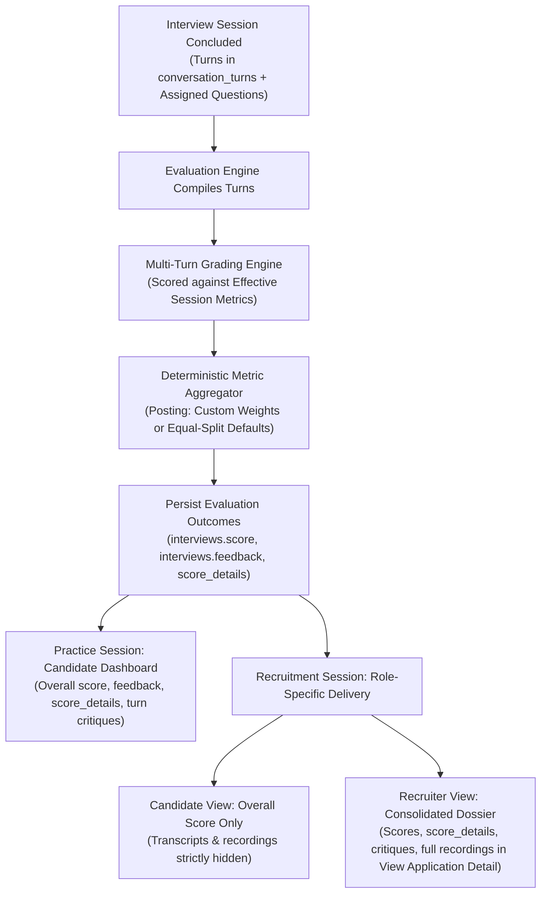

# Post-Interview Evaluation & Reporting Domain

The **Post-Interview Evaluation & Reporting Domain** transforms raw interview transcripts into structured technical assessments, actionable diagnostic feedback, and role-appropriate performance reports.

---

## 1. Purpose

Provide objective, diagnostic technical feedback. Identifies specific conceptual blind spots, assesses depth of understanding against target job requirements, and provides clear study recommendations for practice sessions while delivering structured performance evidence for recruiter evaluation.

---

## 2. Core Concepts

* **Technical Competency Dimensions (`metrics`):**
  The platform metrics used to evaluate technical interview performance:
  * Each dimension is defined in the `metrics` table (`id`, `name`).
  * The five currently active baseline metrics are *Technical Accuracy*, *Depth of Understanding*, *Problem-Solving & Approach*, *Answer Relevance*, and *Communication Clarity*. This is not an immutable platform list.
  * **Specification Status Invariant:** Decision 13a (ratified 2026-10-18) settles posting-level custom weights and equal-split defaults. Detailed metric criteria, scoring formulas, and validation constraints beyond that decision remain unresolved.
* **Posting-Level Metric Weights (`metrics_percentage`):**
  Evaluation weights are **separate from the core question bank (`core_questions`)**. Recruiters may select a subset of metrics and save percentages totaling **100%** through `metrics_percentage (job_posting_id, metric_id, percentage)`. Without a saved custom configuration, compute effective equal-split defaults on read across currently available metrics (**20% each** for the current five); do not persist default rows. `configured=false` and `using_defaults=true` indicate valid configuration; Admin approval must not require custom weights.
  * **Editing Boundary:** Editable in `pending`/`rejected`, locked in `open`/`intake_closed`/`closed`. Applying this boundary to conceptual moderation approval, funding, and Open Intake is subject to the finalized technical state mapping (Decisions 13/16); no additional editable state is implied.
* **Evaluation Results Persistence (`interviews`, `score_details`, `conversation_turns`):**
  Evaluation outcomes are persisted directly in the relational schema upon session conclusion:
  * **Overall Assessment:** Stored in `interviews.score` (numerical score) and `interviews.feedback` (narrative evaluation).
  * **Competency Breakdown:** Persisted in `score_details` (`interview_id`, `metric_id`, `score`).
  * **Turn-by-Turn Critiques:** Persisted in `conversation_turns.feedback` for each answered question turn.
* **Role-Specific Result Disclosure:**
  * **Practice Interviews:** The Candidate has full access to their evaluation scores, competency breakdowns (`score_details`), turn critiques (`conversation_turns.feedback`), and overall feedback (`interviews.feedback`).
  * **Recruitment Interviews:**
    * The **Candidate** can view their overall recruitment score, but **cannot** view recruitment transcripts or audio/video recordings during recruitment. These assets must not be exposed indirectly through history, result APIs, exports, or asset URLs.
    * The **Recruiter** owning the Job Posting receives full access to the applicant's profile, CV, evaluation score, competency breakdown (`score_details`), turn critiques, and recruitment audio/video recordings and transcripts consolidated directly within **View Application Detail**.
* **Historical Context Preservation:**
  Scoring uses the effective evaluation configuration (saved custom posting weights or equal-split defaults when absent). Persisted turn feedback and `score_details` remain immutable; later configuration changes must not recalculate historical results. This does not imply persisted default rows or a new snapshot mechanism.
* **Human Review Evidence (No Automated Hiring Authority):**
  Evaluation scores and reports serve as structured evidence to assist human judgment. Evaluation thresholds and scores carry **no automated hiring or rejection authority**.

---

## 3. Actors Involved

* **Candidate:** Views personal practice interview history, evaluation scores, competency breakdowns, turn critiques, and feedback; views overall recruitment evaluation score (transcripts and recordings remain hidden).
* **Recruiter:** Adjusts posting-level evaluation weights (`metrics_percentage`) for own Job Postings; inspects candidate profile, CV, interview scores, competency breakdowns (`score_details`), turn critiques, and recruitment audio/video recordings and transcripts consolidated directly inside **View Application Detail**.
* **Administrator:** Inspects session operational records. `Configure Interview Behavior Guidelines` is separately ratified under the Administration Domain and does not grant global evaluation rubric/weight editing. Unrestricted raw LLM system-prompt editing, runtime toggles, provider configuration management, and pricing administration remain excluded. Guideline changes must not alter completed historical evaluation results (Decision 16).

---

## 4. Main Domain Flow

---

## 5. Business Rules & Invariants

1. **Strict Configuration Adherence:**
   Recruitment evaluations must use the posting's effective metrics and weights: custom percentages totaling 100%, or equal-split defaults when no custom configuration exists (currently five metrics at 20% each). KAN-61 scoring must apply the same fallback as the configuration API. The grading engine cannot introduce arbitrary criteria outside the effective configuration.
2. **Posting Settings Separated from Question Bank:**
   Evaluation weights are managed separately from the core question bank (`core_questions`). Customization is optional; `configured=false` and `using_defaults=true` are valid and must not block Admin approval. Custom weights are persisted in `metrics_percentage`; defaults are computed on read. Editing is allowed in `pending`/`rejected`, locked in `open`/`intake_closed`/`closed`, subject to the finalized technical state mapping.
3. **Historical Evaluation Immutability:**
   Once generated and persisted, evaluation scores (`interviews.score`, `score_details`) and feedback are **immutable**. Historical scores and critiques can never be altered or recalculated if source configurations change.
4. **Role-Specific Disclosure Boundaries:**
   * In recruitment, the Candidate can view only their overall evaluation score; recruitment transcripts and audio/video recordings are hidden from the Candidate during recruitment and must not be exposed via exports, history APIs, or asset URLs.
   * No Candidate recruitment recording replay feature exists.
   * The owning Recruiter has exclusive review access to recruitment transcripts and recordings within `View Application Detail`.
5. **Formative & Diagnostic Purpose (No Auto-Hiring):**
   RoleCue evaluations provide educational and diagnostic evidence. Evaluation scores carry **no autonomous hiring or disqualification authority**.
6. **Unique Metric Evaluation per Session:**
   Every evaluated Interview Session produces at most one score entry per evaluated metric, enforced by:
   $$\text{UNIQUE}(interview\_id, metric\_id)\text{ on score_details}$$

---

## 6. Relationships to Other Domains

* **[[01_Domains/Interview/README|Interview Domain]]:**
  Consumes completed interview turns (`conversation_turns`) and records evaluation results on `interviews` (`score`, `feedback`) and `score_details`.
* **[[01_Domains/Job-Posting-Application/README|Job-Posting-Application Domain]]:**
  For recruitment interviews, links evaluations to the Application via `interviews.application_id`. Enforces role-specific visibility rules between Candidates and Recruiters (consolidated in `View Application Detail`).
* **[[01_Domains/Job-Description/README|Job-Description Domain]]:**
  Uses the technical competencies confirmed in the JD to ground technical accuracy and relevance scoring.
* **[[01_Domains/Administration/README|Administration Domain]]:**
  Administrators oversee operational session records. (Global evaluation criteria editing is excluded from the frozen scope).

---

## 7. External Integrations

* **LLM Provider:** Analyzes dialogue turns, performs criterion-based grading against the session's evaluation configuration, identifies technical misconceptions, and generates learning roadmaps.
