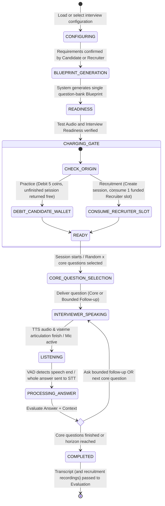

# Real-Time Interview Simulation Domain

The **Real-Time Interview Simulation Domain** coordinates the live technical interview interaction between the Candidate, the 3D virtual interviewer, speech services, and the adaptive question execution loop.

---

## 1. Purpose

Orchestrate a lifelike, conversational technical interview simulation. Executes assessment plans defined by internal question-bank blueprints, samples a random set of core questions with bounded follow-ups, synchronizes spoken audio with 3D avatar facial animations, and captures rich conversation turns and recruitment recordings for evaluation.

---

## 2. Core Concepts

* **Interview Configuration (Composite Capability):**
  A single setup capability whose visual and vocal selection depends on the interview origin:
  * **Target JD for Practice:** The Candidate chooses an available system 3D interviewer or eligible model from their personal avatar inventory, an available Voice Profile, a 3D environment, difficulty, and duration. Only the Candidate's **own** inventory avatars are eligible (another user's personal avatar is never usable), and the Voice Profile must be active. No system avatar presets are currently persisted.
  * **Recruiter Job Posting:** The Recruiter selects the company 3D interviewer model and Voice Profile before Job Posting approval. The Candidate must use those locked settings and cannot override them; a recruitment start that names its own avatar or voice is refused.
* **Interview Blueprint (Core-Question Bank):**
  A conceptual and product term for the persistent **core-question bank** generated after human confirmation of extracted skills, requirements, and seniority context:
  * Persistent storage utilizes `core_questions`; there is **no separate Blueprint table** in the database.
  * Exactly **one current question bank** exists per JD (absent until generated).
  * Contains ONLY the persistent pool/list of core questions. Rubrics and posting weights remain separate entities; the 2026-11-07 target adds a rubric reference and private expected_answer to each core question (Decision 24).
  * **Role Access Invariant:** Strictly **hidden from Candidates** (Candidates never view, edit, or confirm question banks). Recruiters **can** view and edit core questions within the question bank generated for their own Job Postings while the Posting is `pending` or `rejected` (locked from `open` onward).
  * *Separation:* Evaluation weights and scoring settings are configured separately and are not embedded into the question bank.
* **Interview Session (`interviews`):**
  A concrete execution attempt of an interview executing from the core-question bank:
  * **Practice Session (`type = 'practice'`):** Executed for personal skill development from a confirmed Role Profile owned by the Candidate; `role_profile_id IS NOT NULL` and `application_id IS NULL`. Debited **5 coins** from the Candidate's personal wallet upon session start; reconnecting to or resuming the same active session is free.
    * **Double-Start Protection:** Starting again while the Candidate has an unfinished practice session for the same Role Profile returns that session instead of charging again. A start request may carry an idempotency key; a retried start with the same key returns the session it created and charges once.
  * **Recruitment Session (`type = 'recruitment'`):** Linked directly to the Candidate's Application via `application_id UNIQUE REFERENCES applications(id)`, and through it to exactly one Job Posting. It has **no Role Profile** (`role_profile_id IS NULL`): a Role Profile exists only for Candidate self-practice, and Recruiters have none. Ownership comes from `applications.candidate_id`, and the session is presented under the Job Posting's title. Requires prior CV approval (`interview_eligible`), a funded Posting with a free slot, and a non-empty question bank. Consumes one prepaid interview slot strictly upon the Candidate's **first successful interview start**, when the session is created; starting again returns the same session and consumes no additional slot. The Candidate is never charged.
  * **24-Hour Interview Deadline:** Approved Candidates must complete the interview before `interview_deadline = approval_time + 24 hours` (calculated upon CV approval; `approval_time` is conceptual and only `interview_deadline` is persisted). Merely starting the interview before the deadline is insufficient: once the window closes, further answers and completion are refused, and the application is automatically set to terminal `rejected`.
  * **Session Timing:** Each session records `started_at` and, once finished, `completed_at`; an unfinished session has no `completed_at`.
* **Recruitment Audio/Video Recordings:**
  Recruitment interviews capture audio/video recordings (`record_path`) and conversational transcripts.
  * Retained exclusively for review by the Recruiter owning the Job Posting inside View Application Detail.
  * A recording moves through `record_status` (`none`, `uploading`, `processing`, `ready`, `failed`) and is served to the owning Recruiter only when `ready`. The transcript is available to the owning Recruiter once the recruitment interview is completed.
  * Candidates view recruitment status only; scores, grading evidence, transcripts and recordings remain hidden.
  * Practice interviews do not record video; they use microphone/STT for spoken dialogue.
  * **Recording Rules (Settled 2026-11-03, KAN-87; Decision 18):**
    * The camera is required to start a recruitment interview.
    * The recording is one continuous camera and microphone take (VP8/Opus, about 4 MB per minute; Safari uses MP4). It is buffered in the browser across a reload and joined into one file, so until the upload completes it exists only in the browser that recorded it.
    * The Candidate sees upload states (recording, uploading, retrying, ready, failed) and their own `record_status`, but never a replay.
    * Upload failures retry and finally end `failed`; the interview is never cancelled for it.
    * The recording is kept 90 days after the Application's final decision, then deleted (job pending KAN-174).
* **Persistent Session Question Mapping (`interview_questions`):**
  The questions assigned to an interview are explicitly persisted in `interview_questions`, linking each session turn position (`(interview_id, position)`) to its source `core_question_id REFERENCES core_questions(id)`. This relational link guarantees that historical sessions remain permanently traceable and reproducible without requiring an unnormalized `blueprint_snapshot` column.
* **Conversational Turns (`conversation_turns`):**
  Sequentially indexed dialogue units capturing interviewer question text, candidate answer transcript, and per-turn feedback (`(interview_id, position, question, answer, feedback)`).
  * `position` is the conversation order. `kind` is `core` or `follow_up`. `question_number` is the core question a turn belongs to; it is derived from turn order and not stored, assuming a follow-up always directly follows its core question.
  * A follow-up turn is stored only once it has an answer. Progress is counted in core questions ("Question N of x · Follow-up").
* **Adaptive Question Loop:**
  During simulation, the runtime samples a random set of $x$ core questions from the bank and may ask bounded follow-ups based on the candidate's answers and interview context.
  * Deciding whether to follow up and generating follow-up question wording are distinct responsibilities.
  * **Implemented (KAN-56, 2026-11-03; Decision 14):** $x$ = `interview.question_limit` (8); at most `INTERVIEW_FOLLOW_UP_LIMIT` (default 1) follow-ups per core question. Each decision has a 5 s timeout, and any failure moves to the next core question. While transitioning, the engine runs the follow-up decision before the next turn; it adds about 1–4 s.
  * Coverage policy and handling of a bank smaller than $x$ remain open product decisions.
  * No specific external decision vendor (such as Jev/TypeSafe) has been selected; Jev is tentative and not approved. Decisions go through the `FollowUpDecider` seam.

---

### Rubric grading metadata (implemented 2026-11-12)

*Status 2026-11-14: per-core rubric grading, coverage-aware sampling (recruitment: refuse when a weighted metric cannot be covered; practice: best-effort cover, never refuse) and practice activation are implemented; see spec section 13. Grader calibration is open.*

The bank remains the pool of core questions, not an embedded grading matrix. Decision 24 adds core_questions.rubric_id and expected_answer as private grading metadata and keeps rubric definitions relationally separate. Generation proposes both for recruiter review. Core-plus-follow-up isolation remains; used definitions are locked without snapshots. Metric coverage-aware sampling and practice activation are engineering decisions to confirm in [[01_Domains/Evaluation/Scoring-Rubrics-Spec|Barem/metric scoring spec]].

## 3. Actors Involved

* **Candidate:** Configures Target JD interview parameters, completes Test Audio and Interview Readiness, joins, reconnects to, leaves (ends early) and concludes practice and recruitment interviews. For a Job Posting interview, uses the locked company presentation configured by the Recruiter.
* **Recruiter:** Views and edits core questions in the question bank for own Job Postings while they are `pending` or `rejected`; may customize posting-level evaluation weights or use valid equal-split defaults (Decision 13a); funds interview slots; reviews applicant results, transcripts, and audio/video recordings.
* **System Handler (Internal Handler):** In-process job runner (KAN-174; one PostgreSQL advisory lock per job, configurable `JOBS_*`). It ends sessions abandoned for 15 minutes, marks stale recruitment recordings `failed` and purges recordings 90 days after the final decision (Decisions 18 and 20).
* **Administrator:** Searches and filters interview sessions, views operational session metadata and diagnostics, and Configures Interview Behavior Guidelines (mandatory registered scope, ratified 2026-10-20). Guidelines influence intended AI interviewer behavior, require Admin authorization, and preserve completed historical results. Guideline fields, versioning and prompt composition are settled by Decision 27 and implemented (KAN-276); unrestricted raw LLM system-prompt editing, administrative overrides of posting weights or historical evaluation results, runtime toggles, provider configuration management, and pricing administration remain excluded (Decision 16).

---

## 4. Main Domain Flow

### Turn Orchestration Loop:
The live runtime (KAN-52) implements this loop over a WebSocket; the authoritative message contract is `docs/interview-ws-protocol.md` in the code repository. The server drives the states, the socket never charges or creates a session, each answer is one recording of at most 3 minutes (or a typed fallback), and speech-to-text sits behind a `Transcriber` boundary that transcribes one complete answer per turn, with no partial or streaming transcript. `main` ships only the development fake; an Azure Speech provider exists on the `dev/azure-stt` branch for end-to-end runs; local Whisper is KAN-55 (Khang).
1. **Core Question Sampling:** At session start, the runtime samples a random set of $x$ core questions from the Blueprint's question bank.
2. **Question Delivery:** TTS synthesizes the interviewer's speech with synchronized facial blend-shape visemes.
3. **Candidate Answer:** The Candidate answers by voice. Voice Activity Detection (VAD) monitors speech boundaries and audio streams to STT.
4. **Adaptive Follow-Up Analysis:** The runtime analyzes the Answer against the Interview Context to determine whether to trigger a bounded follow-up or proceed to the next core question. Deciding whether to follow up and generating follow-up wording are decoupled responsibilities without premature vendor lock-in.
5. **Loop or Evaluation:** When all core questions and bounded follow-ups are completed, the session finalizes and hands the turn transcript (and recruitment recordings, if applicable) to the Evaluation Domain.

---

## 5. Business Rules & Invariants

1. **Blueprint Access Invariant:**
   Candidates must **never** be shown the Interview Blueprint or question banks. Candidates interact exclusively through the natural conversational interface. Recruiters **can** view and edit core questions within the question bank generated for their own Job Postings.
2. **Requirement Confirmation Precedes Blueprint Generation:**
   Extracted requirements must be reviewed and explicitly confirmed before the question-bank Blueprint is generated.
3. **Single Current Blueprint per JD:**
   Each Target JD or Job Posting has at most **one current Blueprint** containing its question bank (absent until generated). Changing difficulty or configuration does not spawn multiple current banks.
4. **Start Charging Boundary vs. Resume:**
   * A practice interview is debited in coins (5 coins) from the Candidate's personal wallet **upon session start**, not when it finishes. Starting again while an unfinished practice session exists for the same Role Profile returns that session without charging; a retried start with the same idempotency key returns the session it created.
   * A recruitment interview consumes one prepaid interview slot funded by the Recruiter strictly upon the Candidate's **first successful start**, when the Application's single recruitment session is created. The Candidate is **never** charged.
   * If a session disconnects, reconnecting to the same active session incurs **no second charge** and consumes no additional slot. There is no pause, and leaving early never refunds (Decision 20).
5. **Recruitment Interview Eligibility & 24-Hour Deadline:**
   * To launch a recruitment interview, a Candidate must have submitted an application with a CV, and the Recruiter must have approved the CV via View Application Detail. Approval grants interview eligibility, but does not consume a slot yet.
   * A Candidate must complete the recruitment interview before `interview_deadline = approval_time + 24 hours` (calculated upon CV approval; `approval_time` is conceptual and only `interview_deadline` is persisted). Merely starting before the deadline is insufficient; after the deadline, answers and completion are refused, and failing to complete the interview before the deadline automatically transitions the Application to terminal `REJECTED`.
   * The session strictly runs using the Job Posting's locked company 3D interviewer model and Voice Profile.
   * A recruitment session has no Role Profile; it belongs to exactly one Job Posting through its Application, and its owner is `applications.candidate_id`.
6. **Recruitment Recording & Visibility Boundary:**
   Recruitment interviews capture audio/video recordings and conversational transcripts for review by the owning Recruiter. A recording is served only once its `record_status` is `ready`. The camera is required, upload failures end `failed` rather than cancelling the interview, and recordings are deleted 90 days after the final decision (Decision 18). Candidates view recruitment status only; scores, grading evidence, transcripts and recordings remain hidden. Practice interviews do not record video.
7. **Session Question Mapping Preservation:**
   Every session persists its assigned questions in `interview_questions`, linking each turn position to its `core_question_id`. Historical sessions remain permanently reproducible and auditable even if the JD question bank is modified later.
8. **Question Selection & Bounded Follow-Up Policy:**
   Simulation selects a random sample of $x$ = 8 core questions (`interview.question_limit`), frozen at start, and asks at most `INTERVIEW_FOLLOW_UP_LIMIT` (default 1) follow-ups per core question. Each decision is bounded by a 5 s timeout and skips to the next core question on failure (Decision 14). Coverage policy and small-bank handling remain open. No specific decision vendor (such as Jev/TypeSafe) is selected; Jev is tentative and unapproved.
9. **Graceful 2D Degradation:**
   If a client device lacks WebGL acceleration, the system provides seamless fallback to an animated 2D audio waveform display without interrupting voice dialogue (KAN-217). If a 3D room fails or times out, the room falls back to its photographic still (Decision 23).
10. **Abandoned Session Cleanup:**
    If no question is delivered and no answer is stored for **15 minutes** (`JOBS_ABANDONED_SESSIONS_TIMEOUT`), the **System Handler** ends the session through the same idempotent end path as a normal completion or a Leave. It sets `end_reason = abandoned` and evaluates what was answered; a session with no answers ends with a failed evaluation. Activity is derived from existing timestamps (`started_at`, `asked_at`, `answered_at`); no heartbeat column exists (Decision 20).
11. **Leave Ends the Interview (no pause):**
    Leave asks for confirmation, then submits immediately (`POST /interviews/{id}/complete`). The session is evaluated as usual; unanswered core questions stay unanswered, and the report says how it ended (`end_reason` = `completed`, `left` or `abandoned`). A recruitment Application moves on exactly as after a normal completion. An accidental disconnect is not a leave (Decision 20).
12. **Interviewer Performance:**
    Every interviewer line carries bounded cues: emotions `neutral`, `friendly`, `curious`, `encouraging`, `thinking` and gestures `nod`, `explain_hand`, `lean_in`, `greet`, `listen`. They are rule-based for core questions and proposed by the follow-up decider for follow-ups, with no extra model call. The client plays them with a Mixamo-sourced VRMA motion set alongside lip-sync, and reacts while the Candidate speaks (Decision 22).

---

## 6. Relationships to Other Domains

* **[[01_Domains/Job-Description/README|Job-Description Domain]]:**
  Provides confirmed requirements and refinement notes that feed question-bank generation (`core_questions`).
* **[[01_Domains/Job-Posting-Application/README|Job-Posting-Application Domain]]:**
  Verifies that applicants have passed CV screening (`interview_eligible`) and that the posting has a funded interview slot before initiating recruitment interviews. Recruitment interviews link back via `interviews.application_id`.
* **[[01_Domains/Avatar-Voice/README|Avatar-Voice Domain]]:**
  Supplies 3D avatar models (`avatars`), blend-shape viseme definitions, and TTS Voice Profiles (`voices`).
* **[[01_Domains/Evaluation/README|Evaluation Domain]]:**
  Receives completed conversation turns (`conversation_turns`) and computes overall scores (`interviews.score`), narrative feedback (`interviews.feedback`), and dimensional metrics (`score_details.score`) mapped to `metrics.id`. Recruitment scoring uses custom `metrics_percentage` weights or the same effective equal-split fallback as the configuration API when custom weights are absent (currently five metrics at 20% each; Decision 13a).
* **[[01_Domains/Payment/README|Payment Domain]]:**
  Debits Candidate wallet coins at practice session start. Consumes prepaid Recruiter interview slots at recruitment session start.
* **[[01_Domains/Administration/README|Administration Domain]]:**
  Administrators inspect operational session metadata and Configure Interview Behavior Guidelines influencing intended AI interviewer behavior. Guideline fields, persistence, versioning and prompt composition are settled by Decision 27 and implemented (KAN-276): a session starts with the current guideline snapshot and keeps it, and only the follow-up decider is affected. Completed historical interview results remain unchanged. Decision 16's separate raw-prompt, posting-weight/historical-result editing, runtime-toggle, provider-configuration, and pricing exclusions still apply.

---

## 7. External Integrations

* **LLM Provider:** Generates internal question banks, analyzes candidate answers, and assists in dialogue orchestration. (Follow-up decision provider unselected; Jev is tentative and not approved).
* **STT Provider:** Transcribes candidate spoken audio to text.
* **TTS Provider:** Synthesizes realistic interviewer voice audio and supplies viseme timing metadata for avatar lip-sync animation.

## Planned Roadmap Practice Extension — Decision 25

Agreed 2026-11-07; backend implemented and merged 2026-11-13, UI in progress, end-to-end acceptance pending KAN-357 (not released). Practice may be general (focus_item_id=NULL) or focused on one owned Roadmap topic. Focus does not change the profile's target/seniority. Sample only that topic, prioritize unseen questions/unachieved topics while preserving Barem metric coverage, and validate/top up topic coverage before start. Default8 core questions and5 coins/start remain; resume is free and retains the original focus. A new focus request cannot rewrite an unfinished session or double-charge. Recruitment has no Roadmap focus/evidence. After finalized successful Barem evaluation, question results update topic history; question-level scores must first be available for practice. Explicit skips are0, unasked/evaluation-error cases are not. Implemented: `POST /interviews` accepts `focus_item_id`; the answer carries the stored `focus_item_id` and `resumed`; an open practice session of the profile is returned (200) with its own focus. See [[01_Domains/Learning-Roadmap/Learning-Roadmaps-Spec|Roadmap spec, section 13.4]].

## Planned Purchased Avatar Eligibility — Decision 26

A paid Marketplace copy is a distinct avatar row in the buyer's own inventory; existing avatar selection, ownership and posting-locked interviewer rules remain. Model storage resolves through shared avatar_assets after implementation; a buyer does not gain access to the seller's private avatar row. Seller delist/source deletion does not swap/remove an interviewer already granted to a buyer. No per-use transaction/license-status lookup is introduced. See [[01_Domains/Avatar-Marketplace/Avatar-Marketplace-Spec|Marketplace spec]] (agreed 2026-11-07, implementation pending).
