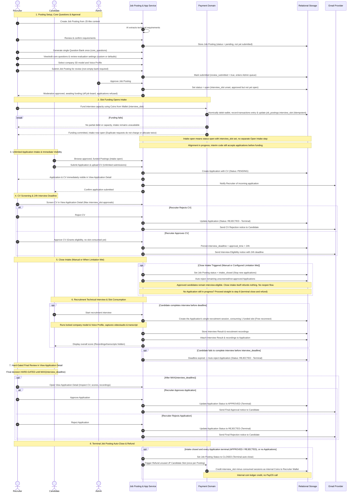

# Job Posting & Application Domain

The **Job Posting & Application Domain** provides a lightweight recruitment board and CV-first application workflow, enabling Recruiters to advertise employer openings, fund interview slots, screen incoming CVs, oversee technical interview results and recordings, and render final hiring decisions.

---

## 1. Purpose

Bridge the gap between technical interview preparation and career discovery. Recruiters have a direct channel to publish job vacancies, fund interview capacity, screen CVs before interviews take place, and review interview performance evidence (scores and recordings), while Candidates have a targeted channel to apply for technical roles and demonstrate technical proficiency.

---

## 2. Core Concepts

* **Job Posting (`job_postings`):**
  A formal job vacancy created by a Recruiter from JD-like content, serving as the company's Job Description.
  * **Canonical Equivalence:** `Job Posting` **is** the company's Job Description. There is no separate "Corporate JD" entity or company-tenant system.
  * **Question Bank & Settings:** Generates a single internal core-question bank Blueprint (persisted in `core_questions`). The owning Recruiter can view and edit core questions for their own posting while it is `pending` or `rejected`; the bank is locked once the posting is `open` (see *Question Bank Preparation & Submit for Review* below). Evaluation settings are separate: optional custom weights for a subset of metrics must total 100%; otherwise effective equal-split defaults apply (currently five active metrics at 20% each). `configured=false` and `using_defaults=true` are valid; Admin approval does not require custom weights. Editing is allowed in `pending`/`rejected`, locked in `open`/`intake_closed`/`closed`, subject to the finalized technical state mapping (Decision 13a).
  * **Interview Presentation:** Company 3D interviewer model and Voice Profile selected by the Recruiter before Admin approval. Candidates cannot override either setting for a recruitment interview.
  * **Persisted Lifecycle Status (`job_postings.status`):**
    The frozen PostgreSQL enum `job_posting_status` contains only:
    * `pending`: Being prepared by the Recruiter, or submitted and awaiting Admin moderation. `job_postings.review_submitted` separates the two: only a submitted `pending` posting is in the Admin queue.
    * `open`: Set by Admin approval. With `interview_slot` unset the Posting is **approved but not yet open**; once funded (`interview_slot IS NOT NULL`) intake is open (see *Persistence Mapping* below).
    * `intake_closed`: Application intake closed (manually or automatically); remaining unscreened applications rejected; eligible candidates may interview.
    * `closed`: Terminal closed state reached when all applications are terminal `approved` or `rejected`; unused capacity refunded.
    * `rejected`: Moderated and rejected by Administrator.
    * **Persistence Mapping (Settled 2026-10-29):** No `approved` status or independent `intake_status` column is added. Admin approval sets `status = 'open'`. A Posting with `status = 'open' AND interview_slot IS NULL` is approved but not yet open: not listed on the job board, public detail not reachable, applications refused (`INTAKE_NOT_OPEN`); the owning Recruiter and Admin still see it as approved, awaiting funding. Successful funding is the Recruiter's Open Intake action: setting `interview_slot` opens intake in the same step, with no separate Open Intake endpoint or button. Intake open = `status = 'open' AND interview_slot IS NOT NULL` (see [[02_System/Domain-Model|Domain Model]] and Decisions 13/16 in [[03_Decisions/Product-Decisions|Product Decisions]]).
    * **Implementation alignment in progress (2026-10-29):** Code is being aligned so the job board and apply require funded capacity. Until that lands, the interim behavior still applies: Admin approval opens intake immediately, so Candidates may discover the Posting and apply before it is funded. CV approval and recruitment interview start already require funded capacity (they are refused while `interview_slot` is unset), and funding is accepted only while the Posting is `open`. This interim gap is being closed, not a decision change.
  * **Question Bank Preparation & Submit for Review:**
    * After confirming requirements (and an optional `refinement_note`), the Recruiter generates the core-question bank **once**; a second generation on an existing bank is refused, while a failed generation may be retried.
    * The Recruiter reviews and edits the bank (add, edit, delete) only while the Posting is `pending` or `rejected`. Questions can be added by hand only after the bank has been generated. Bank edits and Admin approval are serialized on the Posting, so an approval never opens a Posting with an empty bank.
    * Generating the bank does **not** submit the Posting. The Recruiter explicitly **submits for review**; submission requires a non-empty bank. A `rejected` Posting may regenerate and edit its bank, then **resubmits**.
    * Admin approves or rejects only submitted Postings. Deleting the last question withdraws a submitted Posting from the Admin queue; it must be submitted again.
  * **Removal of Archive:** `Archive Job Posting` is removed from RoleCue's product contract. It is not a supported capability or lifecycle state.
* **Interview Slot (`job_postings.interview_slot`):**
  The frozen ERD field defining maximum recruitment interview capacity:
  * Specifies the maximum number of Candidates that may be approved to proceed into the recruitment interview stage.
  * Funded by the Recruiter using wallet coins **after moderation approval**, at **1 coin per slot**; successful funding opens intake. Coin debit, unified `transactions` ledger entry, and `job_postings.interview_slot` update must be atomic and idempotent; failures and duplicate requests cannot cause partial capacity or double charges. Funding never invokes PayOS.
  * **Funded Exactly Once:** A Posting is funded exactly once; there are no top-ups. Repeating the funding with the same slot count returns the current capacity without a second charge; a different count is refused.
  * **Non-Headcount Invariant:** It does **NOT** mean total Applications/CVs submitted, company hiring headcount, or final hires. RoleCue does **NOT** persist or enforce company hiring headcount.
  * Passing CV screening does **not** consume a slot yet.
  * Starting the interview consumes one funded slot strictly on the Candidate's **first successful start**, when the Application's single recruitment session is created. Reconnecting to or resuming that active session does **not** consume another.
  * Unused interview capacity (`interview_slot` minus consumed sessions) is refunded as coins back into the Recruiter's personal wallet upon **terminal Job Posting auto-close** (`Refund unused JP Candidate Slot`), exactly once per Posting. An unfunded Posting has nothing to refund.
* **Application Intake (Open vs. Close):**
  * **Open intake:** Recruiter opens intake by successfully funding `interview_slot` after moderation approval; there is no separate Open Intake step. Candidates can discover and submit only when `status = 'open' AND interview_slot IS NOT NULL`; `status = 'open'` alone means approved, not open (interim implementation still accepts applications before funding until alignment lands). Candidates may submit an **UNLIMITED** number of Applications/CVs; submissions are **NOT limited by interview capacity**.
  * **Close intake (`status = 'intake_closed'`):** Halts receiving new applications. Executed manually by the Recruiter (*Close Job Posting Intake*) or automatically by the System Handler (*Close Job Posting When Meet Configured Limitation* upon reaching `interview_slot` approved candidates).
  * **Close Intake Invariant:** Closing intake automatically **REJECTS** all remaining Applications that are still unscreened or not approved to proceed to interview. Candidates already approved for interview (`interview_eligible`) remain eligible and may complete their interviews. Close intake itself does **not** refund interview capacity and is **not** terminal Job Posting close. There is **NO Reopen Intake flow** and **NO manual End Recruitment command**.
  * **Close Intake Chaining & Repeat:** After closing intake, the terminal close rule is evaluated in the same operation. When no Application is still in progress (including a Posting that never received an Application), the Posting goes straight to terminal `closed`, and the unused-slot refund comes from that terminal-close step. Calling Close Intake again on an `intake_closed` or `closed` Posting succeeds without changing anything.
* **Application (`applications`):**
  A candidate submission to a moderated, funded Job Posting with Recruiter-opened intake, containing `candidate_id`, `job_posting_id`, `cv_path`, `interview_deadline`, and `status`:
  * **Application Lifecycle Statuses (`application_status` enum):**
    * `pending`: Application submitted with CV; awaiting Recruiter CV screening.
    * `interview_eligible`: Recruiter approved CV; candidate has 24-hour deadline to interview.
    * `interviewed`: Candidate completed technical interview; awaiting hard-gated final review.
    * `approved`: Terminal Recruiter approval.
    * `rejected`: Terminal rejection (CV rejection, deadline expiration, intake close cleanup, or final recruiter rejection).
  * **Relational Association:** `applications` exists before any interview occurs. The relationship is maintained by `interviews.application_id` (`UNIQUE REFERENCES applications(id)`), **not** by an `interview_id` foreign key on `applications`.
  * **Immediate Recruiter Visibility:** The Application and CV are immediately visible to the owning Recruiter upon submission inside **View Application Detail**, prior to any interview taking place.
  * **24-Hour Interview Deadline:** When an Application is CV-approved (`interview_eligible`), it is assigned:
    $$\text{interview\_deadline} = \text{approval\_time} + 24\text{ hours}$$
    (`approval_time` is conceptual/event-time only; only `applications.interview_deadline` is persisted). A Candidate must complete the recruitment interview before this deadline; merely starting the interview before the deadline is insufficient. If the candidate fails to complete the interview before this deadline, the Application automatically transitions to terminal `rejected`.
* **Two Distinct Decisions Consolidated in View Application Detail:**
  1. **CV Screening Decision:** The Recruiter's initial evaluation of the uploaded CV/resume within View Application Detail. Recruiter may approve at most `interview_slot` Candidates to proceed to interview (`status` moves from `pending` to `interview_eligible`). Approving grants interview eligibility and starts the 24-hour deadline; it does not consume a funded slot yet.
  2. **Hard-Gated Final Decision:** The definitive, terminal verdict rendered by the Recruiter (`approved` or `rejected`) inside View Application Detail. This decision is **HARD-GATED until MAX(interview_deadline)** across all interview-eligible Applications for the posting. After the gate, the Recruiter reviews candidate profile, CV, and authorized Interview Result and recordings/transcripts to render the decision.
  * **Consolidated Review Invariant:** Recruiter viewing of CV, results, evaluations, and recordings is consolidated inside **View Application Detail**. Do not maintain separate current top-level review use cases.
* **Terminal Job Posting Close:**
  Once intake is closed, a Job Posting automatically transitions to terminal `closed` when **EVERY Application in scope reaches a terminal result** (`approved` or `rejected`); a Posting with no Applications qualifies. Unused interview capacity is refunded to the Recruiter's wallet as internal coins upon terminal close (`Refund unused JP Candidate Slot`). There is no manual End Recruitment command.

---

## 3. Actors Involved

* **Recruiter:**
  * Creates Job Postings from JD-like content; reviews and confirms AI-extracted structured requirements.
  * Generates the question bank once, then views and edits core questions (`core_questions`) for own Job Postings while `pending` or `rejected`; explicitly submits (or resubmits) the Posting for review.
  * Reviews posting-level evaluation settings; may customize metric weights or use valid equal-split defaults.
  * Selects the company 3D interviewer model and Voice Profile before submitting for Admin approval.
  * After moderation approval, funds interview capacity (`interview_slot`) using personal wallet coins; successful funding opens Application Intake in the same step.
  * Manually triggers Close Job Posting Intake when desired (halts new applications; rejects unscreened/unapproved applications).
  * Inspects incoming Applications and CVs immediately upon submission inside View Application Detail.
  * Performs CV screening approval (max `interview_slot` approvals).
  * After the `MAX(interview_deadline)` hard gate, reviews applicant dossier, CV, technical evaluation scores, and recordings/transcripts in View Application Detail.
  * Renders definitive final decision: **Approve** or **Reject** Application.
* **Candidate:**
  * Browses and searches moderated, funded public Job Postings with Recruiter-opened intake, subject to Recruiter account-lock visibility rules (Decision 13b).
  * Submits an unlimited number of applications with uploaded CV/resumes while intake is open.
  * Tracks application status.
  * Upon receiving CV approval, participates in the required technical interview within the 24-hour deadline using the Job Posting's locked presentation and funded slot (Candidate is never charged).
  * Views overall recruitment evaluation score (transcripts and recordings remain hidden).
* **System Handler (Internal Automated Handler):**
  * Closes intake automatically when the configured interview capacity limit (`interview_slot`) is met (*Close Job Posting When Meet Configured Limitation*).
  * Automatically marks an Application terminal `REJECTED` if the candidate does not complete the interview before `interview_deadline`.
  * Automatically closes the Job Posting terminally and executes `Refund unused JP Candidate Slot` when every application has reached a terminal result (`APPROVED` or `REJECTED`).
* **Administrator:**
  * Views and filters submitted Job Postings (a `pending` Posting still in preparation is not in the queue).
  * Approves or rejects submitted Job Postings for platform content and quality moderation.

---

## 4. Main Domain Flow

This is the ratified business sequence. Approval sets `open`; successful funding of `interview_slot` is the Open Intake action, with no invented statuses or fields (persistence mapping settled 2026-10-29, Section 2). Implementation alignment is in progress; until it lands, the interim implementation accepts applications before funding.

---

## 5. Business Rules & Invariants

1. **Non-ATS Boundary (Scope Termination):**
   * Recruitment scope strictly terminates at **Application Approve / Reject**.
   * RoleCue does **NOT** model or support:
     * Multi-stage recruitment pipelines (e.g., Phone Screen $\rightarrow$ Tech Interview $\rightarrow$ Culture Fit).
     * Interview panel scheduling or calendar synchronization.
     * Candidate ranking algorithms or automated resume scoring.
     * Offer letter generation, compensation negotiation, or digital signature.
     * Employee onboarding or background checks.
2. **Canonical Job Posting Rule:**
   * A `Job Posting` is the company's job description.
   * Do not create or introduce a separate "Corporate JD" entity or database table.
3. **Question Bank & Evaluation Settings Independence:**
   * A Job Posting holds at most one current core-question bank Blueprint, generated once. The owning Recruiter can view and edit core questions within this bank while the Posting is `pending` or `rejected`; the bank is locked from `open` onward.
   * Submission for review is an explicit Recruiter action that requires a non-empty bank. Admin moderates only submitted Postings; deleting the last question withdraws the submission.
   * Posting-level evaluation weights are separate from the question bank; Recruiters may customize them or use the valid equal-split defaults defined in Decision 13a.
4. **Approval and Interview Presentation Lock:**
   * A Recruiter must select the company 3D interviewer model and Voice Profile before submitting a Job Posting for Admin approval.
   * Discovery and applications require moderation approval and successful wallet-coin funding; funding is the Recruiter's Open Intake action. Mapping settled 2026-10-29 without schema change (no `approved` status or `intake_status` field): intake open = `status = 'open' AND interview_slot IS NOT NULL`; approved but unfunded Postings refuse applications (`INTAKE_NOT_OPEN`). Implementation alignment in progress (2026-10-29): until it lands, the interim implementation accepts applications before funding (Section 2); CV approval and interview start already require funded capacity.
   * A Job Posting interview always uses its locked company 3D model and Voice Profile. The Candidate cannot override them.
5. **Immediate Application & CV Visibility:**
   * The Application and uploaded CV/resume exist and are immediately visible to the owning Recruiter upon submission.
   * The former rule requiring a completed technical interview before the application becomes visible is **superseded**.
6. **Two Distinct Decisions (CV Screening vs. Final Verdict):**
   * **CV Screening Decision:** Passing CV screening grants the candidate eligibility to launch the required technical interview. It does **not** constitute an application approval.
   * **Final Decision:** Rendered only after reviewing the candidate's interview performance evidence alongside their application and CV.
7. **Interview Slot Capacity & Intake Accounting:**
   * `job_postings.interview_slot` represents exclusively maximum recruitment interview capacity (the maximum number of Candidates that may be approved to proceed into the recruitment interview stage).
   * It does **NOT** represent total Applications/CVs submitted, company hiring headcount, or final hires. RoleCue does **NOT** persist or enforce company hiring headcount.
   * While intake is `OPEN`, Candidates may submit an **unlimited** number of Applications/CVs (submissions are not limited by `interview_slot`).
   * Recruiter may approve at most `interview_slot` Candidates to proceed to interview.
   * CV approval grants interview eligibility; it does **not** consume a funded slot yet.
   * Starting the technical interview consumes one funded slot strictly upon the Candidate's **first successful start**, when the Application's single recruitment session is created. Reconnecting to or resuming that active session does **not** consume another slot.
   * Interview capacity is funded exactly once per Posting at 1 coin per slot; there are no top-ups.
   * Candidates are **never** charged for recruitment interviews.
8. **Close Intake Semantics (No Reopen, No Manual End Recruitment):**
   * **Close intake** stops accepting new applications.
   * Closing intake automatically **REJECTS** all remaining unscreened or not-approved Applications.
   * Candidates already approved for interview remain interview-eligible and may still complete their interviews within their 24-hour windows.
   * Close intake itself does **not** refund interview slots and is **not** terminal Job Posting close. If no Application is still in progress when intake closes (including a Posting with zero Applications), the same operation proceeds to terminal close, whose step performs the refund.
   * Closing intake on a Posting that is already `intake_closed` or `closed` succeeds without change.
   * There is **NO Reopen Intake flow** and **NO manual End Recruitment command**.
   * When the configured limitation (`interview_slot` approved candidates) is reached, the System Handler automatically executes Close Intake (*Close Job Posting When Meet Configured Limitation*).
9. **24-Hour Interview Deadline:**
   * When an Application is approved to proceed to interview:
     $$\text{interview\_deadline} = \text{approval\_time} + 24\text{ hours}$$
     (`approval_time` is conceptual/event-time only; only `applications.interview_deadline` is persisted).
   * A Candidate must complete the recruitment interview before `interview_deadline`. Merely starting the interview before the deadline is insufficient. If the Candidate does not complete the recruitment interview before `interview_deadline`, the Application automatically transitions to terminal `REJECTED`.
10. **Hard-Gated Final Recruiter Review:**
    * Recruiter final Approve/Reject decisions are **HARD-GATED** until:
      $$\text{MAX}(\text{interview\_deadline})$$
      across all interview-eligible Applications for that Job Posting.
    * Before this timestamp, the Recruiter cannot render final Approve/Reject decisions.
    * After the gate, the Recruiter inspects Candidate profile, CV, and authorized interview scores, results, recordings, and transcripts inside **View Application Detail**, and renders final **Approve / Reject Application**.
    * All Recruiter CV, report, and recording review capabilities are consolidated inside **View Application Detail**.
11. **Terminal Job Posting Auto-Close & Unused Slot Refund:**
    * Once intake is closed, a Job Posting automatically reaches terminal closed state when **EVERY Application in scope reaches a terminal result** (`APPROVED` or `REJECTED`), or immediately when it has no Applications.
    * Terminal rejections include applications rejected during Close Intake cleanup, interview deadline expiry, Recruiter CV rejection, and final Recruiter rejection.
    * Upon terminal auto-close, the platform executes **Refund unused JP Candidate Slot**, refunding all still-unused recruitment interview capacity (`interview_slot` minus consumed recruitment sessions, 1 coin per slot) to the Recruiter's personal coin wallet as internal coins. The refund runs exactly once per Posting, on the transition to `closed`; it never double-credits and never debits again.
    * Refunds do **not** occur on Close Intake and do **not** call PayOS.
12. **Recruitment Recording & Visibility Boundaries:**
    * Audio/video recordings and transcripts captured during recruitment interviews are accessible exclusively to the owning Recruiter.
    * Candidates can view their overall recruitment evaluation score, but **cannot** access recruitment transcripts or audio/video recordings during recruitment.
    * Administrators do **not** have recruitment recording access by inference.
13. **Scores are Evidence for Human Review:**
    * Automated evaluation scores provide structured evidence to assist human hiring representatives. RoleCue does **not** make autonomous hiring decisions or automated disqualifications based on score thresholds.
14. **No Multi-Tenant Company Architecture:**
    * RoleCue does **NOT** implement multi-tenant SaaS architecture.
    * There are no Company tenants, company workspaces, tenant isolation middleware, or Row-Level Security tenant policies.
    * Job Postings are owned relationally by `recruiter_id`.
15. **Ownership & Access Isolation:**
    * Candidates can browse moderated, funded public Job Postings with Recruiter-opened intake and view only their own submitted applications and recruitment scores. Decision 13b's Recruiter account-lock visibility restrictions also apply.
    * Recruiters can only view and manage Job Postings and applications belonging to their own account.
16. **Final Decision Immutability:**
    * Once an application moves to `APPROVED` or `REJECTED`, the final decision cannot be reverted back to `PENDING`.

---

## 6. Relationships to Other Domains

* **[[01_Domains/Auth/README|Auth Domain]]:**
  Authenticates Candidates and Recruiters. Enforces role-based access control on posting management, CV screening, and application adjudication.
* **[[01_Domains/Job-Description/README|Job-Description Domain]]:**
  A Candidate browsing a Job Posting may copy its requirements to create a private **Target JD for Practice** in their personal library. However, the Job Posting and Target JD remain completely decoupled entities.
* **[[01_Domains/Administration/README|Administration Domain]]:**
  Administrators view, filter, and approve or reject submitted Job Postings to ensure platform content quality.
* **[[01_Domains/Interview/README|Interview Domain]]:**
  Runs the required technical interview using the Job Posting's locked company 3D interviewer model and Voice Profile. A recruitment interview belongs to exactly one Application (and through it one Job Posting) and has no Role Profile. Consumes one prepaid interview slot upon first successful start. Produces the Interview Result and recordings attached to the Application.
* **[[01_Domains/Payment/README|Payment Domain]]:**
  Debits Recruiter wallet coins to fund interview capacity (`interview_slot`). Upon terminal Job Posting auto-close, calculates eligible unused slots and credits internal coin refunds to the Recruiter's personal wallet (`Refund unused JP Candidate Slot`).

---

## 7. External Integrations

* **Email Provider:** Dispatches email notifications to Recruiters when new applications arrive, and notifies Candidates of CV screening outcomes and final application decisions.
