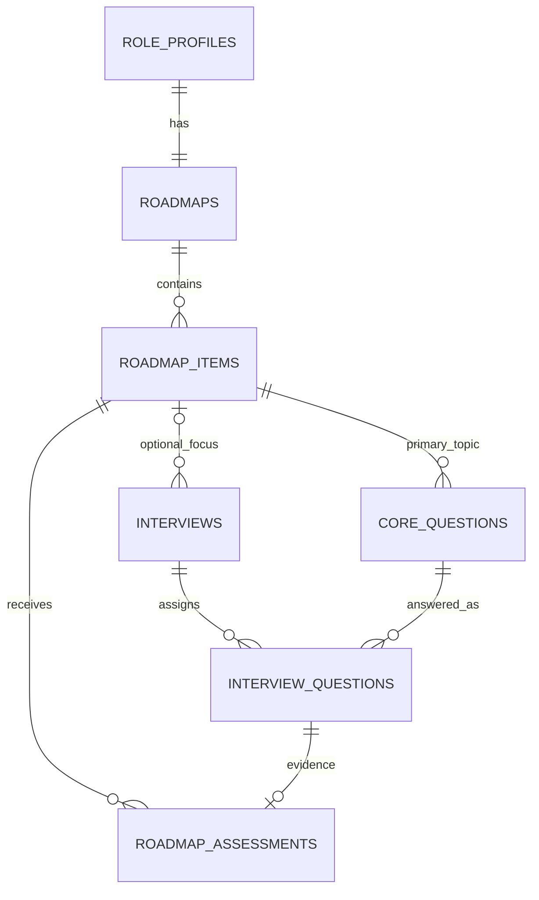

# Roadmap học tập theo Role Profile

> [!important] Trạng thái và phạm vi
> Product owner đã chốt thiết kế và business rule ngày 2026-11-07. Đây là **tính năng cần triển khai**, không phải mô tả tính năng đã có trên application main. Chi tiết contract/DDL được đánh dấu là thiết kế kỹ thuật để review khi triển khai; không tự thêm bảng snapshot/version hoặc thay đổi business rule đã duyệt.

## 1. Mục tiêu và ví dụ xuyên suốt

Mỗi Role Profile của Candidate có **một Roadmap riêng**. Roadmap biến mục tiêu nghề nghiệp trong requirements đã duyệt thành các mục kiến thức có thứ tự; các lần phỏng vấn practice cung cấp kết quả để theo dõi từng mục.

Ví dụ Role Profile A: **Senior Backend Golang**. Roadmap A có SQL → Go concurrency → System design. User có thể luyện tổng quát A hoặc chọn luyện riêng Go concurrency. Cả hai dùng cùng Role Profile và Roadmap; không phải tạo profile khác để luyện lại một mục.

Ba khái niệm cần tách rõ:

| Khái niệm | Ví dụ | Vai trò |
|---|---|---|
| Mục kiến thức / topic | Go concurrency | Nội dung cần học và được theo dõi trên Roadmap |
| Metric | Technical Accuracy | Phương diện đánh giá câu trả lời trong hệ thống Barem |
| Loại câu / rubric | Giải thích cơ chế và lựa chọn giải pháp | Hướng dẫn chấm tái sử dụng cho nhiều câu |

Một câu practice có **một topic chính**, dùng **một rubric** có nhiều criterion; các criterion tham chiếu metric. Topic không thay metric/rubric. Xem [[01_Domains/Evaluation/Scoring-Rubrics-Spec|Barem điểm và tổng hợp metric]].

## 2. Business rule đã chốt

1. Mỗi Role Profile có một Roadmap. Tạo **bản ghi** Roadmap cùng lúc tạo Role Profile; nội dung các mục chỉ sinh từ requirements **sau khi user duyệt**.
2. Roadmap chỉ nhận kết quả **practice** của chủ sở hữu. Không đưa điểm, nhận xét hoặc tín hiệu suy ra từ recruitment vào Roadmap.
3. FE vẽ tuyến tính theo `position`; thứ tự hiển thị không khóa quyền luyện các mục phía sau.
4. User không sửa trực tiếp cấu trúc/nội dung topic, điểm, trạng thái hoặc threshold trong MVP. AI không tự thêm/xóa/đổi chủ đề sau mỗi phiên; kết quả mới cập nhật điểm/trạng thái và gợi ý ôn tập.
5. Cho phép sinh lại Roadmap trước khi bắt đầu bất kỳ practice session nào của profile. Khi đã bắt đầu một phiên, giữ cấu trúc để lịch sử còn ý nghĩa. Đổi mục tiêu bằng Role Profile mới/Roadmap mới.
6. Luyện tổng quát chọn từ bank của profile. Luyện riêng một topic chỉ chọn câu của topic đó, không thay JD/seniority/mục tiêu gốc.
7. Practice giữ **5 coins/lượt**, mặc định **8 core questions**. Tiếp tục cùng phiên không trừ thêm; một profile giữ tối đa một phiên đang dở theo cơ chế hiện có.
8. Mỗi topic cần tối thiểu **5 câu khác nhau** để có thể đạt yêu cầu. Tổng bank mặc định 50 không chứng minh mọi topic đủ câu; phải kiểm tra phân bổ, độ phủ metric và số câu cần cho phiên focused. Thiếu câu thì bổ sung trước start/charge; lỗi thì không charge, không lấy câu khác topic hoặc hạ ngưỡng đạt ngầm.
9. Khi chọn câu, ưu tiên câu chưa đánh giá và mục chưa đạt trong giới hạn coverage Barem. Không cố định vĩnh viễn cùng một bộ 5 câu và không tự thay ngưỡng đã chốt vì bank thiếu.
10. Tiến độ được tính từ kết quả phỏng vấn hợp lệ; đọc tài liệu/đánh dấu hoàn thành bài tập không làm tăng tiến độ.
11. Câu đã hiển thị mà user chủ động bỏ qua/không trả lời khi hoàn tất phiên nhận **0**. Câu không hỏi/không tới lượt không tính 0. Lỗi AI/STT/transcript/recording không tự coi là trả lời sai để cho 0. Practice hiện không ghi video; quy tắc lỗi recording chỉ bảo đảm không dùng lỗi kỹ thuật làm bằng chứng năng lực nếu cơ chế media thay đổi.
12. Phiên chưa hoàn tất hoặc evaluation lỗi/chưa xong không cập nhật Roadmap. Follow-up nằm trong đánh giá core cha; retry không tạo thêm bằng chứng độc lập.

## 3. Hai loại trạng thái khác nhau

### 3.1. `generation_status`: chuẩn bị nội dung

Lưu trên `roadmaps`:

| Giá trị | Ý nghĩa |
|---|---|
| `pending` | Bản ghi đã tạo; chờ requirements được duyệt hoặc chờ công việc sinh nội dung |
| `generating` | Đang sinh/kiểm tra nội dung và chuẩn bị mapping bank |
| `ready` | Đã có tập topic hợp lệ để hiển thị; điều kiện bank/coverage vẫn được kiểm tra trước mỗi start |
| `failed` | Sinh nội dung lỗi; có đường retry |

Trạng thái này không nói user học giỏi hay đã hoàn thành. Không hoàn thành Roadmap rỗng hoặc đang lỗi sinh nội dung.

### 3.2. `learning_status`: tiến độ học

Backend tính từ kết quả; không lưu thêm cột status/score vào `roadmap_items` ở MVP:

| Đối tượng | Trạng thái | Điều kiện |
|---|---|---|
| Topic | `not_started` | Chưa có câu được đánh giá hợp lệ |
| Topic | `in_progress` | Có kết quả nhưng chưa đủ 5 câu khác nhau, hoặc điểm trung bình < 80 |
| Topic | `achieved` | Đủ 5 câu khác nhau trong cửa sổ và điểm trung bình >= 80 |
| Roadmap | `not_started` | Chưa có topic nào có kết quả |
| Roadmap | `in_progress` | Có kết quả nhưng chưa đạt toàn bộ topic |
| Roadmap | `completed` | Nội dung ready, có ít nhất một topic và tất cả topic achieved |

Khi nội dung chưa ready, UI ưu tiên trạng thái chuẩn bị; `progress_percent` là null, không hiển thị 100% từ phép chia 0/0. `learning_status` là not_started nếu chưa có kết quả.

## 4. Cách tính điểm — đọc phần này trước khi implement

### 4.1. Điểm câu lấy từ Barem, không lấy overall của phiên

Barem tạo điểm normalized của mỗi core question trong `interview_questions.score`:

```text
question_score = 100 × tổng điểm criterion đạt / tổng điểm criterion tối đa
```

Follow-up bổ sung câu trả lời cho core cha. Điểm từng criterion/nhận xét giải thích vì sao câu đạt mức đó.

Barem vẫn tính metric/session overall riêng: criterion → metric theo câu → metric phiên → trọng số → `interviews.score`. Roadmap **không thay công thức đó**. Whole-question score vốn dùng xem chi tiết nay còn là đầu vào theo dõi topic; không được dùng điểm topic để tính ngược overall.

### 4.2. Chọn cửa sổ kết quả của một topic

Thực hiện đúng thứ tự:

1. Chỉ lấy kết quả từ các phiên practice đã hoàn tất, evaluation thành công, cùng profile và topic; bỏ câu không hỏi/lỗi kỹ thuật.
2. Với mỗi `core_question_id`, lấy **kết quả mới nhất**. Một câu được hỏi lại nhiều lần chỉ đóng góp một kết quả hiện tại.
3. Sắp các kết quả còn lại theo thời điểm đánh giá của phiên, chọn tối đa **5 core questions khác nhau gần nhất**. Cùng thời điểm cần tie-break ổn định bằng interview ID/assignment position; không dùng thời điểm job catch-up.
4. Lấy trung bình các điểm câu trong cửa sổ. Chưa có kết quả thì score=null; có 1–4 câu thì hiện điểm tạm kèm số câu, vẫn chưa achieved.
5. So sánh điểm **trước làm tròn hiển thị** với 80. Không nâng 79.99 thành đạt chỉ vì UI làm tròn thành 80. Độ chính xác numeric cụ thể phải theo contract kết quả Barem.

Không lấy trung bình toàn bộ lịch sử; không chỉ lấy phiên gần nhất; không lấy điểm cao nhất mọi thời đại. Kết quả mới thay thế dần kết quả cũ. Cửa sổ không tự hết hạn theo số ngày trong MVP.

### 4.3. Ví dụ nhiều phiên và câu hỏi lặp

INT-01: SQL Q1=60, Q2=80; Go Q3=50.
- SQL có điểm tạm70, 2/5 câu, in_progress.
- Go có điểm tạm50, 1/5 câu, in_progress.

INT-02 luyện riêng Go: Q4=70, Q5=90.
- Go có 3 câu khác nhau Q3/Q4/Q5: (50+70+90)/3=70, 3/5, in_progress.
- SQL giữ nguyên vì không có câu SQL mới.

Khi SQL có 5 câu khác nhau đạt 70,80,90,80,90:
- SQL=(70+80+90+80+90)/5=82 → achieved.
- Sau đó trả lời lại chính câu từng đạt 70, lần mới đạt 20: câu đó đóng góp20 thay70; nếu năm câu này vẫn là cửa sổ hiện tại thì SQL=72 → in_progress.
- Lịch sử từng lần trả lời vẫn xem được; chỉ phép tính điểm hiện tại chọn kết quả mới nhất/cửa sổ 5 câu.

### 4.4. Tiến độ toàn Roadmap

```text
progress_percent = 100 × số topic achieved / tổng số topic
```

Ví dụ SQL 82 (đủ 5 câu, achieved), Go 72 (đủ 5 câu, in_progress), System design chưa được hỏi (not_started):
- Roadmap in_progress, đạt 1/3 mục ≈33.3%.
- Điểm SQL 82 là chất lượng câu trả lời; tiến độ33.3% là tỷ lệ mục đạt yêu cầu.
- SQL cao không bù cho Go chưa đạt hoặc System design chưa được đánh giá.

`achieved` và `completed` phản ánh kết quả hiện tại. Nếu điểm mới kéo một mục xuống dưới80, mục về in_progress; Roadmap completed cũng có thể về in_progress. Không có huy hiệu completed vĩnh viễn trong MVP. Ngưỡng5 câu/80 là quyết định product đã duyệt, không phải chứng nhận năng lực Senior hay kết quả kiểm chuẩn AI.

## 5. Thiết kế dữ liệu: đúng ba bảng mới

Đây là target schema để review migration, chưa phải schema đã áp dụng. ID dùng UUID theo quy ước hiện tại; các timestamp là timestamptz. Không có bảng skill catalog toàn cục, activity checklist, prerequisite graph hoặc snapshot/version.

### 5.1. `roadmaps`

| Field | Ràng buộc | Ý nghĩa |
|---|---|---|
| `id` | UUID PK | ID Roadmap |
| `role_profile_id` | UUID NOT NULL UNIQUE FK role_profiles | Mỗi profile có một Roadmap, owner suy qua candidate_id |
| `generation_status` | NOT NULL, default pending, enum/check | Trạng thái sinh nội dung tại §3.1 |
| `created_at` | NOT NULL, default now() | Tạo cùng Role Profile |
| `updated_at` | NOT NULL | Lần cập nhật bản ghi, không phải thời điểm đánh giá |

Không nhân đôi user_id, tên nghề hoặc seniority nếu đã đọc được từ Role Profile. Tạo profile và Roadmap row trong cùng transaction để không có profile mới bị thiếu Roadmap.

### 5.2. `roadmap_items`

Mỗi dòng là một topic, ví dụ SQL hoặc Go concurrency.

| Field | Ràng buộc | Ý nghĩa |
|---|---|---|
| `id` | UUID PK | ID topic |
| `roadmap_id` | UUID NOT NULL FK roadmaps | Topic thuộc Roadmap nào |
| `title` | TEXT NOT NULL, không rỗng | Tên hiển thị, ví dụ SQL |
| `description` | TEXT NULL | Phạm vi cần luyện theo requirements; có thể kèm gợi ý ôn tập |
| `position` | INT NOT NULL >=0 | Thứ tự vẽ tuyến tính, không phải trọng số hoặc điều kiện mở khóa |
| `created_at` | NOT NULL, default now() | Lúc tạo topic |
| `updated_at` | NOT NULL | Lần sửa nội dung bởi workflow hợp lệ |

Sắp theo position rồi id để ổn định nếu có position trùng. Không có archived_at, parent_id, item_type, manual status hoặc cột điểm/tiến độ lưu riêng. Candidate không có endpoint sửa item trực tiếp.

Ví dụ: TOP-GO thuộc RM-A, title="Go concurrency", description="Goroutine, channel, synchronization, race condition theo mức Senior", position=2.

### 5.3. `roadmap_assessments`

Một dòng nối **một câu đã đánh giá trong một phiên** với **topic nhận bằng chứng**.

| Field | Ràng buộc | Ý nghĩa |
|---|---|---|
| `id` | UUID PK | ID bản ghi liên kết |
| `roadmap_item_id` | UUID NOT NULL FK roadmap_items | Topic nhận kết quả |
| `interview_id` | UUID NOT NULL FK interviews | Phiên practice nguồn |
| `question_position` | INT NOT NULL | Assignment position của core trong phiên, không phải conversation position của follow-up |
| `created_at` | NOT NULL, default now() | Lúc ghi nhận liên kết; không dùng để chọn kết quả gần nhất |

Ràng buộc `UNIQUE(interview_id, question_position)` và composite FK `(interview_id, question_position)` tới `interview_questions(interview_id, position)`. Một core chỉ có một topic chính. Service/transaction phải bảo đảm interview và item cùng profile/candidate và interview type=practice; FK đơn lẻ không đủ chứng minh điều đó.

Bảng này **không có score, feedback, transcript hoặc expected_answer riêng**. Đọc điểm từ interview_questions và criterion details từ kết quả Barem. Cùng core_question xuất hiện ở nhiều phiên tạo nhiều dòng lịch sử; phép tính §4 chỉ chọn lần mới nhất. Retry cùng một kết quả không được tạo dòng thứ hai.

Ví dụ INT-01 câu position1 và 2 thuộc TOP-SQL: tạo hai assessments; join lại kết quả câu để đọc60 và80. Không dùng riêng core_question_id vì không xác định được lần trả lời.

### 5.4. Hai field mới trên bảng có sẵn

| Bảng / field | Ý nghĩa |
|---|---|
| `core_questions.roadmap_item_id` nullable FK | Một topic chính cho câu practice; câu recruitment không có mapping Roadmap |
| `interviews.focus_item_id` nullable FK | NULL là luyện tổng quát; có ID là luyện riêng topic đó; recruitment phải NULL |

Không thêm interviews.roadmap_id hoặc practice_mode khi đã suy qua role_profile_id/focus_item_id. Kiểm tra bank/JD/profile và topic thuộc cùng owner. Không cho client tự gửi topic của câu hỏi hoặc dữ liệu chấm điểm.

### 5.5. Xóa, sinh lại và bảo toàn lịch sử

- Không có xóa item độc lập trong MVP. Dữ liệu đã có session/question/assessment tham chiếu không bị đổi nghĩa hoặc hard-delete tùy tiện.
- Sinh lại trước phiên đầu tiên được phép thay topic và bank **đồng bộ**, giữ Roadmap ID. Kiểm tra không có bất kỳ practice session nào kể cả đã kết thúc nhưng chưa có điểm; kiểm tra lại dưới lock khi commit.
- Sau khi có session, giữ topic mapping và dữ liệu câu đã sử dụng. Không sửa SQL thành Go trên cùng ID.
- Erasure của chủ tài khoản/profile là flow riêng, xử lý assessment trước các parent/references; quy tắc bất biến không cản quyền xóa dữ liệu theo policy hiện có.
- Dev có thể dùng reset/migration strategy đã được dự án duyệt; spec này không thực hiện reset DB và không yêu cầu tương thích điểm legacy bằng điểm giả.



Diagram là target extension. Quan hệ focus/assessment chỉ áp dụng practice; các FK và check/transaction mới phải được review trong migration.

## 6. Flow tạo, retry và sinh lại

### Tạo và xác nhận

1. Candidate tạo Role Profile từ JD: transaction tạo profile và Roadmap pending.
2. Phân tích JD; user sửa/review requirements. Chưa sinh nội dung Roadmap/bank từ requirements chưa duyệt.
3. Khi user duyệt, workflow sinh topic theo requirements/seniority/refinement. Backend cấp/kiểm tra IDs và position, giới hạn số mục/độ dài output theo contract kỹ thuật.
4. Generate bank nhận topic IDs được phép, kết hợp rubric/expected_answer theo thiết kế Barem. Validate mọi mapping, độ phủ topic/metric và số câu trước khi dùng.
5. Publish tập topic/bank hợp lệ và trạng thái ready theo transaction/workflow an toàn; API không trả bank/đáp án nội bộ cho Candidate.
6. Lỗi generation có failed/retry rõ; retry không tạo thêm Roadmap hoặc nhiều current bank cho cùng JD.

Không giữ DB transaction mở trong suốt model call. Chi tiết claim/fencing cần ngăn worker cũ ghi đè lần sinh mới, dùng generation_status/updated_at cùng cơ chế lock phù hợp; không tự thêm bảng snapshot/version. Nếu phát hiện cần storage vận hành khác ngoài ba bảng đã chốt, phải nêu rõ để review trước khi mở scope.

### Sinh lại trước lần luyện đầu

- Hành động rõ ràng trên UI, có cảnh báo sẽ thay kế hoạch/câu hỏi nội bộ chưa sử dụng.
- Chỉ owner, cùng requirements đã duyệt, chưa có bất kỳ practice session nào.
- Giữ Roadmap ID; thay tập topic và mapping bank đồng bộ. Không xóa bộ cũ trước khi bộ mới hợp lệ; lỗi phải có retry và không kích hoạt bộ dang dở.
- Start và regenerate phải loại trừ nhau dưới lock cùng profile; không để vừa tạo session vừa xóa câu/topic của phiên đó.
- Nếu requirements/mục tiêu thay đổi sau xác nhận, dùng flow Role Profile mới; không mở lại sửa confirmed Role Profile như hệ quả ngầm của tính năng Roadmap.

## 7. Flow start/resume và sampling

### Luyện tổng quát

Role Profile → Roadmap → Luyện tổng quát → setup → preflight → tạo session/focus=NULL → phỏng vấn → chấm → cập nhật đúng các topic được hỏi.

Ưu tiên mục chưa đạt và câu chưa đánh giá, đồng thời giữ metric coverage trong question_limit của Barem. Không tuyên bố mọi topic đã được đánh giá nếu session chỉ hỏi một phần. Không làm topic chưa được hỏi giảm về 0.

### Luyện theo mục

Roadmap → Go concurrency → Luyện mục này → setup với focus_item_id → chỉ sample câu Go → tạo phiên → chấm → cập nhật Go.

- Owner/topic/profile phải khớp, Roadmap/bank đủ điều kiện, avatar/voice/wallet vẫn được kiểm tra như hiện tại.
- Thiếu câu phù hợp thì sinh bổ sung có giới hạn trước khi charge/start; không dùng SQL để đủ8 câu. Tổng bank 50 chỉ là cấu hình mặc định, không là bảo đảm coverage.
- Thiếu tiền/lỗi generation/lỗi start không tạo debit lẻ. Session+assignments+5 coins debit vẫn atomic; preview/setup/generation không trừ phí practice.
- Generation/bổ sung phải giữ nghĩa các câu đã dùng và không reset tiến độ. Bank vẫn là một current pool, không tạo nhiều Blueprint hoặc snapshot.

### Phiên đang dở và idempotency

Giữ một unfinished practice/profile. Nếu đã có phiên tổng quát, bấm luyện Go không được sửa focus/câu của phiên đó hoặc charge phiên thứ hai. UI giải thích và dẫn user tiếp tục phiên cũ hoặc kết thúc trước khi tạo phiên mới.

Cùng idempotency key và cùng intent trả đúng phiên trước đó. Dùng lại key nhưng đổi focus không được khiến UI hiển thị Go trong khi server trả session tổng quát; contract cần conflict/metadata rõ. Response phải cho biết focus thực tế và đây là phiên tạo mới hay resume. Recruitment không nhận focus và không đổi billing/slot policy.

## 8. Chấm practice, cập nhật và khôi phục sau lỗi

1. Kích hoạt contract Barem cho practice: kết quả từng core/criterion, điểm câu normalized và phân biệt skip/no-answer với unasked/evaluation-error. Đây là dependency cần triển khai, không giả đã có trên main.
2. Chỉ khi phiên hoàn tất và evaluation thành công, lấy câu có kết quả hợp lệ cùng topic mapping để insert assessments trong transaction. UNIQUE bảo vệ retry.
3. Read model tính lại điểm/cửa sổ/trạng thái từ dữ liệu đã lưu. Không gọi AI lần nữa chỉ để cộng/trung bình điểm.
4. Nếu cập nhật Roadmap lỗi sau khi kết quả interview đã lưu, giữ nguyên kết quả interview. Cơ chế catch-up phải phát hiện phiên eligible còn thiếu assessments sau retry/restart, dùng existing System Handler job runner/reconciliation có batch/lock; không dựa vào callback chỉ ở RAM.
5. Catch-up dùng thời điểm kết quả của phiên, không dùng created_at của assessments. Worker xử lý phiên cũ sau phiên mới không làm điểm quay về kết quả cũ.
6. UI thể hiện chấm xong nhưng Roadmap đang cập nhật/chưa cập nhật được; không giả hiển thị0 hoặc completed. Khi thiếu liên kết, read API trả update state tính từ sự chênh lệch kết quả/assessments.
7. Gợi ý ôn tập có thể đọc feedback đã có. Không bắt thêm một AI call sau mỗi phiên để quyết định điểm/trạng thái. Không mở scope AI tự sửa topic/editor.

Trong MVP không có manual score override hoặc UI chấm lại lịch sử. Nếu có cơ chế kỹ thuật sửa kết quả hợp lệ, Roadmap đọc kết quả hiện hành và tính lại; không có snapshot điểm cũ. Dữ liệu evaluation sai/chưa tin cậy không được dùng làm bằng chứng đã đạt.

## 9. UI/UX và API boundary

### 9.1. Màn hình

- **Role Profile Detail:** đường vào Roadmap; thấy pending/generating/failed/retry/ready, không tạo nhầm bản thứ hai.
- **Roadmap tuyến tính:** topic theo position, mô tả/phạm vi, điểm hoặc “chưa đánh giá”, số câu hiện có/tối đa 5, learning_status và lần đánh giá mới nhất. Có nút luyện tổng quát/luyện topic; topic phía sau không bị khóa theo position.
- **Giải thích tiến độ:** đủ 5 câu khác nhau, trung bình>= 80; X/Y mục đạt; trạng thái có thể giảm theo kết quả mới. Điểm tạm1–4 câu không trình bày là đạt.
- **Setup:** giữ topic đã chọn qua điều hướng, retry và start; hiển thị phí5 coins và8 core; resume đúng intent của phiên đang dở.
- **Báo cáo sau phiên:** topic nào vừa có kết quả, vì sao đạt/chưa đạt, trạng thái cập nhật Roadmap và liên kết về Roadmap.
- **Lịch sử topic:** các lần luyện/điểm liên quan, câu nào đóng góp cửa sổ hiện tại; phân biệt lịch sử đầy đủ với5 câu dùng tính hiện tại. Chỉ hiển thị câu/feedback sau đánh giá theo quyền practice report, không preview hidden bank/expected_answer.
- **Sinh lại:** chỉ trước phiên đầu, giải thích tác động, khóa nút khi đang chạy/start; lỗi có retry. Không có topic editor.

UI vi/en theo locale hiện có; không tự dịch nội dung chuyên môn do model/user tạo. Có loading/empty/error/retry, keyboard/mobile và nhãn không chỉ dựa vào màu.

### 9.2. Contract kỹ thuật dự kiến

Các route/DTO dưới là đề xuất engineering để chốt cùng Swagger khi triển khai, không phải endpoint đã có:

| Operation | Boundary |
|---|---|
| GET `/role-profiles/{id}/roadmap` | Owner-only; generation_status, learning_status, progress_percent, completed/total items và items đã sort |
| GET `/role-profiles/{id}/roadmap/items/{item_id}/history` | Owner-only; history phân trang, scores/nguồn kết quả và cờ nằm trong cửa sổ hiện tại; không leak grading metadata |
| POST `/role-profiles/{id}/roadmap/retry` | Owner-only, failed/pending hợp lệ, idempotent; không reset Roadmap ready đã có phiên |
| POST `/role-profiles/{id}/roadmap/regenerate` | Owner-only, đã duyệt requirements, chưa có practice session; chống concurrent start |
| Existing practice start | Bổ sung focus_item_id nullable; response/history trả focus thực tế và kết quả resume/new |

Mỗi item read model gồm id, title, description, position, score nullable, evidence_question_count 0–5, learning_status và thời điểm kết quả mới nhất. Server tính mọi score/status; client không gửi score/criterion/topic mapping của câu. Dùng envelope/snake_case và cách che tài nguyên không thuộc owner của dự án; không tự đặt status code/code lỗi mới ngoài conventions.

## 10. Phạm vi loại trừ và giới hạn

- Không editor Roadmap, manual completion, checklist tính tiến độ, prerequisite unlock hoặc cây kỹ năng nhiều tầng.
- Không Roadmap dùng chung nhiều Role Profile, template marketplace, chia sẻ công khai, quyền Recruiter xem Roadmap Candidate.
- Không recruitment-to-roadmap hoặc suy ra điểm ẩn qua dashboard/export/notification.
- Không thay metric/weights/overall của Barem; không tự thêm metric hoặc tiêu chí từ topic.
- Không bắt AI tự lập lại toàn bộ kế hoạch sau mỗi phiên; không biến ngưỡng 80 thành chứng nhận tuyển dụng.
- Không tự thêm bảng/cột snapshot/version/score cache. Chi tiết storage phát sinh cần được trình rõ.
- Giá trị5 câu và80 đã duyệt. Kiểm tra calibration để hiểu giới hạn và cải thiện câu hỏi/barem; không tự thay các giá trị này trong task kỹ thuật.

## 11. Phụ thuộc và tiêu chí nghiệm thu

### Phụ thuộc

- Barem: cấu hình rubric/criterion/expected_answer, grading per-core, normalized question score và persistence atomic; coverage/core-follow-up grouping. Phải mở rõ cho practice, không chỉ recruitment. Không tạo task Roadmap thay thế các task Barem đã tồn tại.
- Interview start/coin ledger/idempotency/owner scopes và existing System Handler job runner.
- Privacy: account/profile deletion, export và retention có đường xử lý các FK/history mới. Assessment không sao chép transcript/expected_answer; không giữ evidence text ngoài policy cũ.

### Scenarios bắt buộc

| Case | Kết quả cần đạt |
|---|---|
| Tạo profile, chưa duyệt | Có đúng1 Roadmap pending, chưa lộ bank |
| Confirm/retry generation | Có tập topic/mapping hợp lệ, một current bank, không trùng Roadmap |
| General chỉ hỏi SQL | SQL cập nhật; Go giữ nguyên/chưa đánh giá |
| Focus Go | Chỉ core Go;5 coins một lần; resume không đổi focus |
| Đủ bank tổng nhưng thiếu Go | Bổ sung trước start; lỗi không charge/không dùng SQL |
| 0 câu /1–4 câu /5 câu | NULL+not_started / điểm tạm+in_progress / kiểm tra ngưỡng 80 |
| 79.99 và80 | 79.99 chưa đạt;80 đạt nếu đủ 5 câu, so sánh trước làm tròn |
| Cùng câu được trả lời lại | Chỉ điểm mới nhất của câu đóng góp; không tăng số câu khác nhau |
| Có hơn5 câu khác nhau | Chỉ5 câu gần nhất sau bước dedup; history vẫn đầy đủ |
| Score mới giảm | achieved/completed có thể quay về in_progress |
| Một topic đạt, hai topic chưa |1/3 mục đạt, không completed dù điểm mục đạt rất cao |
| Skip/no-answer so với unasked/error | Skip hợp lệ0; unasked không tham gia; lỗi chưa cho điểm/không auto 0 |
| Retry/restart/catch-up đảo thứ tự | Không trùng assessment/charge; chọn kết quả theo event time |
| Regenerate đồng thời start | Chỉ một intent thắng; không có session tham chiếu topic/câu vừa bị thay |
| Foreign Candidate/Recruiter/recruitment | Không xem/sửa history hoặc đưa recruitment evidence vào Roadmap |
| Erasure/export/retention | Không FK orphan, không bản sao private text, không leak recruitment scores |

Các command kiểm chứng khi implementation: từ `api`, chạy `go test ./internal/features/roleprofile/... ./internal/features/questionbank/... ./internal/features/interview/... ./internal/features/evaluation/...`, `make check`, và integration bằng disposable test DB (`make test-integration`, không trỏ DB dev/shared). Từ `frontend`, chạy `bun run lint`, `bun run typecheck`, `bun run test`, `bun run build`, `bun run test:e2e` cho các flow liên quan. Spec-only update không tuyên bố đã chạy application test suite.

## 12. Quyết định và tài liệu liên quan

- [[03_Decisions/Product-Decisions#25. Per-Role-Profile Learning Roadmap (Agreed 2026-11-07; Implementation Pending)|Decision 25]]
- [[01_Domains/Evaluation/Scoring-Rubrics-Spec|Barem điểm và metric]]
- [[01_Domains/Job-Description/README|JD review/confirmation]]
- [[01_Domains/Interview/README|Practice session và charging]]
- [[02_System/Data-Relationships|Quan hệ dữ liệu]]

Task execution thuộc repo ứng dụng/Jira sau khi user duyệt plan, không ghi trạng thái sprint hay dependency ticket vào Brain. Thay đổi business rule sau này cần cập nhật spec và Decision 25, không sửa ngầm trong implementation.
