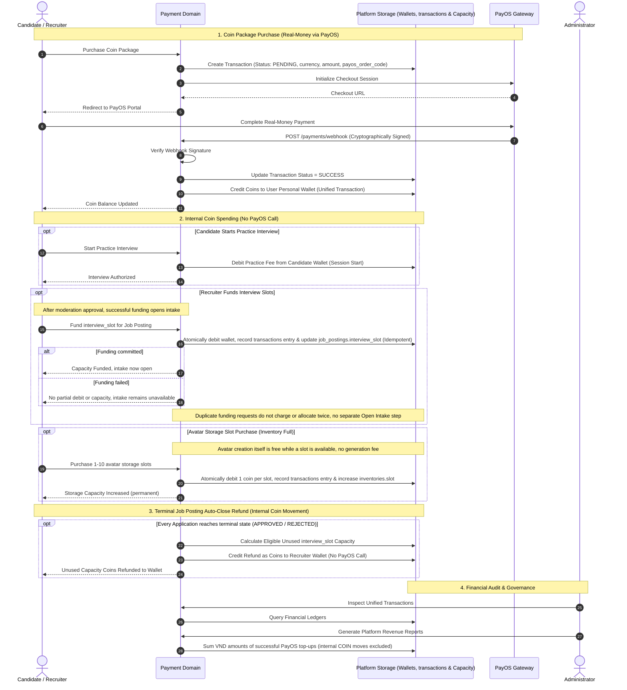

# Payment & Coin Monetization Domain

The **Payment & Coin Monetization Domain** manages real-money coin package purchases, personal coin wallets for Candidates and Recruiters, internal coin spending for interview simulations and avatar operations, and slot refund accounting upon recruitment completion.

---

## 1. Purpose

Provide a transparent, reliable coin-based monetization infrastructure. Candidates and Recruiters purchase coin packages using real money to fund their respective platform activities. Ensures rigorous ledger auditability, clean separation between external real-money transactions and internal coin movements, and deterministic charging and refund boundaries.

---

## 2. Core Concepts

* **Coin (`coins`):**
  The standard internal digital currency of RoleCue. Coins are purchased in packages (`coin_packages`) using real money via PayOS and spent internally on platform capabilities.
* **Personal Wallet (`wallets`):**
  An internal digital coin ledger owned individually by an authenticated **Candidate** or **Recruiter**. Tracks current available balance and append-only transaction history.
  * **Role Restriction Invariant:** Only Candidates and Recruiters hold personal coin wallets. **Administrators do NOT have a wallet.**
* **Coin Packages (`coin_packages`):**
  Defined coin bundles available for purchase using real money via PayOS checkout.
* **Unified Transaction Model (`transactions`):**
  An immutable ledger recording both external real-money package orders and internal coin movements. The platform operates on a single unified transaction model with fields including:
  * `from`
  * `to`
  * `amount`
  * `currency`
  * `description`
  * `status`
  * `payos_order_code`
  * `created_at`
  * **Architectural Invariant:** The team explicitly rejected the proposed payment redesign that separated `payment_orders` and `coin_transactions`. The unified transaction model is the frozen contract, and its semantic and traceability limitations are accepted technical debt for this capstone.
  * **Ledger Semantics:** `currency` is `VND` for real-money PayOS top-ups and `COIN` for internal coin movements. `from` and `to` hold a user identifier or the literal `system` counterparty; `amount` is an integer. `created_at` (`timestamptz`, NOT NULL, database default, indexed) dates each row; it was added in migration 000014 (KAN-191/192/206), and rows written before it carry the migration time (dev data only). A user's wallet history lists rows by `created_at` newest first and shows times in the viewer's local time.
* **Platform Revenue:**
  Revenue is the sum of the `VND` amounts of **successful** PayOS top-ups. Internal coin movements (practice fees, interview slot funding, avatar storage slot purchases, refunds) are not revenue. Date-range reporting filters `created_at` over a `[date_from, date_to)` window; Admin billing screens and the CSV export use Vietnam time (UTC+07:00) (Decision 15).
* **Fixed Prices (Decision 15, settled 2026-10-27):**
  Interview slot **1 coin** per slot; avatar storage slot **1 coin** per slot; practice session **5 coins**. These are fixed system constants for now. There is no separate avatar generation fee (Decision 7, settled 2026-10-27); coin package prices remain unresolved.
* **Interview Capacity Funding (`interview_slot`):**
  After Admin moderation approval, Recruiter uses personal wallet coins to fund `interview_slot` capacity; successful funding is the Recruiter's Open Intake action and opens Application Intake in the same step. Coin debit, unified `transactions` ledger entry, and `job_postings.interview_slot` update must commit atomically and idempotently. Failed operations leave no partial debit/capacity; retries or duplicates cannot double-charge or allocate capacity twice. PayOS is not involved. `interview_slot` limits CV-approved Candidates eligible for interview, not CV submissions; CV approval does not consume a prepaid slot.
  * **Funded Exactly Once:** A Posting is funded exactly once at 1 coin per slot; there are no top-ups. Repeating the funding with the same count charges nothing; a different count is refused.
  * **Persistence Mapping (Settled 2026-10-29):** No schema change: no `approved` Job Posting status or independent `intake_status` column. Admin approval sets `open`, and funding is accepted only while `open`; an `open` Posting with `interview_slot` unset is approved but not yet open (applications refused with `INTAKE_NOT_OPEN`), and setting `interview_slot` opens intake. Implementation alignment in progress (2026-10-29): until it lands, the interim implementation lets Candidates apply before funding; CV approval and recruitment interview start already require funded capacity. The canonical sequence is unchanged (see [[02_System/Domain-Model|Domain Model]] and Decisions 13/16).
* **Avatar Operations Funding:**
  Every Candidate and Recruiter starts with **3 personal avatar storage slots** (Decision 7, ratified 2026-10-20); Admin has no inventory. The frontend reads actual capacity from the authoritative API. Creating an avatar is free while a storage slot is available; there is **no** separate generation fee (Decision 7, settled 2026-10-27). Coins fund one avatar operation:
  1. *Capacity Purchase:* Buys additional avatar storage slots (1–10 per purchase, `POST /inventory/purchase`) at **1 coin** per slot, debited atomically through the shared ledger. When inventory is full, creation is refused (`INVENTORY_FULL`) until the user deletes an avatar or buys a slot; purchased slots are permanent capacity.
* **Terminal Job Posting Slot Refund (`Refund unused JP Candidate Slot`):**
  When a Job Posting automatically reaches terminal closed state (once intake is closed and every application in scope has a terminal result `APPROVED` or `REJECTED`, or there are no applications), all still-unused interview capacity (`interview_slot` minus consumed recruitment sessions) is refunded as internal coins back into the owning Recruiter's personal coin wallet, exactly once per Posting.
  * Refund does **not** happen on Close Intake itself. When Close Intake leaves no application in progress, it proceeds straight to terminal close, and the refund comes from that step.
  * Refund does **not** invoke PayOS (it is an internal coin ledger movement).

---

## 3. Actors Involved

* **Candidate:** Purchases coin packages using real money via PayOS; maintains a personal wallet; spends coins to start practice interview sessions and perform personal avatar operations.
* **Recruiter:** Purchases coin packages using real money via PayOS; maintains a personal wallet; spends coins to fund Job Posting `interview_slot` capacity and perform avatar operations; receives internal coin refunds for eligible unused interview capacity upon terminal Job Posting auto-close.
* **Administrator:** Audits unified payment transactions; generates platform revenue reports.
* **PayOS (Confirmed Payment Provider):** Ingests checkout intents for coin packages and delivers cryptographically signed webhooks confirming real-money transaction status via `payos_order_code`.

---

## 4. Main Domain Flow

---

## 5. Business Rules & Invariants

1. **Separation of External Payments and Internal Coins:**
   Real-money transactions occur exclusively through PayOS to acquire coin packages. Internal spending (practice interview start fees, interview slot funding, avatar storage slot purchases) and internal refunds (unused interview capacity upon terminal Job Posting close) execute purely within the internal coin ledger. Internal coin spending and refunds do **not** invoke PayOS.
2. **Unified Transaction Model Invariant:**
   Transactions are persisted in a single `transactions` table containing fields `from`, `to`, `amount`, `currency`, `description`, `status`, and `payos_order_code`. RoleCue does not use separate `payment_orders` and `coin_transactions` tables. PayOS top-ups use `currency = VND`; internal coin movements use `COIN` with the `system` counterparty.
3. **Wallet Scope & Role Boundaries:**
   Personal coin wallets belong exclusively to **Candidates** and **Recruiters**. Administrators do **NOT** have a wallet. Registered User inheritance does not grant an Admin wallet capabilities.
4. **Practice Interview Start Charging Boundary:**
   A practice interview costs **5 coins**, debited from the Candidate's coin wallet **at session start**, not when it concludes. If a session experiences a network disconnect or is paused, reconnecting to or resuming the same session incurs **no second charge**. Starting again while an unfinished practice session exists for the same Role Profile returns that session free, and a retried start with the same idempotency key returns the session it created.
5. **Recruitment Interview Slot Consumption:**
   Funding occurs after moderation approval and is itself the Recruiter's Open Intake action, exactly once per Posting at 1 coin per slot (no top-ups); wallet debit, unified ledger entry, and capacity update are atomic and idempotent. `interview_slot` limits CV-approved interview-eligible Candidates, not CV submissions; CV approval grants eligibility without consuming a slot. A recruitment interview consumes one prepaid interview slot funded by the Recruiter strictly upon the Candidate's **first successful start**, when the Application's single recruitment session is created. The Candidate is **never charged**. Reconnecting to or resuming that active recruitment session does not consume an additional slot.
6. **No Avatar Generation Fee:**
   There is **no** separate avatar generation fee (Settled 2026-10-27, Decision 7). Avaturn capture, GLB generation, GLB-to-VRM conversion, and VRM persistence cost nothing as long as the user has a free storage slot.
7. **Avatar Inventory Capacity Purchase:**
   Each Candidate and Recruiter starts with **3 storage slots**; Admin has no personal inventory. When the inventory is full, creation is refused (`INVENTORY_FULL`); the user deletes an avatar or buys additional slots at 1 coin per slot (1–10 per purchase, debited atomically through the shared ledger). Effectively, an avatar beyond the free capacity costs 1 coin (the slot it needs). Purchased slots are permanent capacity; deleting an avatar frees its slot. Coin-package prices and exchange rates remain unresolved (Decision 16).
8. **Terminal Job Posting Auto-Close vs. Close Intake Refund Boundary:**
   Only **terminal Job Posting auto-close** (reached once intake is closed and every application has a terminal result `APPROVED` or `REJECTED`, or there are none) triggers **Refund unused JP Candidate Slot**, exactly once per Posting. **Close intake itself does NOT refund interview slots**; when it chains straight into terminal close, the refund comes from the terminal-close step.
9. **No Cash Refund Dispute Queues:**
   RoleCue does not operate external gateway refund queues, cash dispute adjudication forms, or administrative chargeback workflows. Unused slot refunds upon terminal auto-close execute automatically as internal ledger credits.
10. **Webhook Idempotency & Cryptographic Verification:**
    Payment webhooks from PayOS must be cryptographically verified. Handlers must be strictly idempotent; duplicate webhooks for the same order code must never result in duplicate coin credits.
11. **Ledger Immutability:**
    The unified transaction ledger is append-only. Once recorded, entries cannot be modified or deleted.

---

## 6. Relationships to Other Domains

* **[[01_Domains/Interview/README|Interview Domain]]:**
  Verifies Candidate wallet balance and debits coins at practice session start. For recruitment interviews, verifies that the Job Posting has an available funded interview slot and consumes it upon the Candidate's first successful start.
* **[[01_Domains/Job-Posting-Application/README|Job-Posting-Application Domain]]:**
  Debits Recruiter wallet coins to fund `interview_slot` capacity. Upon terminal Job Posting auto-close, calculates eligible unused capacity and credits internal coin refunds to the Recruiter's wallet (`Refund unused JP Candidate Slot`).
* **[[01_Domains/Avatar-Voice/README|Avatar-Voice Domain]]:**
  Debits coins (1 coin per slot) when a Candidate or Recruiter purchases additional avatar storage slots. Avatar creation itself is not charged.
* **[[01_Domains/Auth/README|Auth Domain]]:**
  Associates personal coin wallets and transaction records with authenticated Candidate and Recruiter `user_id`s.
* **[[01_Domains/Administration/README|Administration Domain]]:**
  Administrators audit unified payment transactions and generate revenue reports (revenue = successful `VND` PayOS top-ups).

---

## 7. External Integrations

* **PayOS:** Confirmed third-party electronic payment processor facilitating real-money checkout for coin packages and delivering cryptographically signed webhooks confirming transaction status via `payos_order_code`.
