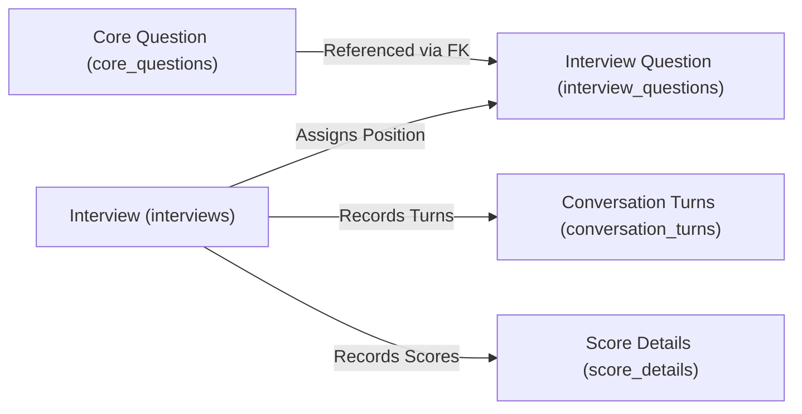

# Data Relationships & Cardinality Invariants

This document specifies the conceptual entity relationships, cardinalities, cascade behaviors, and lifecycle invariants governing data integrity across RoleCue.

---

## 1. Master Relationship Cardinality Matrix

Reconciled with the implemented schema (shared migrations `000001` through `000013`) on **2026-10-27**. The Cascade Policy column shows the implemented foreign-key action: `NO ACTION` (the PostgreSQL default) rejects deleting a referenced parent, with the same effect as `RESTRICT` for these tables. Rows marked *no FK* are logical relationships without a database foreign key.

| Parent Entity | Child Entity | Cardinality | Nullable FK? | Cascade Policy | Business Rationale |
| :--- | :--- | :---: | :---: | :--- | :--- |
| **`User` (`users`)** | `Account` (`accounts`) | `1 : 0..*` | No | `CASCADE` | Better Auth OAuth provider and hashed credential records per user. |
| **`User` (`users`)** | `Session` (`sessions`) | `1 : 0..*` | No | `CASCADE` | Better Auth active session cookie records; a user may hold several concurrent sessions under the single Better Auth session authority. |
| **`User` (`users`)** | `Verification` (`verifications`) | `1 : 0..*` | Yes | `NO ACTION` | Better Auth email verification and recovery tokens; `user_id` is optional. |
| **`User` (`users`)** | `TwoFactor` (`two_factors`) | `1 : 0..*` | No | `CASCADE` | TOTP two-factor secret, encrypted backup codes, and lockout state. |
| **`User` (`users`)** | `Wallet` (`wallets`) | `1 : 0..1` | No | `NO ACTION` | Personal coin wallet for Candidate or Recruiter (`UNIQUE(user_id)`); Admin has no wallet. |
| **`User` / `Wallet`** | `Transaction` (`transactions`) | `1 : 0..*` | — (*no FK*) | — | Unified ledger entries reference the user (or the literal `system` counterparty) as text in `from` / `to`; entries are append-only and never deleted. |
| **`CoinPackage` (`coin_packages`)** | `Transaction` (`transactions`) | `1 : 0..*` | — (*no FK*) | — | Real-money checkout purchases for coin packages via PayOS (`payos_order_code`, `currency = VND`); the package is identified in the order, not by a foreign key. |
| **`User` (`users`)** | `Inventory` (`inventories`) | `1 : 0..1` | No | `NO ACTION` | Candidate or Recruiter personal avatar storage (`UNIQUE(user_id)`, `CHECK slot >= 0`), initially 3 slots; Admin has no inventory (Decision 7). |
| **`Inventory` (`inventories`)** | `Avatar` (`avatars`) | `1 : 0..*` | No | `NO ACTION` | Standardized VRM personal 3D avatars stored in user inventory. |
| **`Level` (`levels`)** | `JobDescription` (`job_descriptions`) | `1 : 0..*` | Yes | `NO ACTION` | Seniority level tier classification (`intern`, `junior`, `mid`, `senior`, `lead`); optional until set. |
| **`JobDescription` (`job_descriptions`)** | `Requirement` (`requirements`) | `1 : 0..*` | No | `NO ACTION` | Extracted requirements classified by `kind`, optional `category`, and optional `type`; confirmed requirements feed question-bank generation. |
| **`JobDescription` (`job_descriptions`)** | `CoreQuestion` (`core_questions`) | `1 : 0..*` | No | `NO ACTION` | Core question bank (conceptual Blueprint) generated from confirmed requirements. |
| **`JobDescription` (`job_descriptions`)** | `RoleProfile` (`role_profiles`) | `1 : 0..1` | No (Unique) | `NO ACTION` | Candidate practice role profile referencing its own target job description (`UNIQUE(jd_id)`). |
| **`User` (`users`)** | `RoleProfile` (`role_profiles`) | `1 : 0..*` | No | `NO ACTION` | Candidate owns zero or more practice role profiles; Recruiters have none. |
| **`JobDescription` (`job_descriptions`)** | `JobPosting` (`job_postings`) | `1 : 0..1` | No (Unique) | `NO ACTION` | Job Posting requirements defined 1:1 by underlying job description (`UNIQUE(jd_id)`). |
| **`User` (`users`)** | `JobPosting` (`job_postings`) | `1 : 0..*` | No | `NO ACTION` | Recruiter authors zero or more company Job Postings. |
| **`JobPosting` (`job_postings`)** | `MetricPercentage` (`metrics_percentage`) | `1 : 0..*` | No | `NO ACTION` | Optional custom weights totaling 100%; absent rows use effective equal-split defaults, not persisted default rows (Decision 13a). |
| **`Metric` (`metrics`)** | `MetricPercentage` (`metrics_percentage`) | `1 : 0..*` | No | `NO ACTION` | Evaluation metric referenced in posting weights (primary key `(job_posting_id, metric_id)`). |
| **`JobPosting` (`job_postings`)** | `Application` (`applications`) | `1 : 0..*` | No | `NO ACTION` | Applications received by an open Job Posting. |
| **`User` (`users`)** | `Application` (`applications`) | `1 : 0..*` | No | `NO ACTION` | Candidate submits zero or more applications. |
| **`RoleProfile` (`role_profiles`)** | `Interview` (`interviews`) | `1 : 0..*` | Yes | `NO ACTION` | Practice interview guided by role profile requirements. `NULL` for recruitment; CHECK `type <> 'practice' OR role_profile_id IS NOT NULL`. |
| **`Application` (`applications`)** | `Interview` (`interviews`) | `1 : 0..1` | Yes (Unique) | `NO ACTION` | Recruitment interview references candidate application (`UNIQUE(application_id)`), and through it exactly one Job Posting; its owner is `applications.candidate_id`. Practice interviews have `application_id IS NULL`. |
| **`Interview` (`interviews`)** | `InterviewQuestion` (`interview_questions`) | `1 : 0..*` | No | `NO ACTION` | Session question assignment mapping turn position to source core question (primary key `(interview_id, position)`). |
| **`CoreQuestion` (`core_questions`)** | `InterviewQuestion` (`interview_questions`) | `1 : 0..*` | No | `NO ACTION` | Core question referenced in interview sessions. |
| **`Interview` (`interviews`)** | `ConversationTurn` (`conversation_turns`) | `1 : 0..*` | No | `NO ACTION` | Sequential conversational dialogue turns in an interview session. |
| **`Interview` (`interviews`)** | `ScoreDetail` (`score_details`) | `1 : 0..*` | No | `NO ACTION` | Evaluation score breakdown per metric (`UNIQUE(interview_id, metric_id)`). |
| **`Metric` (`metrics`)** | `ScoreDetail` (`score_details`) | `1 : 0..*` | No | `NO ACTION` | Platform evaluation metric evaluated in interview score details. |
| **`Avatar` (`avatars`)** | `Interview` (`interviews`) | `1 : 0..*` | Yes | `NO ACTION` | Avatar persona presented during interview session. |
| **`Voice` (`voices`)** | `Interview` (`interviews`) | `1 : 0..*` | Yes | `NO ACTION` | Voice persona speaking during interview session. |
| **`Avatar` (`avatars`)** | `JobPosting` (`job_postings`) | `1 : 0..*` | Yes | `NO ACTION` | Required company 3D avatar locked by Recruiter for Job Posting interview; nullable while the Posting is prepared, required before submission. |
| **`Voice` (`voices`)** | `JobPosting` (`job_postings`) | `1 : 0..*` | Yes | `NO ACTION` | Required company Voice Profile locked by Recruiter for Job Posting interview; nullable while the Posting is prepared, required before submission. |

---

## 2. Core Integrity Invariants

### 2.1. Historical Session Reproducibility via Relational Question Mapping

* **Invariant:** Every `Interview` maps its session turn positions to persistent `core_questions` via `interview_questions (interview_id, position, core_question_id)`.
* **Integrity Guarantee:** Even if the source Job Description or Job Posting is updated, foreign key constraints (which reject deleting a referenced parent) preserve historical question associations without an unnormalized `blueprint_snapshot` column. A foreign key alone does not prevent editing referenced content; reproducible grading additionally requires the content/barem immutability rules in Decision 24. Privacy erasure remains an explicit controlled exception.

### 2.2. Question Bank Preservation via `ON DELETE RESTRICT`
* **Invariant:** The foreign key constraint between `interview_questions` and `core_questions` rejects deleting a referenced core question (`NO ACTION`, equivalent to `RESTRICT` here).
* **Integrity Guarantee:** Deleting or replacing question banks must be rejected if completed interview sessions reference them. Historical practice and recruitment records must never be orphaned.

### 2.3. Consolidated Evaluation Storage & Score Detail Invariant
* **Invariant:** Evaluation scores are persisted directly on `interviews.score`, `interviews.feedback`, and `score_details (interview_id, metric_id, score)` with a strict `UNIQUE(interview_id, metric_id)` constraint. Turn-level critiques are stored in `conversation_turns.feedback`.
* **Integrity Guarantee:** A completed interview session produces an authoritative score breakdown across platform metrics. There is no separate `performance_reports` table; reporting is queried directly from relational interview and score detail tables.

### 2.4. Independent Relational Data Scoping (No Multi-Tenancy)
* **Invariant:** RoleCue does not use multi-tenant schemas or Row-Level Security tenant isolation policies.
* **Integrity Guarantee:**
  * Recruiter data is partitioned relationally by `recruiter_id`.
  * Candidate data is partitioned relationally by `candidate_id` / `user_id`.
  * Recruiter and Candidate coin wallets are partitioned strictly by `user_id`.

### 2.5. Job Posting Application & CV-First Workflow Integrity
* **Invariant (Intake Open):** Moderation approval → successful Recruiter wallet-coin funding (which is the Recruiter's Open Intake action) are required before Candidate discovery or applications. Mapping (settled 2026-10-29, no schema change): approval sets `open`; `status = 'open' AND interview_slot IS NULL` is approved but not yet open (off the job board, public detail unreachable, applications refused with `INTAKE_NOT_OPEN`); intake is open exactly when `status = 'open' AND interview_slot IS NOT NULL`. The enum keeps only `pending`, `open`, `intake_closed`, `closed`, and `rejected`, with no `approved` value or independent `intake_status` column (Decisions 13/16; [[02_System/Domain-Model|Domain Model]]). Implementation alignment in progress (2026-10-29): until it lands, the interim implementation lets Candidates apply before funding, while CV approval and interview start already require funded capacity. Decision 13b's Recruiter account-lock visibility restrictions also apply. Once intake is validly open, CV submissions are unlimited and immediately visible in `View Application Detail`; `interview_slot` does not limit submissions.
* **CV Screening & Deadline:** Recruiter approves at most `interview_slot` Candidates (`interview_eligible`). CV approval grants eligibility without consuming a prepaid slot. Approval calculates and persists `interview_deadline = approval_time + 24 hours` (`approval_time` is conceptual/event-time only; only `applications.interview_deadline` is persisted).
* **Deadline Enforcement:** A Candidate must complete the recruitment interview before `interview_deadline`. Merely starting the interview before the deadline is insufficient. After the deadline, answers and completion are refused; if an approved Candidate does not complete their interview before `interview_deadline`, the System Handler marks the application as terminal `rejected`.
* **Slot Consumption:** Slot capacity is consumed upon the Candidate's first successful interview start, when the Application's single recruitment session row is created (`UNIQUE(application_id)`); consumed capacity is the count of those sessions. Reconnects and resumes do not consume additional capacity. Candidates are never charged.
* **Hard-Gated Final Decisions:** Recruiter final decisions (`approved` or `rejected`) are **HARD-GATED until MAX(interview_deadline)** across all interview-eligible applications for that posting, consolidated in `View Application Detail`.
* **Close Intake:** `intake_closed` stops new submissions and rejects unscreened/unapproved applications while preserving eligible Candidates' deadline windows. Close Intake itself does not refund capacity; it evaluates terminal close in the same transaction, so a Posting with no application still in progress (including zero applications) closes at once. Repeating Close Intake on an `intake_closed` or `closed` Posting succeeds without change.
* **Terminal Job Posting Close & Slot Refund:** Terminal close is reached automatically from `intake_closed` when EVERY application in scope has a terminal result (`approved` or `rejected`), or there are none, transitioning posting status to `closed`. The System Handler executes `Refund unused JP Candidate Slot`, refunding `interview_slot` minus consumed recruitment sessions to the Recruiter's wallet as internal coins, exactly once on that transition, so nothing is double-credited or debited again. There is no manual End Recruitment flow and no Reopen Intake flow.

### 2.6. ACID Transactional Integrity for Unified Financial Transactions
* **Invariant:** All updates to the unified `transactions` ledger (`from`, `to`, `amount`, `currency`, `description`, `status`, `payos_order_code`) and associated wallet balance updates must execute within explicit database transactions (`BEGIN ... COMMIT`).
* **Funding Atomicity & Idempotency:** After moderation approval, as the step that opens intake, wallet coin debit, unified ledger entry, and `job_postings.interview_slot` update must commit as one atomic, idempotent operation. Funding happens exactly once per Posting at 1 coin per slot (no top-ups). Failures leave no partial debit or capacity; retries and duplicates cannot double-charge or allocate capacity twice. Funding does not invoke PayOS, which is exclusively for real-money coin-package top-ups.
* **Ledger Semantics & Revenue:** PayOS top-ups use `currency = VND`; internal coin movements use `COIN` with the literal `system` counterparty in `from`/`to`. Revenue is the sum of `VND` amounts of successful top-ups only. `transactions.created_at`, added in migration 000014 (KAN-191/192/206), dates each row; date-range reporting filters it over a `[date_from, date_to)` window (Decision 15).
* **Integrity Guarantee:** Prevents race conditions during PayOS webhook verification and ensures that internal coin movements (practice interview starts, slot funding, avatar storage slot purchases, and terminal auto-close unused slot refunds) maintain strict ledger balance consistency.
* **Accepted Technical Debt:** The team formally rejected the split `payment_orders` / `coin_transactions` redesign; the single unified `transactions` table is authoritative for this capstone.

### 2.7. Personal Avatar Capacity & Charging
* **Ratified Initial Allocation (2026-10-20):** Every Candidate and Recruiter starts with **3 personal avatar storage slots**; Admin has no inventory. This is a business allocation rule, not an asserted SQL default.
* **Capacity Authority:** Users may purchase additional capacity with wallet coins. The frontend reads actual `inventories.slot` capacity through the authoritative API because it can increase.
* **No Generation Fee (Settled 2026-10-27):** Avatar creation only checks capacity (`INVENTORY_FULL` when no slot is free) and debits no coins. The only avatar charge is a capacity purchase (`POST /inventory/purchase`, 1–10 slots at 1 coin per slot), whose wallet debit, `transactions` entry, and `inventories.slot` increase commit atomically through the shared ledger (Decision 7).

---

## 3. Rubric Relationships — Decision 24 (Configuration Applied 2026-11-11; Results Proposed)

These rows describe agreed configuration relationships and proposed result storage; the configuration tables and the two core_questions columns are applied by migration 000032, while the result table remains proposed. See [[01_Domains/Evaluation/Scoring-Rubrics-Spec|the detailed spec]].

| Parent | Child | Cardinality / constraint | Delete/edit rule |
|---|---|---|---|
| User | Rubric | Private scope has one owner; system scope has no recruiter owner | Owner-scoped operations; account erasure resolves references explicitly |
| Rubric | RubricCriterion | One rubric contains multiple crits | Used definitions immutable; do not delete referenced crits |
| Metric | RubricCriterion | Exactly one metric per crit | No arbitrary metric creation from AI/recruiter input |
| Rubric | CoreQuestion | One selected rubric per ready question; many questions share a rubric | Missing while drafting only; RESTRICT referenced hard deletion; archive stops new assignment |
| InterviewQuestion | InterviewCriterionScore (proposed) | Composite interview/assigned-core-position FK | Delete result evidence before removing interview during erasure |
| RubricCriterion | InterviewCriterionScore (proposed) | One result per interview/core/criterion | Criterion points belong to a particular answer/session, not the reusable question |

The two new configuration tables are rubrics/rubric_criteria; core_questions adds rubric_id and expected_answer TEXT. A separate results table is proposed because a single question total cannot reconstruct crit or metric points. Score detail remains one session metric row; interviews.score remains the weighted overall. No extra point budget is awarded for expected_answer. Follow-ups belong to their core question.

Without snapshots, rubric definitions are locked as soon as any question references them, and question content/expected_answer/bindings are locked once the posting is approved or a session started (Decision 24, 2026-11-11). Archive retains old references; making a new template is the way to change used definitions for new drafts. No ordinary delete/update may masquerade as privacy erasure. Retention must cover criterion evidence and explanations, including private answer fragments copied outside conversation_turns.

## 4. Planned Roadmap Relationships — Decision 25 (Not Yet Implemented)

| Parent | Child/reference | Cardinality / constraint | Meaning |
|---|---|---|---|
| role_profiles | roadmaps |1:1, UNIQUE(role_profile_id) | Create row together; owner through candidate_id |
| roadmaps | roadmap_items |1:N, zero while pending/failed | Ordered knowledge topics; no archived_at |
| roadmap_items | core_questions.roadmap_item_id |1:N, nullable for non-Roadmap questions | One primary topic per practice question |
| roadmap_items | interviews.focus_item_id |1:N optional | NULL=general, topic ID=focused practice; recruitment NULL |
| interview_questions | roadmap_assessments |1:0..1 | UNIQUE(interview_id,question_position), composite assignment FK |
| roadmap_items | roadmap_assessments |1:N | Evidence links, no duplicate score/transcript |

FKs alone do not establish same owner/profile; validate transactionally. Topic/bank regeneration is permitted only before any practice session, under the same profile guard as start. Do not delete/relabel used topics; account/profile erasure remains a coordinated deletion flow. Points/status/progress are derived from valid practice results; event time controls the latest-five distinct-question window. See [[01_Domains/Learning-Roadmap/Learning-Roadmaps-Spec|field-level schema and worked examples]].

## 5. Planned Marketplace Relationships — Decision 26 (Not Yet Implemented)

| Parent | Child | Target constraint / meaning |
|---|---|---|
| users | avatar_assets.created_by | Creator reference, nullable/anonymizable under erasure policy; not every buyer |
| avatar_assets | avatars.asset_id |1:N shared file, each avatar retains own inventory_id; move model_path into asset |
| avatar_assets | avatar_listings.asset_id | Target one listing per asset; seller/asset identity fixed |
| users | avatar_listings.seller_id | Seller reference; ordinary listing lifecycle uses statuses, privacy deletion handled separately |
| transactions | Marketplace product | **No FK/columns added**; purchase information only in description |

No avatar_purchases/entitlement table, avatars.purchase_transaction_id, preview_path/source on assets, or transaction purpose/access_status/avatar_listing_id. Wallet movement+ledger+inventory grant must commit together, using existing idempotency_key to prevent repeated charges. Ownership for use comes from inventory, not description parsing. A deleted copy has no free restore entitlement; shared file cleanup must preserve all remaining avatar/listing references. See [[01_Domains/Avatar-Marketplace/Avatar-Marketplace-Spec|the approved limits and engineering contract]].

## 6. Interview Behavior Guideline Relationships — Decision 27

| From | To | Cardinality | Integrity |
|---|---|---|---|
| Admin (User) | InterviewBehaviorGuideline | One Admin saves many versions | `updated_by` is a plain column, no FK: the audit row outlives the account |
| InterviewBehaviorGuideline | Interview | One version can be the snapshot of many interviews | `interviews.behavior_guideline_id` is set at session start; NULL means defaults; versions are append-only so a referenced row is never changed |
