# Conceptual Domain Model

This document maps the primary business entities of the RoleCue platform and illustrates their conceptual relationships, multiplicities, and boundaries.

> [!NOTE]
> The frozen RoleCue Use Case Diagram and the RoleCue ERD (named `RoleCue`) are authoritative.
> **ERD reconciliation (2026-10-27):** The ERD below was reconciled with the implemented schema (shared migrations `000001` through `000013`). It adds the additive columns and constraints introduced after the original frozen ERD (onboarding status, inventory constraints, Role Profile workflow and requirement classification, the metrics seed, interview session state, and question-bank review submission) and corrects attribute types and cardinalities to match the implementation.
> Conceptual models and entity names in this document illustrate domain relationships and business invariants conforming strictly to that contract. RoleCue does not redesign payment models, propose V2/vNext schemas, or invent missing business rules.

---

## 1. Conceptual Entity-Relationship Model

```mermaid
classDiagram
    class User {
        +UUID id
        +String name
        +String email
        +Boolean email_verified
        +String image
        +String username
        +String display_username
        +String role
        +Boolean is_locked
        +String lock_reason
        +Timestamp lock_expires_at
        +Boolean two_factor_enabled
        +String company_name
        +String company_website
        +OnboardingStatus onboarding_status
        +Timestamp created_at
        +Timestamp updated_at
    }

    class Account {
        +UUID id
        +UUID user_id
        +String account_id
        +String provider_id
        +String password
        +String access_token
        +String refresh_token
        +String id_token
        +String scope
    }

    class Session {
        +UUID id
        +UUID user_id
        +String token
        +Timestamp expires_at
        +String ip_address
        +String user_agent
        +String impersonated_by
    }

    class Verification {
        +UUID id
        +String identifier
        +String value
        +Timestamp expires_at
        +UUID user_id
    }

    class TwoFactor {
        +UUID id
        +UUID user_id
        +String secret
        +String backup_codes
        +Boolean verified
        +Integer failed_verification_count
        +Timestamp locked_until
    }

    class Wallet {
        +UUID id
        +UUID user_id
        +Integer balance
    }

    class CoinPackage {
        +UUID id
        +String name
        +Integer price
        +Integer amount
        +String currency
        +String description
    }

    class Transaction {
        +UUID id
        +String from
        +String to
        +Integer amount
        +String currency
        +String description
        +TransactionStatus status
        +String payos_order_code
    }

    class Level {
        +UUID id
        +String name
        +String description
    }

    class JobDescription {
        +UUID id
        +String raw_text
        +String refinement_note
        +String content_path
        +UUID level_id
    }

    class Requirement {
        +UUID id
        +UUID jd_id
        +String name
        +String target
        +RequirementType type
        +String kind
        +String category
        +String evidence_text
    }

    class RoleProfile {
        +UUID id
        +UUID jd_id
        +UUID candidate_id
        +String title
        +String status
        +Timestamp created_at
    }

    class CoreQuestion {
        +UUID id
        +UUID jd_id
        +String content
    }

    class Inventory {
        +UUID id
        +UUID user_id
        +Integer slot
    }

    class Avatar {
        +UUID id
        +UUID inventory_id
        +String name
        +String model_path
        +String personality
        +Timestamp created_at
        +Timestamp updated_at
    }

    class Voice {
        +UUID id
        +String name
        +Boolean is_active
    }

    class Metric {
        +UUID id
        +String name
    }

    class MetricPercentage {
        +UUID job_posting_id
        +UUID metric_id
        +Float percentage
    }

    class JobPosting {
        +UUID id
        +UUID jd_id
        +UUID recruiter_id
        +String title
        +JobPostingStatus status
        +Boolean review_submitted
        +String reject_reason
        +Integer interview_slot
        +UUID required_avatar_id
        +UUID required_voice_id
        +String location
        +String employment_type
        +Integer salary_min
        +Integer salary_max
        +Integer interview_duration
        +Timestamp created_at
    }

    class Application {
        +UUID id
        +UUID job_posting_id
        +UUID candidate_id
        +String cv_path
        +Timestamp interview_deadline
        +ApplicationStatus status
        +String reject_reason
        +Timestamp created_at
        +Timestamp updated_at
    }

    class Interview {
        +UUID id
        +InterviewType type
        +UUID role_profile_id
        +UUID application_id
        +UUID avatar_id
        +UUID voice_id
        +Integer score
        +String feedback
        +String record_path
        +String record_status
        +Timestamp started_at
        +Timestamp completed_at
        +String evaluation_status
        +Timestamp evaluation_claimed_at
        +String start_key
    }

    class InterviewQuestion {
        +UUID interview_id
        +Integer position
        +UUID core_question_id
    }

    class ConversationTurn {
        +UUID id
        +UUID interview_id
        +Integer position
        +String question
        +String answer
        +String feedback
    }

    class ScoreDetail {
        +UUID id
        +UUID interview_id
        +UUID metric_id
        +Integer score
    }

    %% Relationships
    User "1" -- "0..*" Account : credentials
    User "1" -- "0..*" Session : sessions (several concurrent)
    User "1" -- "0..*" Verification : verifications
    User "1" -- "0..*" TwoFactor : two-factor
    User "1" -- "0..1" Wallet : owns (Candidate or Recruiter)
    User "1" -- "0..1" Inventory : owns (Candidate or Recruiter)
    Inventory "1" -- "0..*" Avatar : contains
    User "1" -- "0..*" Transaction : logs (from/to by user id or system, no FK)
    CoinPackage "1" -- "0..*" Transaction : purchased via PayOS (no FK)

    Level "0..1" -- "0..*" JobDescription : categorizes
    JobDescription "1" -- "0..*" Requirement : extracted
    JobDescription "1" -- "0..*" CoreQuestion : generates
    JobDescription "1" -- "0..1" JobPosting : defines requirements
    JobDescription "1" -- "0..1" RoleProfile : targets
    User "1" -- "0..*" RoleProfile : owns (Candidate)
    User "1" -- "0..*" JobPosting : authors (Recruiter)

    JobPosting "1" -- "0..*" MetricPercentage : weights
    Metric "1" -- "0..*" MetricPercentage : weighted in
    JobPosting "0..*" -- "0..1" Avatar : required avatar
    JobPosting "0..*" -- "0..1" Voice : required voice
    JobPosting "1" -- "0..*" Application : receives
    User "1" -- "0..*" Application : submits (Candidate)

    RoleProfile "0..1" -- "0..*" Interview : guides (practice only)
    Application "1" <-- "0..1" Interview : fulfills recruitment interview (via application_id)
    Interview "1" -- "0..*" InterviewQuestion : instantiates
    CoreQuestion "1" -- "0..*" InterviewQuestion : referenced by
    Interview "1" -- "0..*" ConversationTurn : records
    Interview "1" -- "0..*" ScoreDetail : evaluates
    Metric "1" -- "0..*" ScoreDetail : metric score
    Avatar "0..1" -- "0..*" Interview : presents
    Voice "0..1" -- "0..*" Interview : speaks
```

---

## 2. Entity Descriptions & Invariants

### 2.1. Identity, Wallets & Financials
* **`User` (`users`):** Root authentication and identity record managed via Better Auth runtime. Stores basic profile (`name`, `email`, `email_verified`, `image`), role (`candidate`, `recruiter`, `admin`, text with a CHECK constraint), lock state (`is_locked`, `lock_reason`, `lock_expires_at`), 2FA configuration (`two_factor_enabled`), onboarding status (`onboarding_status`: `pending`, `role_selected`, `completed`), company information (`company_name`, `company_website`), and timestamps directly on the user record. `username`/`display_username` are reserved nullable columns with no login behavior. There are no separate candidate or recruiter profile tables.
* **`Verification` (`verifications`) & `TwoFactor` (`two_factors`):** Better Auth email verification tokens and TOTP two-factor records (secret, encrypted backup codes, verification state, lockout).
* **`Account` (`accounts`) & `Session` (`sessions`):** Better Auth credential tables. `accounts` stores third-party OAuth provider links and hashed local passwords. `sessions` stores active Better Auth session cookie records; a user may hold several concurrent sessions. RoleCue uses session cookies with `/api/auth/get-session` runtime validation; there is no custom JWT/refresh-token rotation layer.
* **`Wallet` (`wallets`):** Personal coin ledger owned individually by an authenticated **Candidate** or **Recruiter** (`user_id UNIQUE`). Holds an integer `balance`. Administrators do **NOT** have a wallet.
* **`CoinPackage` (`coin_packages`):** Fixed coin purchasing tiers available for purchase via PayOS (`name`, integer `price`, integer coin `amount`, `currency`, `description`).
* **`Transaction` (`transactions`):** The unified financial ledger table. Records both real-money PayOS checkout orders (via `payos_order_code`, `currency = VND`) and internal coin balance transfers/refunds (`currency = COIN`) using `from`, `to`, integer `amount`, `currency`, `description`, and `status` (`pending`, `success`, `failed`, `cancelled`). `from` and `to` are text holding a user identifier or the literal `system` counterparty; there are no foreign keys to wallets or coin packages, and no `created_at` column yet (date-range reporting is open; Decision 16).
  * *Accepted Technical Debt Note:* The team explicitly rejected the proposed payment architecture redesign (`payment_orders` + `coin_transactions`). The single unified `transactions` table is the authoritative model for this capstone.

### 2.2. Practice & Simulation Pipeline
* **`Level` (`levels`):** Seniority classification tier (`intern`, `junior`, `mid`, `senior`, `lead`) with a `description`.
* **`JobDescription` (`job_descriptions`):** Persistent job description record storing `raw_text` (pasted text), natural-language `refinement_note`, optional `content_path` (for PDF documents), and optional `level_id REFERENCES levels(id)`. Serves as the requirements foundation for both candidate practice role profiles and recruiter job postings.
* **`Requirement` (`requirements`):** One extracted requirement of a JD (`jd_id`, `name`, `target`, `evidence_text`). Classified by `kind` (`skill`, `technology`, `domain_knowledge`), optional `category` (`programming_language`, `framework`, `database`, `tool`, `technology`, `other`), and optional `type` (`required`, `preferred`). Confirmed requirements are the input to question-bank generation.
* **`RoleProfile` (`role_profiles`):** Candidate practice profile instance linking a candidate (`candidate_id REFERENCES users(id)`) to exactly one target job description (`jd_id UNIQUE REFERENCES job_descriptions(id)`), with a `title` and workflow `status` (`draft`, `analyzing`, `review`, `confirmed`). A Role Profile exists only for Candidate self-practice; Recruiters have no Role Profile.
* **`CoreQuestion` (`core_questions`):** The persistent question bank. "Interview Blueprint" is a conceptual product term only; there is no Blueprint database table. Stores core questions linked to `job_descriptions.id` (`jd_id REFERENCES job_descriptions(id)`).
* **`Interview` (`interviews`):** Concrete interview execution (practice or recruitment). Captures `type` (`practice` or `recruitment`), nullable `role_profile_id REFERENCES role_profiles(id)`, `record_path`, integer `score`, `feedback`, `avatar_id REFERENCES avatars(id)`, and `voice_id REFERENCES voices(id)`.
  * *Role Profile Link:* `role_profile_id` is set for practice and `NULL` for recruitment, enforced by CHECK `type <> 'practice' OR role_profile_id IS NOT NULL`. A recruitment interview belongs to exactly one Job Posting through its Application; its owner is `applications.candidate_id`, and it is presented under the Posting's title rather than a Role Profile name.
  * *Session State:* `started_at`, `completed_at` (null while unfinished), `evaluation_status` (`pending`, `completed`, `failed`) with `evaluation_claimed_at` for the run that owns the evaluation, `record_status` (`none`, `uploading`, `processing`, `ready`, `failed`) for recruitment recordings, and an optional unique `start_key` (practice start idempotency key).
  * *Recruitment Application Link:* For recruitment interviews, `application_id uuid UNIQUE REFERENCES applications(id)` links the interview to the candidate's application. Enforced via database CHECK constraint: practice $\rightarrow$ `application_id IS NULL`; recruitment $\rightarrow$ `application_id IS NOT NULL`.
  * *Recruitment Slot Invariant:* For recruitment interviews, slot capacity is consumed upon the Candidate's **first successful interview start**, when the Application's single recruitment session is created (`UNIQUE(application_id)`). Reconnects or resumes do not consume additional capacity. Candidates are never charged.
  * *Practice Start Invariant:* A practice start debits 5 coins. Starting again while an unfinished practice session (`completed_at IS NULL`) exists for the same Role Profile returns that session free; a retried start with the same idempotency key (`start_key`) returns the session it created.
* **`InterviewQuestion` (`interview_questions`):** Relational question assignment table mapping each session turn position (`(interview_id, position)`) to its source `core_question_id REFERENCES core_questions(id)`. Replaces unnormalized `blueprint_snapshot` column while ensuring historical interview reproducibility.
* **`ConversationTurn` (`conversation_turns`):** Granular dialogue unit within an interview session. Captures `interview_id`, `position`, `question`, `answer`, and turn-level `feedback`.
* **`ScoreDetail` (`score_details`):** Integer score per metric for one interview (`UNIQUE(interview_id, metric_id)`).
* **Evaluation & Scoring:** RoleCue persists evaluation outcomes directly in `interviews.score`, `interviews.feedback`, `score_details (interview_id, metric_id, score)`, and `conversation_turns.feedback`. There is no separate `performance_reports` table.

### 2.3. Recruitment Board
* **`JobPosting` (`job_postings`):** The company's Job Description authored by a Recruiter. References `jd_id UNIQUE REFERENCES job_descriptions(id)`, `recruiter_id REFERENCES users(id)`, `required_avatar_id REFERENCES avatars(id)`, `required_voice_id REFERENCES voices(id)` (nullable in the schema while the Posting is prepared; required by the business rule before submission), `title`, and `status` (`pending`, `open`, `intake_closed`, `closed`, `rejected`). Also stores `review_submitted` (whether a `pending` Posting is in the Admin queue), Admin `reject_reason`, descriptive `location`, `employment_type`, `salary_min`/`salary_max`, `interview_duration`, and `created_at`.
  * **`interview_slot` Field:** Singular integer field representing maximum recruitment interview capacity (maximum number of Candidates that may be approved to proceed into the interview stage). It does **NOT** limit total CV submissions and does **NOT** represent company hiring headcount or final hires. RoleCue does NOT persist or enforce company hiring headcount.
  * **Evaluation Weights (`metrics` & `metrics_percentage`):** Separate from the core-question bank. `metrics` holds `id` and a case-insensitively unique `name` (seeded with the five baseline metrics); `metrics_percentage` is keyed by `(job_posting_id, metric_id)` with a floating-point `percentage`. Recruiters may save a subset of metrics with percentages totaling 100% via `metrics_percentage (job_posting_id, metric_id, percentage)`. Without custom rows, compute effective equal-split defaults on read (currently five active metrics at 20% each); do not persist default rows. `configured=false` and `using_defaults=true` are valid, and Admin approval must not require customization. Editing is allowed in `pending`/`rejected`, locked in `open`/`intake_closed`/`closed`, subject to the finalized technical state mapping (Decision 13a).
  * **Intake Lifecycle:**
    * **Preparation & Submit for Review:** A new Posting is `pending` with `review_submitted = false`. The Recruiter generates the core-question bank once, edits it while `pending` or `rejected`, and explicitly submits the Posting for review (`review_submitted = true`), which requires a non-empty bank. Only submitted Postings are in the Admin queue; deleting the last question withdraws the submission. A `rejected` Posting is corrected and resubmitted.
    * **Ratified Publication Gate (2026-10-20):** Recruiter prepares and submits the Posting for moderation; Admin approves; Recruiter funds `interview_slot` with wallet coins; only after successful funding does Recruiter open Application Intake. Coin debit, unified `transactions` ledger entry, and `job_postings.interview_slot` update must be atomic and idempotent, with no partial effects or duplicate charges/capacity and no PayOS call. Funding happens exactly once per Posting at 1 coin per slot; there are no top-ups (same-count repeats charge nothing, a different count is refused).
    * **Intake Open:** Public discovery and applications require moderation approval, successful funding, and the Recruiter's subsequent Open Intake action. `status = 'open'` is the existing intake-open status; the interim implementation setting it at approval is a known gap (below). Decision 13b's account-lock visibility restrictions also apply. Candidates may submit an unlimited number of Applications/CVs, immediately visible to the Recruiter in **View Application Detail**.
    * **Schema & Unresolved Mapping:** The enum contains only `pending`, `open`, `intake_closed`, `closed`, and `rejected`. There is no persisted `approved` Job Posting state or independent `intake_status` column. Moderation approval is conceptual; the persistence mapping for Approval → Funding → Open Intake is an unresolved implementation/design gap. No column, enum value, transition, or storage mechanism is added or assumed here; resolution requires evidence or product-owner approval (Decisions 13/16).
    * **Known Implementation Gap (Interim Behavior, 2026-10-27):** The current implementation sets `open` directly at Admin approval, so Candidates may discover the Posting and apply before it is funded. CV approval and recruitment interview start still require funded capacity (refused while `interview_slot` is unset), and funding is accepted only while `open`. This interim behavior is a known gap against the canonical sequence, not authorization to bypass funding or a change to the product contract.
    * **Close Intake:** Manual Recruiter action (`Close Job Posting Intake`) or automated System Handler action (`Close Job Posting When Meet Configured Limitation` when approved count reaches `interview_slot`). Transitions posting to `intake_closed` and automatically sets all unscreened/unapproved applications (`pending`) to terminal `rejected`. Already-approved candidates retain interview eligibility within their 24-hour deadline. Closing intake itself refunds nothing; it then evaluates terminal close in the same transaction, so a Posting with no Application still in progress (including one with zero Applications) closes at once and the refund comes from that terminal-close step. Closing an `intake_closed` or `closed` Posting again succeeds without change. There is **NO Reopen Intake** flow.
    * **Terminal Job Posting Close:** Automatically reached from `intake_closed` when no application is still `pending`, `interview_eligible`, or `interviewed` (every application in scope is `approved` or `rejected`, or there are none). Transitions posting to `closed`. Automatically triggers `Refund unused JP Candidate Slot`, crediting `interview_slot` minus consumed recruitment sessions (1 coin per slot) to the Recruiter's wallet as internal coins, exactly once on that transition; an unfunded Posting refunds nothing. There is **NO manual End Recruitment** command.
* **`Application` (`applications`):** The Candidate's application to a `JobPosting`.
  * **Fields:** `job_posting_id`, `candidate_id`, `cv_path`, `interview_deadline`, `status` (`pending`, `interview_eligible`, `interviewed`, `approved`, `rejected`), `reject_reason`, `created_at`, `updated_at`. Note that `applications` exists before the interview occurs and does **NOT** hold an `interview_id`; recruitment interviews link back to applications via `interviews.application_id`.
  * **Intake Submission:** Candidates submit CV/resume while intake is `open`; unlimited submissions permitted.
  * **CV Screening:** Recruiter reviews CV in **View Application Detail** and approves at most `interview_slot` Candidates (`interview_eligible`). CV approval grants eligibility without consuming a prepaid slot. Approval calculates and persists `interview_deadline = approval_time + 24 hours` (`approval_time` is conceptual/event-time only; only `applications.interview_deadline` is persisted).
  * **Interview Deadline Enforcement:** A Candidate must complete the recruitment interview before `interview_deadline`. Merely starting the interview before the deadline is insufficient. Once the deadline passes, further answers and completion are refused. If a Candidate fails to complete their interview before `interview_deadline`, the System Handler automatically marks the application as terminal `rejected`.
  * **Hard-Gated Final Decisions:** Recruiter final Approve/Reject decisions are **HARD-GATED until MAX(interview_deadline)** across all interview-eligible applications for that posting, evaluated on the database clock; only an `interviewed` application can receive one. After the gate, the Recruiter renders final **Approve / Reject Application** decisions (`approved` or `rejected`) consolidated directly inside **View Application Detail**.

### 2.4. Audio-Visual Presentation & Avatar Inventory
* **`Inventory` (`inventories`):** Personal avatar inventory record owned by a **Candidate or Recruiter** (`user_id UNIQUE REFERENCES users(id)`), tracking allocated storage capacity `slot` (CHECK `slot >= 0`). Ratified on **2026-10-20**: every Candidate and Recruiter starts with **3 storage slots**; Admin has no personal inventory. This is a product allocation requirement, not a claim about a database default. Each saved avatar occupies one slot; avatar creation only checks capacity (refused with `INVENTORY_FULL` when full) and is not charged, as there is no separate generation fee (settled 2026-10-27, Decision 7). Users can purchase additional capacity using wallet coins at 1 coin per slot (1–10 per purchase, debited atomically through the shared ledger); purchased slots are permanent and deleting an avatar frees its slot. The frontend reads actual capacity from the authoritative API.
* **`Avatar` (`avatars`):** Humanoid 3D avatar stored as a standardized VRM asset (`inventory_id REFERENCES inventories(id)`, `name`, `model_path`, `personality`). RoleCue converts Avaturn's final GLB to VRM, persists the asset, and associates it with the owning user in their personal inventory.
* **`Voice` (`voices`):** Voice configuration sourced from external TTS providers (`name`, `is_active`). Curated and managed by Administrators.
