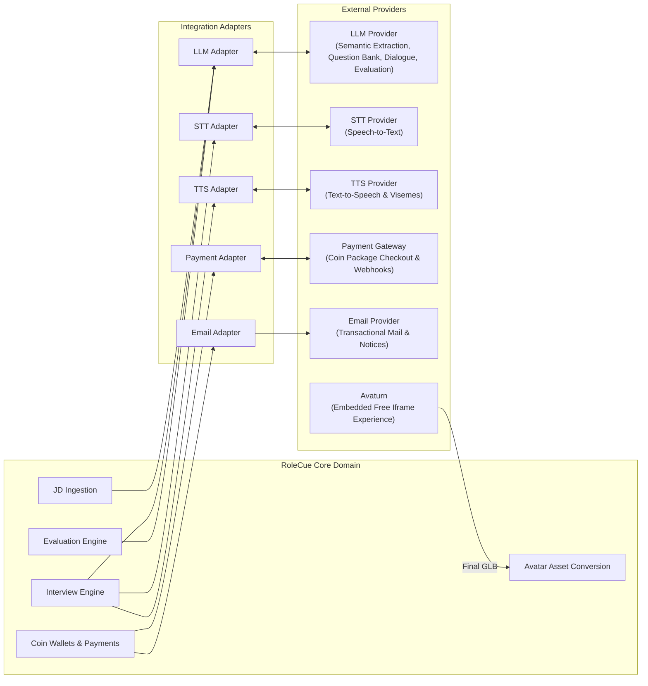

# External Service Integrations

This document specifies the integration architecture, operational requirements, and fault-tolerance policies for external third-party service providers connected to RoleCue.

---

## 1. Architectural Integration Principles

1. **Vendor Agnosticism:**
   Core domain entities and business workflows must never depend directly on vendor-specific SDKs or proprietary JSON schemas. Service-provider APIs are encapsulated behind internal interface adapters.
2. **Deterministic Pre/Post Validation:**
   Outputs from external AI providers (LLM extractions, STT transcripts) are treated as untrusted data. They must undergo deterministic schema validation and sanitization before entering domain persistence.
3. **Graceful Fallback:**
   When an external service experiences transient latency spikes or network timeouts, the platform must degrade gracefully without corrupting persisted session state or dropping conversation history.
4. **No Speculative Service Integrations:**
   RoleCue connects strictly to approved external service boundaries: LLM, STT, TTS, Payment Gateway, Email, and the embedded Avaturn iframe. There are **no external identity verification / eKYC providers, no AI video fraud/cheating analysis services, and no separate cloud storage providers** modeled as external architecture actors.
   * **Internal Authentication Boundary:** Better Auth 1.7.7 runs in RoleCue's standalone internal authentication service; it is not a new external identity provider. It keeps one Better Auth-owned identity/credential/session authority, the existing database and cookie/security contracts, email verification, password recovery, and OAuth behavior. Go verifies sessions against the auth service and enforces business authorization independently. No secondary session authority, JWT exchange, Go refresh-token model, new identity database, or replacement framework exists (Decision 17). Details are in [[01_Domains/Auth/README|Auth Domain]].

---

## 2. Integration Catalog

The RoleCue browser embeds the free Avaturn iframe directly. Avaturn owns capture instructions, three-photo capture, validation and retakes, preview generation, customization, and final GLB generation. RoleCue receives the final GLB, converts it to VRM, and persists the VRM asset in the user's avatar inventory. This is not an Avaturn Pro subscription, backend Avaturn API integration, or RoleCue-managed reconstruction pipeline.

---

> [!note] Planned evaluation payload — Decision 24
> Rubric-aware evaluation sends a core question, its own answers/follow-ups, structured criteria/scoring guides and question-specific expected_answer to the grading provider. AI proposes criterion points/evidence; Go validates and calculates metrics/overall. Preserve task routing, per-core isolation, budgets, redaction and candidate privacy. Rubric text is untrusted data, not a raw-prompt administration channel. See [[01_Domains/Evaluation/Scoring-Rubrics-Spec|Barem/metric scoring spec]].

## 3. Provider Specifications

### 3.1. Large Language Model (LLM) Provider
* **Purpose:**
  * **Structured JD Extraction:** Parses unstructured job description text into validated JSON technical competencies (title, seniority, categorized skills, technologies).
  * **Question-Bank Generation:** Autonomously builds the internal core-question bank (`core_questions`, conceptual Blueprint) from confirmed requirements and refinement notes.
  * **Adaptive Questioning Dialogue:** Analyzes candidate answers against the interview context to evaluate turns and generate bounded follow-up questions.
  * **Multi-Dimensional Evaluation:** Evaluates full session transcripts against the session snapshot's evaluation configuration across technical competencies.
* **Follow-Up Decision Seam (KAN-56, 2026-11-03):** follow-up decisions go through `FollowUpDecider`. The default adapter is one LLM call with a strict JSON schema that is validated, in English, with an injection-resistant prompt that treats the answer as untrusted data. Logs carry only the outcome, a classified failure reason and the duration, never the answer or the prompt. Measured at 1.0–4.4 s per decision; the Gemini free tier often returns 503/504, and the turn then simply skips the follow-up.
* **Unresolved Decision Provider / Jev Status:**
  * Deciding whether to ask a follow-up and generating follow-up question wording are distinct responsibilities.
  * **Jev/TypeSafe is tentative, NOT selected.** No specific external vendor or standalone decision service has been ratified. The integration layer does not mandate a dedicated decision-provider SDK or lock follow-up decisions to a single vendor.
* **Admin Interview Behavior Guidelines (Ratified 2026-10-20):**
  * Admin-authorized guidelines influence the intended behavior of the AI interviewer. This mandatory capability does not imply unrestricted raw LLM system-prompt editing, provider configuration management, administrative overrides of posting weights or historical evaluation results, runtime toggles, or pricing administration. Fields, persistence and versioning are settled by Decision 27 and implemented (KAN-276); the integration mechanism is fixed prompt sentences inserted into the follow-up decider's system message only, never user-authored text. Completed historical results remain unchanged (Decision 16; [[01_Domains/Administration/README|Administration Domain]]).
* **Fault Handling:**
  * If extraction fails or outputs an invalid schema, the system retries with adjusted parameters; surfaces an extraction failure if unresolvable.
  * Implemented (KAN-56): if a follow-up decision times out (`INTERVIEW_FOLLOW_UP_TIMEOUT`, default 5 s), fails or returns invalid output during a live turn, the system proceeds to the next core question to maintain conversational fluency.

* **Per-Task Routing (KAN-273, merged 2026-11-03; Decision 21):**
  * Each AI task can use its own provider with an ordered fallback: JD extraction, question bank, live follow-up, evaluation (`AI_<TASK>_PROVIDER/_MODEL/_TIMEOUT/_MAX_RETRIES/_FALLBACK`).
  * Routing is **opt-in**: unset tasks keep the single `LLM_*` Gemini model.
  * The recipe used for end-to-end runs:
    * Groq `openai/gpt-oss-120b` for extraction, bank and evaluation;
    * Groq `openai/gpt-oss-20b` for the 5 s follow-up;
    * Gemini as the fallback.
  * Groq uses the OpenAI-compatible API in JSON mode. A 429 falls through immediately to the next entry, and the existing validators decide acceptance.
  * The bank is generated in batches of at most 10 to fit the Groq Free limits (30 requests/min, 8K tokens/min, 200K tokens/day per model).
  * Bedrock and Jev (KAN-274, TypeSafe) are deferred. Details: `api/docs/ai-routing.md` in the code repository.

### 3.2. Speech-to-Text (STT) Provider
* **Purpose:**
  Transcribes each complete recorded answer (one recording per turn, up to 3 minutes) into a clean text transcript during live interview simulations. Partial or streaming transcripts are not implemented.
* **Providers (2026-11-03):**
  * `main` ships only the deterministic development fake (`INTERVIEW_STT_PROVIDER=fake`, the default). Local Whisper is KAN-55 (Khang).
  * **Azure AI Speech fast transcription** is an additional provider on the `dev/azure-stt` branch, used for full end-to-end voice runs and not merged into `main`.
    * API version 2024-11-15, `en-US`, accepts the browser's WebM/Opus directly: no ffmpeg and no Speech SDK.
    * It reuses the TTS key and region. It is synchronous with a 30 s timeout (`INTERVIEW_STT_TIMEOUT`) and no automatic retry; silence returns "no speech" and the Candidate answers again.
    * Logs never contain audio, transcript, key or provider response bodies.
    * Verified with a 3-question voice Practice run: the transcript in the room, in the DB and in the report matched, and the evaluation completed.
* **Fault Handling:**
  In the event of partial packet loss or STT dropouts, the system prompts the candidate or allows speech retry to maintain conversational continuity.

### 3.2a. Recruitment Recording Storage (KAN-87, 2026-11-03)
* The Candidate's browser calls `POST /interviews/:id/recording` with content type and size to get a presigned PUT (valid 15 minutes, `video/webm`, `audio/webm` or `video/mp4`, at most 500 MB).
* It uploads the file straight to the storage provider, then calls `POST /interviews/:id/recording/complete`, which verifies the object and sets `ready`.
* `GET /interviews/:id/recording` returns only the Candidate's own recruitment `record_status`. The owning Recruiter reads a short-lived signed URL from the Application evidence endpoint.
* The bucket's CORS must allow PUT from the app origin.
* Recordings use the normal `storage.Store`. Since KAN-272 (2026-11-03), System Handler jobs:
  * mark a completed recruitment recording `failed` when it is still `none` after 5 minutes or `uploading` past the 15-minute grant;
  * purge it 90 days after the Application's final decision (decision time = `applications.updated_at` once terminal), setting `record_status = deleted` (Decision 18).

### 3.3. Text-to-Speech (TTS) Provider
* **Purpose:**
  Synthesizes realistic spoken interviewer audio from generated question text and produces synchronized blend-shape viseme timing metadata.
* **Requirements:**
  * Must support returning speech audio paired with phoneme/viseme timing metadata for facial blend-shape animation.
  * Must support multiple voice styles (cataloged and managed as Admin-governed Voice Profiles).
* **Fault Handling:**
  If the TTS stream fails, the session can display the question as text while attempting audio reconnection, avoiding an abrupt session abort.
* **Selected Provider (2026-10-29): Azure AI Speech.** The team chose Azure because it offers both neural voices and viseme data. The API holds the key and region (`AZURE_SPEECH_KEY`, `AZURE_SPEECH_REGION`); the free tier allows 500K characters per month. The same provider backs the Admin voice sync (KAN-201).
  * **Viseme Delivery (decided 2026-10-30, revised the same day):** The real-time REST endpoint returns audio only. Azure documents viseme IDs, audio offsets and 55-value blend-shape frames (`FacialExpression`, 60 FPS) only through the Speech SDK's `VisemeReceived` event. The API uses the official **Go Speech SDK** in-process (KAN-248). It needs cgo and a native Linux library, so the SDK adapter builds only with the `azure_sdk` tag; the production image and Linux developers use it. Windows developers run the API in Docker Compose (KAN-252). The default build stays cgo-free with the REST adapter (audio only), and lip-sync then falls back to audio analysis in the browser. Two alternatives were rejected: a separate speech sidecar service, which the team judged unnecessary once development runs in Docker, and browser-side SDK use with short-lived tokens, which would expose synthesis to clients.
  * **Speech SDK Implementation (merged 2026-11-02, KAN-248):** Go module `github.com/Microsoft/cognitive-services-speech-sdk-go` (capital M) v1.53.0 with the matching native Linux package (`SpeechSDK-Linux-1.53.0.tar.gz`, sha256 `9f88b77c003c7dabe08623e7c4b41ce3f3bad109c79bcfea62f5d4a32861bc6f`). The runtime needs only `libssl3` and CA certificates, plus the whole `lib/x64` directory on the loader path; without the core library a tagged binary does not start. If the SDK cannot initialize, the API uses REST; once running, a single call that cannot reach Azure through the SDK is retried through REST for that line only. Blend-shape weights arrive in Azure's ARKit order (`jawOpen` is index 17); VRM avatars lack Azure's three roll channels (`headRoll`, `leftEyeRoll`, `rightEyeRoll`), which are ignored. The production image does not build the SDK yet (KAN-252).
  * **Voice Scope and Audio:** Interview voices are standard neural **en-US** voices only, because the interview uses a single language and accent. Two kinds are excluded: HD (Dragon) voices, which do not support visemes and are not offered in `koreacentral`, and Multilingual voices, which have no documented viseme support. Azure lists blend shapes for about 47 locales, so en-US is a product choice rather than a viseme limit. Interviewer audio is `audio-48khz-192kbitrate-mono-mp3` (about 24 KB per second of speech). Per-voice viseme and blend-shape output is verified with the Speech SDK in KAN-248. Speaking styles (`express-as`) are deferred. Development was assumed to run on the free F0 tier (20 requests per minute). The shared resource also served fast transcription successfully on 2026-11-03, so the actual SKU, subscription and credit (the user reports credit until 08/2027) should be confirmed in the Azure Portal before recording them here.

### 3.4. Avaturn Embedded Avatar Experience
* **Purpose:**
  Provides the free iframe experience embedded by RoleCue for Personal 3D Avatar creation.
* **Ownership Boundary:**
  * Avaturn presents capture instructions, collects the three required photos, performs capture validation and retakes, generates the preview avatar, provides accessory/customization UI, and generates the final GLB.
  * RoleCue receives the final GLB, converts it to VRM, persists the VRM Personal 3D Avatar, and associates it with the owning Candidate or Recruiter in their avatar inventory.
* **Integration Constraint:**
  RoleCue does not use Avaturn Pro APIs or backend Avaturn API orchestration for capture, customization, or avatar generation. No marketplace or admin asset-upload catalog is integrated.

### 3.5. Payment Gateway (PayOS)
* **Purpose:**
  Facilitates secure electronic payment processing for **coin package purchases** using real money via PayOS. (Memberships and subscriptions have been completely superseded).
* **Confirmed Provider:**
  PayOS is the confirmed provider. PayOS order codes are tracked directly on the unified `transactions` table (`payos_order_code`). The team explicitly rejected the proposed redesign into split `payment_orders` / `coin_transactions` tables; the unified transaction model is the accepted contract.
* **Security & Invariants:**
  * Webhook callbacks must be cryptographically signed by PayOS.
  * Webhook handlers must verify signatures and maintain strictly idempotent processing to prevent duplicate status changes or coin minting.
  * Real-money transactions acquire coin packages; internal coin spending (practice start fees, interview slot funding, avatar capacity purchases) and internal refunds (unused slot coin refunds upon terminal Job Posting auto-close via `Refund unused JP Candidate Slot`) execute purely within the internal database and do **NOT** invoke PayOS.

### 3.6. Email Provider
* **Purpose:**
  Dispatches transactional system emails:
  * Account registration verification tokens.
  * Forgot Password recovery links.
  * Account lock and unlock notifications (notifying users when an Administrator locks or unlocks their account, including lock reason).
  * Application submission confirmations, CV screening outcome notices, and final application decisions (Approved/Rejected).
  * Security alerts and account notifications.
* **Operational Invariants:**
  * Asynchronous queue-based dispatch; failures in email delivery must never block core transactional API flows.
  * **Decoupling Invariant for Account Locks:** The database status transition (`is_locked`, `lock_reason`) executes immediately and independently of email transmission. A failure in the external email service must never roll back or block an administrative lock or unlock action.

## Planned Marketplace Asset and Payment Reuse — Decision 26

The approved Marketplace reuses current VRM conversion/rendering/storage and internal coin wallets; it adds no new payment provider or asset-creation vendor. PayOS remains coin top-up only. Asset storage is resolved via avatar_assets, with separate owned inventory rows for buyers. Transactions keep their schema and human-readable description; no vendor API is called inside coin settlement. Rights to distribute any source asset must be established before live sales; product approval alone does not grant vendor rights. See [[01_Domains/Avatar-Marketplace/Avatar-Marketplace-Spec|the agreed scope]] (implementation pending).
