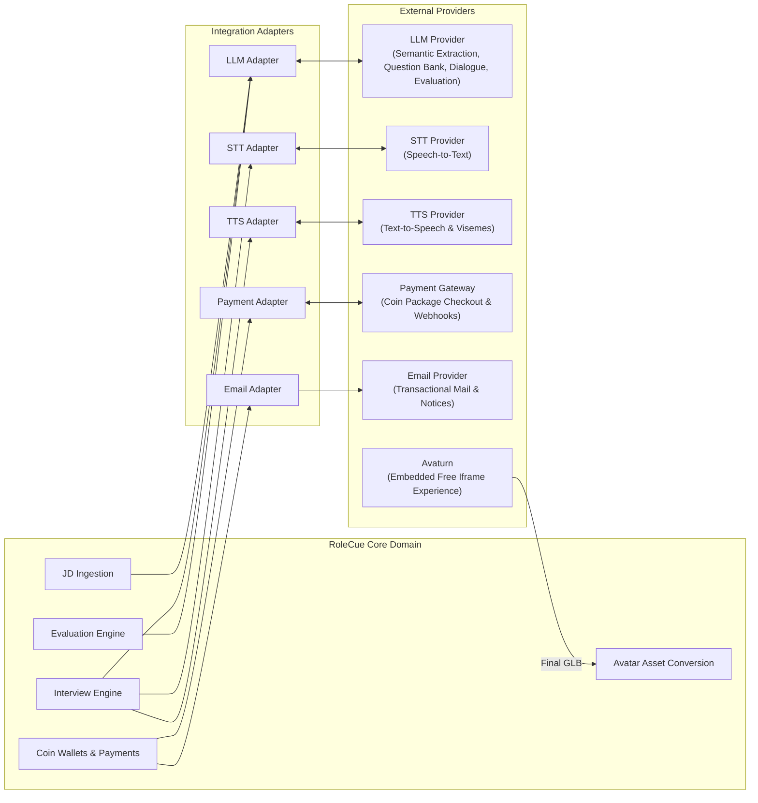

# External Service Integrations

This document specifies the integration architecture, operational requirements, and fault-tolerance policies for external third-party service providers connected to RoleCue.

---

## 1. Architectural Integration Principles

1. **Vendor Agnosticism:**
   Core domain entities and business workflows must never depend directly on vendor-specific SDKs or proprietary JSON schemas. Service-provider APIs are encapsulated behind internal interface adapters.
2. **Deterministic Pre/Post Validation:**
   Outputs from external AI providers (LLM extractions, STT transcripts) are treated as untrusted data. They must undergo deterministic schema validation and sanitization before entering domain persistence.
3. **Graceful Fallback:**
   When an external service experiences transient latency spikes or network timeouts, the platform must degrade gracefully without corrupting persisted session state or dropping conversation history.
4. **No Speculative Service Integrations:**
   RoleCue connects strictly to approved external service boundaries: LLM, STT, TTS, Payment Gateway, Email, and the embedded Avaturn iframe. There are **no external identity verification / eKYC providers, no AI video fraud/cheating analysis services, and no separate cloud storage providers** modeled as external architecture actors.
   * **Internal Authentication Boundary:** Better Auth 1.7.7 runs in RoleCue's standalone internal authentication service; it is not a new external identity provider. It keeps one Better Auth-owned identity/credential/session authority, the existing database and cookie/security contracts, email verification, password recovery, and OAuth behavior. Go verifies sessions against the auth service and enforces business authorization independently. No secondary session authority, JWT exchange, Go refresh-token model, new identity database, or replacement framework exists (Decision 17). Details are in [[01_Domains/Auth/README|Auth Domain]].

---

## 2. Integration Catalog

The RoleCue browser embeds the free Avaturn iframe directly. Avaturn owns capture instructions, three-photo capture, validation and retakes, preview generation, customization, and final GLB generation. RoleCue receives the final GLB, converts it to VRM, and persists the VRM asset in the user's avatar inventory. This is not an Avaturn Pro subscription, backend Avaturn API integration, or RoleCue-managed reconstruction pipeline.

---

## 3. Provider Specifications

### 3.1. Large Language Model (LLM) Provider
* **Purpose:**
  * **Structured JD Extraction:** Parses unstructured job description text into validated JSON technical competencies (title, seniority, categorized skills, technologies).
  * **Question-Bank Generation:** Autonomously builds the internal core-question bank (`core_questions`, conceptual Blueprint) from confirmed requirements and refinement notes.
  * **Adaptive Questioning Dialogue:** Analyzes candidate answers against the interview context to evaluate turns and generate bounded follow-up questions.
  * **Multi-Dimensional Evaluation:** Evaluates full session transcripts against the session snapshot's evaluation configuration across technical competencies.
* **Unresolved Decision Provider / Jev Status:**
  * Deciding whether to ask a follow-up and generating follow-up question wording are distinct responsibilities.
  * **Jev/TypeSafe is tentative, NOT selected.** No specific external vendor or standalone decision service has been ratified. The integration layer does not mandate a dedicated decision-provider SDK or lock follow-up decisions to a single vendor.
* **Admin Interview Behavior Guidelines (Ratified 2026-10-20):**
  * Admin-authorized guidelines influence the intended behavior of the AI interviewer. This mandatory capability does not imply unrestricted raw LLM system-prompt editing, provider configuration management, global evaluation rubric/weight editing, runtime toggles, or pricing administration. UI, fields, schema, persistence, versioning, and prompt composition remain TBD, including the integration mechanism; implementation in `main` is not asserted. Completed historical results remain unchanged (Decision 16; [[01_Domains/Administration/README|Administration Domain]]).
* **Fault Handling:**
  * If extraction fails or outputs an invalid schema, the system retries with adjusted parameters; surfaces an extraction failure if unresolvable.
  * If follow-up determination times out during a live turn, the system proceeds to the next core question from the bank to maintain conversational fluency.

### 3.2. Speech-to-Text (STT) Provider
* **Purpose:**
  Transcribes incoming candidate audio stream chunks into clean text transcripts during live interview simulations.
* **Fault Handling:**
  In the event of partial packet loss or STT dropouts, the system prompts the candidate or allows speech retry to maintain conversational continuity.

### 3.3. Text-to-Speech (TTS) Provider
* **Purpose:**
  Synthesizes realistic spoken interviewer audio from generated question text and produces synchronized blend-shape viseme timing metadata.
* **Requirements:**
  * Must support returning speech audio paired with phoneme/viseme timing metadata for facial blend-shape animation.
  * Must support multiple voice styles (cataloged and managed as Admin-governed Voice Profiles).
* **Fault Handling:**
  If the TTS stream fails, the session can display the question as text while attempting audio reconnection, avoiding an abrupt session abort.
* **Selected Provider (2026-10-29): Azure AI Speech.** The team chose Azure because it offers both neural voices and viseme data. The API holds the key and region (`AZURE_SPEECH_KEY`, `AZURE_SPEECH_REGION`); the free tier allows 500K characters per month. The same provider backs the Admin voice sync (KAN-201).
  * **Viseme Delivery (decided 2026-10-30, revised the same day):** The real-time REST endpoint returns audio only. Azure documents viseme IDs, audio offsets and 55-value blend-shape frames (`FacialExpression`, 60 FPS) only through the Speech SDK's `VisemeReceived` event. The API uses the official **Go Speech SDK** in-process (KAN-248). It needs cgo and a native Linux library, so the SDK adapter builds only with the `azure_sdk` tag; the production image and Linux developers use it. Windows developers run the API in Docker Compose (KAN-252). The default build stays cgo-free with the REST adapter (audio only), and lip-sync then falls back to audio analysis in the browser. Two alternatives were rejected: a separate speech sidecar service, which the team judged unnecessary once development runs in Docker, and browser-side SDK use with short-lived tokens, which would expose synthesis to clients.
  * **Voice Scope and Audio:** Interview voices are standard neural **en-US** voices only. HD (Dragon) voices are excluded because they do not support visemes and are not offered in `koreacentral`. Interviewer audio is 48 kHz mono MP3. Speaking styles (`express-as`) are deferred. Development stays on the free F0 tier (20 requests per minute), which is sufficient for single-user use and the defense.

### 3.4. Avaturn Embedded Avatar Experience
* **Purpose:**
  Provides the free iframe experience embedded by RoleCue for Personal 3D Avatar creation.
* **Ownership Boundary:**
  * Avaturn presents capture instructions, collects the three required photos, performs capture validation and retakes, generates the preview avatar, provides accessory/customization UI, and generates the final GLB.
  * RoleCue receives the final GLB, converts it to VRM, persists the VRM Personal 3D Avatar, and associates it with the owning Candidate or Recruiter in their avatar inventory.
* **Integration Constraint:**
  RoleCue does not use Avaturn Pro APIs or backend Avaturn API orchestration for capture, customization, or avatar generation. No marketplace or admin asset-upload catalog is integrated.

### 3.5. Payment Gateway (PayOS)
* **Purpose:**
  Facilitates secure electronic payment processing for **coin package purchases** using real money via PayOS. (Memberships and subscriptions have been completely superseded).
* **Confirmed Provider:**
  PayOS is the confirmed provider. PayOS order codes are tracked directly on the unified `transactions` table (`payos_order_code`). The team explicitly rejected the proposed redesign into split `payment_orders` / `coin_transactions` tables; the unified transaction model is the accepted contract.
* **Security & Invariants:**
  * Webhook callbacks must be cryptographically signed by PayOS.
  * Webhook handlers must verify signatures and maintain strictly idempotent processing to prevent duplicate status changes or coin minting.
  * Real-money transactions acquire coin packages; internal coin spending (practice start fees, interview slot funding, avatar capacity purchases) and internal refunds (unused slot coin refunds upon terminal Job Posting auto-close via `Refund unused JP Candidate Slot`) execute purely within the internal database and do **NOT** invoke PayOS.

### 3.6. Email Provider
* **Purpose:**
  Dispatches transactional system emails:
  * Account registration verification tokens.
  * Forgot Password recovery links.
  * Account lock and unlock notifications (notifying users when an Administrator locks or unlocks their account, including lock reason).
  * Application submission confirmations, CV screening outcome notices, and final application decisions (Approved/Rejected).
  * Security alerts and account notifications.
* **Operational Invariants:**
  * Asynchronous queue-based dispatch; failures in email delivery must never block core transactional API flows.
  * **Decoupling Invariant for Account Locks:** The database status transition (`is_locked`, `lock_reason`) executes immediately and independently of email transmission. A failure in the external email service must never roll back or block an administrative lock or unlock action.
